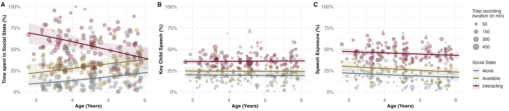
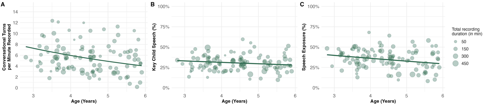
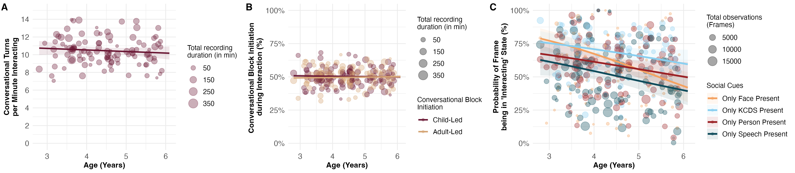

\pagenumbering{arabic}
\setcounter{page}{1}

```{r setup, include = FALSE}
library(papaja)
library(tidyverse)
library(ggplot2)
library(brms)
library(ggthemes)
library(ggpubr)
library(BayesFactor)
library(broom)
library(coda)
library(reshape2)
library(ggridges)
library(readxl)
library(dplyr)
library(lubridate)
library(zoo)
library(gridExtra)
library(grid)
library(kableExtra)
library(cowplot)
library(patchwork)
library(magick)
library(ggplotify)
library(png)
library(jpeg)
library(lme4)
library(data.table)
library(broom)
library(brms)
library(rsvg)
library(grid)
library(english)

estimate_mode <- function(s) {
  d <- density(s)
  return(d$x[which.max(d$y)])
}

hdi_upper<- function(s){
  m <- HPDinterval(mcmc(s))
  return(m["var1","upper"])
}

hdi_lower<- function(s){
  m <- HPDinterval(mcmc(s))
  return(m["var1","lower"])
}
```

```{r analysis-preferences}
# Seed for random number generation
set.seed(42)
knitr::opts_chunk$set(cache.extra = knitr::rand_seed)
knitr::opts_chunk$set(echo = F, warning = F, message = F)
```

```{r quantex-statistics, echo=FALSE, message=FALSE, warning=FALSE}
# 1. Base Data Loading & Filtering
quantex_raw <- read_csv2("data/quantex_data_sheet_MASTER.csv")

quantex_clean <- quantex_raw %>%
  filter(included == "Yes", !is.na(id), !is.na(minutes_per_id), minutes_per_id > 0) %>%
  mutate(
    id = as.character(id),
    
    # 1. Parse date_time string into a full POSIXct datetime object
    dt_parsed = dmy_hm(date_time),
    
    # 2. Extract Date (falls back to existing 'date' column if date_time is NA)
    date = if_else(!is.na(dt_parsed), as.Date(dt_parsed), dmy(date)),
    
    # 3. Extract Time as a string ("HH:MM") or numeric hour of the day (e.g. 9.27 for 09:16)
    time_str  = format(dt_parsed, "%H:%M"),
    time_hour = hour(dt_parsed) + minute(dt_parsed) / 60,
    
    # 4. Extract German Weekday directly from the parsed date
    # 5. Weekend Flag
    is_weekend = if_else(weekday %in% c("Samstag", "Sonntag"), "Wochenende", "Wochentag"),
    
    recording_start = dmy(recording_start),
    recording_end   = dmy(recording_end),
  )

# Exclusion Counts
excluded_data <- quantex_raw %>% filter(is.na(date) | included != "Yes")
num_excluded_videos <- nrow(excluded_data)
num_excluded_participants <- n_distinct(excluded_data$id)
num_total_videos <- nrow(quantex_raw)
num_total_participants <- n_distinct(quantex_raw$id)

# 2. Participant & Age Level Summary
participant_summary <- quantex_clean %>%
  group_by(id) %>%
  summarise(
    total_seconds = sum(seconds, na.rm = TRUE),
    total_minutes = total_seconds / 60,
    total_hours = total_seconds / 3600,
    recording_days = first(recording_days),
    gender = first(na.omit(gender)),
    
    # Age at entry and age at exit
    age_entry = min(age, na.rm = TRUE),
    age_exit  = max(age, na.rm = TRUE),
    .groups = "drop"
  ) %>%
  mutate(
    age_group = case_when(
      age_entry < 4 ~ "3",
      age_entry < 5 ~ "4",
      age_entry >= 5 ~ "5"
    )
)

recording_span_summary <- participant_summary %>%
  summarise(
    min = min(recording_days, na.rm = TRUE),
    q1 = quantile(recording_days, .25, na.rm = TRUE),
    median = median(recording_days, na.rm = TRUE),
    mean = mean(recording_days, na.rm = TRUE),
    q3 = quantile(recording_days, .75, na.rm = TRUE),
    max = max(recording_days, na.rm = TRUE),
    sd = sd(recording_days, na.rm = TRUE),
  )

quantex_nr_children <- nrow(participant_summary)
quantex_male_count   <- sum(participant_summary$gender == "Male", na.rm = TRUE)
quantex_female_count <- sum(participant_summary$gender == "Female", na.rm = TRUE)

quantex_count_3_plus <- sum(participant_summary$age_group == "3", na.rm = TRUE)
quantex_count_4_plus <- sum(participant_summary$age_group == "4", na.rm = TRUE)
quantex_count_5_plus <- sum(participant_summary$age_group == "5", na.rm = TRUE)

# Overall recording-level age span (matches what the models actually see)
min_recording_age <- min(quantex_clean$age, na.rm = TRUE)
max_recording_age <- max(quantex_clean$age, na.rm = TRUE)

min_entry_age <- min(participant_summary$age_entry, na.rm = TRUE)
max_entry_age <- max(participant_summary$age_entry, na.rm = TRUE)
mean_entry_age <- mean(participant_summary$age_entry, na.rm = TRUE)
sd_entry_age   <- sd(participant_summary$age_entry, na.rm = TRUE)

# Duration per Child (Hours & Minutes)
quantex_mean_minutes <- mean(participant_summary$total_minutes)
quantex_sd_minutes   <- sd(participant_summary$total_minutes)
quantex_min_minutes  <- min(participant_summary$total_minutes)
quantex_max_minutes  <- max(participant_summary$total_minutes)

quantex_mean_hours <- quantex_mean_minutes / 60
quantex_sd_hours   <- quantex_sd_minutes / 60
quantex_min_hours  <- quantex_min_minutes / 60
quantex_max_hours  <- quantex_max_minutes / 60
quantex_sum_hours  <- sum(participant_summary$total_hours)

# Duration by Age Group
duration_by_age <- quantex_clean %>%
  group_by(age_group) %>%
  summarise(total_hours = sum(seconds, na.rm = TRUE) / 3600, .groups = "drop")

quantex_hours_3_plus <- duration_by_age %>% filter(age_group == "3") %>% pull(total_hours)
quantex_hours_4_plus <- duration_by_age %>% filter(age_group == "4") %>% pull(total_hours)
quantex_hours_5_plus <- duration_by_age %>% filter(age_group == "5") %>% pull(total_hours)

# 3. Time Span of Data Collection
quantex_oldest_date   <- min(quantex_clean$date, na.rm = TRUE)
quantex_youngest_date <- max(quantex_clean$date, na.rm = TRUE)
quantex_oldest_year   <- as.numeric(format(quantex_oldest_date, "%Y"))
quantex_oldest_month  <- as.numeric(format(quantex_oldest_date, "%m"))
quantex_youngest_year <- as.numeric(format(quantex_youngest_date, "%Y"))
quantex_youngest_month <- as.numeric(format(quantex_youngest_date, "%m"))
quantex_time_span_months <- (quantex_youngest_year - quantex_oldest_year) * 12 + (quantex_youngest_month - quantex_oldest_month) + 1

# 4. Session Segmentation Statistics
quantex_sessions <- quantex_clean %>%
  arrange(id, date, nr) %>%
  mutate(
    new_session_flag = (id != lag(id, default = first(id))) |
                       (date != lag(date, default = first(date))) |
                       (nr != lag(nr, default = 0) + 1),
    session_id = cumsum(new_session_flag)
  )
session_level <- quantex_sessions %>%
  group_by(id, session_id, date) %>%
  summarise(
    n_segments = n(),
    session_min = sum(seconds, na.rm = TRUE) / 60,
    session_hrs = sum(seconds, na.rm = TRUE) / 3600,
    .groups = "drop"
  )

child_session_summary <- session_level %>%
  group_by(id) %>%
  summarise(n_sessions = n(), .groups = "drop")

total_sessions            <- nrow(session_level)
mean_sessions_per_child   <- mean(child_session_summary$n_sessions)
sd_sessions_per_child     <- sd(child_session_summary$n_sessions)
min_sessions_per_child    <- min(child_session_summary$n_sessions)
max_sessions_per_child    <- max(child_session_summary$n_sessions)

mean_session_duration_min <- mean(session_level$session_min)
sd_session_duration_min   <- sd(session_level$session_min)
min_session_duration_min  <- min(session_level$session_min)
max_session_duration_min  <- max(session_level$session_min)

# get per session statistics for interaction segments
segments_df <- read_csv("data/analysis_20261018_221629_second_submission/interaction_segments.csv") %>%
  arrange(video_name)
# Create a clean lookup table of video_name -> session_id
session_lookup <- quantex_sessions %>%
  select(file_name, session_id) %>%
  distinct() %>%
  rename(video_name = file_name)
# Join session_id to your interaction segments
segments_with_session <- segments_df %>%
  left_join(session_lookup, by = "video_name")

# Count distinct states per session
session_state_counts <- segments_with_session %>%
  group_by(session_id) %>%
  summarise(
    n_states = n_distinct(interaction_type),
    has_interacting = any(tolower(interaction_type) == "interacting"),
    has_available   = any(tolower(interaction_type) == "available"),
    has_alone       = any(tolower(interaction_type) == "alone"),
    .groups = "drop"
  )

# Calculate summary percentages
co_occurrence_stats <- session_state_counts %>%
  summarise(
    pct_all_three   = mean(n_states == 3) * 100,
    pct_only_two = mean(n_states == 2) * 100,
    pct_only_one    = mean(n_states == 1) * 100
  )

state_percentages <- session_state_counts %>%
  summarise(
    total_sessions     = n(),
    pct_interacting    = mean(has_interacting) * 100,
    pct_available      = mean(has_available) * 100,
    pct_alone          = mean(has_alone) * 100,
    n_interacting      = sum(has_interacting),
    n_available        = sum(has_available),
    n_alone            = sum(has_alone)
  )

# 5. Annotated Data Statistics
annotated_data <- quantex_clean %>% filter(annotated == "Yes")
quantex_annotated_nr_children <- n_distinct(annotated_data$id)
quantex_annotated_hours       <- sum(annotated_data$seconds, na.rm = TRUE) / 3600

# 6. Weekday Breakdown (Total Hours, %, Sessions, Children)
weekday_summary <- quantex_clean %>%
  group_by(weekday) %>%
  summarise(
    n_videos     = n(),
    n_children   = n_distinct(id),
    total_hours  = sum(seconds, na.rm = TRUE) / 3600,
    .groups = "drop"
  ) %>%
  mutate(
    percent_hours = (total_hours / sum(total_hours)) * 100
  )

# 7. Weekend vs. Weekday Comparison
weekend_vs_weekday <- quantex_clean %>%
  group_by(is_weekend) %>%
  summarise(
    n_videos     = n(),
    n_children   = n_distinct(id),
    total_hours  = sum(seconds, na.rm = TRUE) / 3600,
    .groups = "drop"
  ) %>%
  mutate(
    percent_hours = (total_hours / sum(total_hours)) * 100
  )

# 8. Daytime Analysis
quantex_time_bins <- quantex_clean %>%
  filter(!is.na(dt_parsed)) %>%
  mutate(
    hour_val = hour(dt_parsed) + minute(dt_parsed) / 60,
    time_of_day = case_when(
      hour_val >= 7.0  & hour_val < 12.0 ~ "Morning",
      hour_val >= 12.0 & hour_val < 14.5 ~ "Midday",
      hour_val >= 14.5 & hour_val < 18.0 ~ "Afternoon",
      hour_val >= 18.0 & hour_val <= 24.0 ~ "Evening"
    ),
    time_of_day = factor(time_of_day, levels = c(
      "Morning",
      "Midday",
      "Afternoon",
      "Evening"))
  )

time_range_stats <- quantex_time_bins %>%
  summarise(
    earliest_start = min(time_str, na.rm = TRUE),
    latest_start   = max(time_str, na.rm = TRUE),
    median_hour    = median(hour_val, na.rm = TRUE)
  )

# Time-of-day summary table
time_of_day_summary <- quantex_time_bins %>%
  group_by(time_of_day) %>%
  summarise(
    n_videos     = n(),
    n_children   = n_distinct(id),
    total_hours  = sum(seconds, na.rm = TRUE) / 3600,
    .groups = "drop"
  ) %>%
  mutate(percent_hours = (total_hours / sum(total_hours)) * 100)


# 8. Time-of-Day Summary by Age Group
time_by_age_summary <- quantex_time_bins %>%
  group_by(age_group, time_of_day) %>%
  summarise(
    n_videos    = n(),
    n_children  = n_distinct(id),
    total_hours = sum(seconds, na.rm = TRUE) / 3600,
    .groups = "drop_last"
  ) %>%
  mutate(
    percent_hours_within_age = (total_hours / sum(total_hours)) * 100,
    percent_videos_within_age = (n_videos / sum(n_videos)) * 100
  ) %>%
  ungroup()

# flip table
time_by_age_table <- time_by_age_summary %>%
  select(age_group, time_of_day, percent_hours_within_age) %>%
  pivot_wider(
    names_from = time_of_day,
    values_from = percent_hours_within_age,
    values_fill = 0
  )

contingency_table <- table(quantex_time_bins$age_group, quantex_time_bins$time_of_day)
chi_test_time_of_day <- chisq.test(contingency_table)

# 9. Weekday Summary Table by Age Group
weekday_by_age_summary <- quantex_time_bins %>%
  filter(!is.na(weekday), !is.na(age_group)) %>%
  group_by(age_group, weekday) %>%
  summarise(
    n_videos    = n(),
    n_children  = n_distinct(id),
    total_hours = sum(seconds, na.rm = TRUE) / 3600,
    .groups = "drop_last"
  ) %>%
  mutate(
    percent_hours_within_age  = (total_hours / sum(total_hours)) * 100,
    percent_videos_within_age = (n_videos / sum(n_videos)) * 100
  ) %>%
  ungroup()

weekend_by_age_summary <- quantex_time_bins %>%
  filter(!is.na(is_weekend), !is.na(age_group)) %>%
  group_by(age_group, is_weekend) %>%
  summarise(
    n_videos    = n(),
    n_children  = n_distinct(id),
    total_hours = sum(seconds, na.rm = TRUE) / 3600,
    .groups = "drop_last"
  ) %>%
  mutate(
    percent_hours_within_age  = (total_hours / sum(total_hours)) * 100,
    percent_videos_within_age = (n_videos / sum(n_videos)) * 100
  ) %>%
  ungroup()

# flip table
weekday_by_age_table <- weekday_by_age_summary %>%
  select(age_group, weekday, percent_hours_within_age) %>%
  pivot_wider(
    names_from = weekday,
    values_from = percent_hours_within_age,
    values_fill = 0
  )

weekend_by_age_table <- weekend_by_age_summary %>%
  select(age_group, is_weekend, percent_hours_within_age) %>%
  pivot_wider(
    names_from = is_weekend,
    values_from = percent_hours_within_age,
    values_fill = 0
  )

weekend_contingency <- table(quantex_time_bins$age_group,quantex_time_bins$is_weekend)
chi_test_weekend <- chisq.test(weekend_contingency)

# 10. Covid analysis
covid_start_phase_one <- as.Date("2020-03-18")
covid_end_phase_one <- as.Date("2020-05-17")
covid_start_phase_two <- as.Date("2020-12-14")
covid_end_phase_two <- as.Date("2021-02-14")

is_lockdown <- function(d) {
  between(d, covid_start_phase_one, covid_end_phase_one) |
  between(d, covid_start_phase_two, covid_end_phase_two)
}

participant_lockdown_summary <- session_level %>%
  mutate(in_lockdown = is_lockdown(date)) %>%
  group_by(id) %>%
  summarize(
    total_sessions     = n(),
    total_min          = sum(session_min, na.rm = TRUE),
    lockdown_sessions  = sum(in_lockdown),
    lockdown_min       = sum(session_min[in_lockdown], na.rm = TRUE),
    pct_min_in_lockdown = (lockdown_min / total_min) * 100,
    .groups = "drop"
  ) %>%
  filter(lockdown_sessions > 0)

overall_lockdown_metrics <- participant_lockdown_summary %>%
  summarize(
    n_children            = n(),
    total_lockdown_sess   = sum(lockdown_sessions),
    total_lockdown_min    = sum(lockdown_min),
    total_child_min       = sum(total_min),
    overall_pct_min       = (total_lockdown_min / total_child_min) * 100
  )

# Summary for kindergarten attandance and number of siblings
demographics_df <- read_csv2("data/participants_demographics.csv") 
demographics_summary <- demographics_df %>%
  summarise(
    # Kindergarten metrics
    n_kiga = sum(!is.na(kindergarten)),
    pct_kiga = (sum(kindergarten %in% c("yes", 1, "TRUE")) / n_kiga) * 100,
    
    # Siblings metrics
    n_sibs = sum(!is.na(number_siblings)),
    mean_sibs = mean(number_siblings, na.rm = TRUE),
    sd_sibs = sd(number_siblings, na.rm = TRUE),
    min_sibs = min(number_siblings, na.rm = TRUE),
    max_sibs = max(number_siblings, na.rm = TRUE),
    
    # Counts & percentages by sibling count
    n_sibs_0 = sum(number_siblings == 0, na.rm = TRUE),
    pct_sibs_0 = (n_sibs_0 / n_sibs) * 100,
    
    n_sibs_1 = sum(number_siblings == 1, na.rm = TRUE),
    pct_sibs_1 = (n_sibs_1 / n_sibs) * 100,
    
    n_sibs_2 = sum(number_siblings == 2, na.rm = TRUE),
    pct_sibs_2 = (n_sibs_2 / n_sibs) * 100,
    
    n_sibs_3plus = sum(number_siblings >= 3, na.rm = TRUE),
    pct_sibs_3plus = (n_sibs_3plus / n_sibs) * 100
  )

# öoad cross fold validation metrics
cv_summary <- read.csv("data/cv_summary_final.csv", row.names = 1, stringsAsFactors = FALSE)
cv_summary_means  <- cv_summary["mean", ]
cv_summary_sd <- cv_summary["std", ]
```

```{r yolo-person-statistics, echo=FALSE, message=FALSE, warning=FALSE}
 det_recall <- 0.79
 det_precision <- 0.89
 
 det_f1_score <- 0.85
 det_map <- 0.870
 det_nms_threshold <- 0.5
 det_custom_nms <- 0.9
 
 tp_child <- 0.81
 tp_adult <- 0.91
 tp_child_face <- 0.82
 tp_adult_face <- 0.91
```

```{r}
segments_annotated_percentage = 0.1 # percentage of total dataset annotated for interaction states
segments_annotated = quantex_sum_hours*segments_annotated_percentage
irr_annotated_percentage = 0.1 # percentage of annotated dataset used for interrater reliability check
segments_annotated_min = 1811.45
segments_annotated_min_irr = 212.07
segments_annotated_children = 51

segments_macro_f1_str       <- sprintf("%.2f \\pm %.2f", cv_summary_means$macro_avg_f1, cv_summary_sd$macro_avg_f1)
segments_interacting_f1_str <- sprintf("%.2f \\pm %.2f", cv_summary_means$interacting_f1, cv_summary_sd$interacting_f1)
segments_alone_f1_str       <- sprintf("%.2f \\pm %.2f", cv_summary_means$alone_f1, cv_summary_sd$alone_f1)
segments_available_f1_str   <- sprintf("%.2f \\pm %.2f", cv_summary_means$available_f1, cv_summary_sd$available_f1)

instant_confidence_threshold = 0.15
max_turn_taking_gap_sec = 5.0
max_same_speaker_gap_sec = 1.0
proximity_threshold = 0.60
cpd_interacting_threshold = 0.40
cpd_total_presence_floor = 0.45

num_hyperparameter = 18
num_gating_parameters = 2
num_rule_parameters = 11
num_segmentation_parameters = 5
```

# Abstract 
Everyday social interactions shape human psychological development. Research, however, has primarily relied on controlled settings or brief observations; consequently, the nature of naturalistic everyday experiences remains largely unstudied. To address this gap, we developed an automated multimodal processing pipeline to analyze a large egocentric corpus of naturalistic everyday experiences in the home environment from `r quantex_nr_children` children aged three to five years in Germany (`r quantex_sum_hours` hours). The pipeline detects faces, persons, proximity, and speech types to classify time into Interacting, Available, or Alone states. Results indicate an age-related shift in the distribution of these home contexts: social interaction occupies the largest share of home time at age three and declines towards a more balanced distribution across states by the sixth birthday. In contrast, conversational turn dynamics and agency remain stable throughout the preschool years, with children sharing it nearly equally with conversational partners. Importantly, isolated social cues become significantly less specific for interaction across development, which requires older children to integrate multimodal cues to navigate their social surroundings. Thus, our findings show an age-related restructuring of home experiences, where social interaction becomes less frequent and more diverse with development.

**Keywords**: Social Interaction, Child development, Language, Naturalistic Observation

# Introduction 
Children's everyday experiences play a fundamental role in their cognitive and social development [@piagetPartCognitiveDevelopment1964; @vygotskyMindSocietyDevelopment1978; @rogoffImportanceUnderstandingChildrens2018; @carpendaleWhatMakesUs2020; @smithDevelopingInfantCreates2018; @tomaselloCulturalOriginsHuman2009; @heyesCognitiveGadgetsCultural2018]. Major theoretical frameworks suggest that everyday social interactions are the context in which children develop the social and psychological abilities that allow them to become functioning members of the society they grow up in [@vygotskyMindSocietyDevelopment1978; @tomaselloBecomingHumanTheory2019; @kellerMythAttachmentTheory2021; @lalandUnderstandingHumanCognitive2021; @legareDevelopmentCumulativeCultural2019]. For example, both language and social cognition are thought to be shaped by children’s early social interactions [@bohnLanguageLearningOntogenetic2026; @tomaselloConstructingLanguageUsageBased2005; @pernerUnderstandingRepresentationalMind1993; @heyesCognitiveGadgetsCultural2018; @kuhlEarlyLanguageLearning2014]: children who hear more language and engage more often in conversational turns have better language abilities [@donnellyLongitudinalRelationshipConversational2021; @ferjanramírezParentCoachingIncreases2020; @gilkersonLanguageExperienceSecond2018; @romeo30MillionWordGapChildrens2018; @bergelsonEverydayLanguageInput2023] and children with siblings or parents who use more mental state language are advanced in their social-cognitive development [@mcalisterSiblingsTheoryMind2013; @pernerTheoryMindContagious1994; @devineFamilyCorrelatesFalse2018; @tompkinsRelationParentsMental2018; @taumoepeauSteppingStonesOthers2008; @ensorContentConnectednessMother2008]. Taken together, through social interactions, children develop the unique cognitive and cultural abilities that fundamentally "make them human" [@tomaselloBecomingHumanTheory2019].

Despite the recognized importance of these experiences, how social interactions are structured in the real world is still largely unknown. The field’s historical reliance on controlled laboratory settings has come at a significant cost: while these settings allow for an isolated assessment of specific social experiences, they are unable to capture the complexity and varied dynamics of children’s lived experiences [@rogoffImportanceUnderstandingChildrens2018]. For example, experimental work has shown that children learn words better when object and label are temporally aligned [@yuSocialOriginsSustained2016; @pereiraBottomupViewToddler2014; @yuRapidWordLearning2007]. However, in the real world, such co-occurrence might be relatively rare [@tanAssessingAlignmentInfants2025]. As a consequence, to assess the feasibility and relative importance of lab-based learning processes, we must understand the "natural statistics" of the environment in which development occurs [@rogoffImportanceUnderstandingChildrens2018; @bronfenbrennerEcologyHumanDevelopment2009; @weislederFernaldTalkingMatters2013; @carpendaleConstructingUnderstanding2004], which is largely the unconstrained home environment.

To bridge this gap, researchers have applied different sensing technologies. This includes stationary video recordings to investigate specific developmental dynamics, such as conversational patterns during mealtimes [@bohnMealtimeConversationsParents2024], or the use of house-wide sensor networks to predict linguistic milestones [@royPredictingBirthSpoken2015]. Others have used wearable sensors like sociometers and radio-frequency identification (RFID) tags to quantify proximity, talkativeness, and play contexts in classroom settings [@onnelaUsingSociometersQuantify2014; @daiLongitudinalDataCollection2022]. Small audio recorders, for example, allow for a broader look at everyday linguistic input and language development from over 1,000 children from six continents [@bergelsonEverydayLanguageInput2023]. A relatively recent and more comprehensive approach is the use of egocentric (first-person) audio and video recordings, like the ChildLens [@suffoChildLensEgocentricVideo2026], SAYCam [@sullivanSAYCamLargeLongitudinal2021] or BabyView dataset [@longBabyViewDatasetHighresolution2024] . These datasets provide a unique window into different developmental aspects, such as the alignment between infants' visual environments and their linguistic experiences [@tanAssessingAlignmentInfants2025], as well as the quantification of infants' everyday interactions with physical objects [@yangQuantifyingInfantsEveryday2025; @sullivanSAYCamLargeLongitudinal2021; @zhuangUnsupervisedNeuralNetwork2021].

However, the advent of these massive datasets has highlighted the limitations of traditional processing methods. Manual hand-coding of video — used in detailed studies of peer interaction or family mealtimes [@rossanoHow24yearold2022; @bohnMealtimeConversationsParents2024] — quickly reaches its limit when faced with hundreds of hours of unconstrained egocentric recordings. Consequently, there is a growing shift toward automated pipelines. Modern Machine Learning (ML) frameworks now enable the scalable analysis of these data. Self-supervised models, for instance, are used for speaker segmentation in long-form recordings [@charlotBabyHuBERTMultilingualSelfSupervised2025] to study caregiver-child interactions [@wengArtificialIntelligencePowered2025] or attention-centric models [@tianYOLOv12AttentionCentricRealTime2025] are applied to evaluate everyday object occurrences in an infant's visual field [@yangQuantifyingInfantsEveryday2025]. Previous work has successfully applied convolutional neural networks [@simonyanVeryDeepConvolutional2014] to extract visual features from a toddler's perspective [@bambachToddlerVisualObject2018], while more recent frameworks employ vision language models (VLMs) to detect specific environmental aspects, such as screen exposure, from wearable sensors [@liScreenDetectionEgocentric2026]. 

Consequently, these computational methods have advanced our understanding of isolated sensory dimensions — such as physical proximity [@daiLongitudinalDataCollection2022; @onnelaUsingSociometersQuantify2014], speech volume and turn-taking behaviour [@bergelsonEverydayLanguageInput2023; @gilkersonMappingEarlyLanguage2017], visual object learning [@bambachToddlerVisualObject2018], or activity recognition [@bambachLendingHandDetecting2015]. However, capturing naturalistic social dynamics from an egocentric perspective requires multimodal integration. Audio stream alone cannot capture the spatial parameters of interaction or physical co-presence, which also depend on physical cues like body orientation and proximity [@mondadaChallengesMultimodalityLanguage2016]. Similarly, visual data alone cannot fully capture these dynamics, as it cannot distinguish between an adult quietly working nearby and one actively talking with the child [@liChallengesTrendsEgocentric2025]. Therefore, visual cues (faces, bodies, proximity) and audio cues (child speech, child-directed speech, overheard talk) must be synchronized to reliably separate active engagement from passive co-presence or solitary time in naturalistic egocentric recordings.

Up until now, existing multimodal approaches to understanding everyday social life have primarily focused on the infant years and toddlerhood [@royPredictingBirthSpoken2015; @longBabyViewDatasetHighresolution2024; @sullivanSAYCamLargeLongitudinal2021] or have frequently relied on manual annotations of relatively small samples [@rossanoHow24yearold2022; @roweDifferencesEarlyGesture2009]. Yet, examining the preschool years (ages three to five) is critical because this age range sees fundamental development across several psychological domains. Children show significant improvement in social cognition, for example regarding the development of Theory of Mind and perspective-taking [@wellmannMetaAnalysis2001]. Executive functions are also evolving, including increased inhibitory control and self-regulation [@garonExecutiveFunction2008; @montroyDevelopmentSelfRegulation2016]. Children's linguistic skills develop in a way that reflects the frequency and structure of their daily social interactions [@hoffHowSocialContexts2006], and their communicative competence improves as they master the timing of conversational turn-taking [@casillasTurnTaking2016]. In terms of pragmatics, children learn to adjust their speech based on a listener's knowledge [@shatzDevelopmentCommunication1973; @fukumuraDevelopmentAudienceDesign2016; @baerFittingMessageListener2018], as they begin to realize that other people can have different perspectives or incorrect ideas about the world [@wimmerBeliefsBeliefsRepresentation1983; @wellmannMetaAnalysis2001]. 

Beyond direct dyadic communication, children also begin to create more coherent and comprehensive narratives [@PetersonDevelopmentPsycholinguistics1983; @lindgrenDevelopmentNarrativeSkills2022; @bohnackerStorytellingBilingualTurkishSwedish2022], which is supported by their emerging ability to remember events in a specific time and order [@mcCormackChildrensFutureorientedCognition2020; @pernerEpisodicMemoryDevelopment2007]. Alongside these developments, social learning shifts from observation toward active participation in cultural practices [@gweonInferentialSocialLearning2021] and children develop emotional competence as they begin to control their outward-directed emotions according to the social context [@denhamPreschoolEmotional2003], a shift made possible by the growing capacity to inhibit immediate impulses in favor of social rules [@zelazoDimensionalChangeCard2006]. Importantly, developmental change in these domains has been repeatedly linked to aspects of social interaction, that is, the frequency and dynamics of how children interact with whom [@sameroffTransactionalModel2009; @kuhlSpeechLearningGated2007; @mcalisterLongitudinalStudyChild2007; @gilkersonMappingEarlyLanguage2017; @rudasillChildTemperamentTeacher2011; @pancsofarMotherFatherLanguage2006; @bernierExternalRegulationSelfRegulation2010].

This emerging developmental autonomy changes the structure of children's everyday experiences within the home. Whereas three-year-olds require regular adult monitoring to navigate daily tasks, older preschoolers develop the self-sufficiency and attentional focus required for extended periods of independent play [@ruffDevelopmentAttentionDistractibility2003; @morrongielloCaregiverSupervisionChildInjury2005]. As a result, a child's social ecology in the home may include fewer direct interactions, which are typically the sole focus when measuring speech volume or turn-taking behavior. Sociological frameworks have long recognized that co-presence without active engagement represents a distinct social context. @goffmanBehaviorPublicPlaces1969 introduced the term "unfocused interaction" to describe situations where individuals share the same physical space without engaging in a shared focus of attention or active communication. In the home, children spend part of the time in passive company of others: parents or siblings pursue independent activities while staying physically available in the immediate environment. The developmental relevance of passive availability in the home environment has been highlighted by @ochsSchieffelinLanguageAcquisition1984, who show that early language acquisition across cultures frequently relies on speech spoken around - rather than directed to - the child. Similarly, @rogoffFirsthandLearningIntent2003 demonstrate that children learn through intent participation, which is characterized by overhearing conversations and observing activities when they are co-present around others. 

Simultaneously, increasing autonomy introduces regular periods of solitude into children's everyday home experiences. Solitary time provides essential opportunities for self-directed free play and creative exploration without adult supervision [@ginsburgImportancePlayPromoting2007], as well as a dedicated context for private, self-regulatory speech [@vygotskyMindSocietyDevelopment1978; @garonExecutiveFunction2008]. To summarize, naturalistic home experiences during the preschool years requires can be divided into three mutually exclusive states: active engagement (*Interacting*), passive co-presence (*Available*), and solitary activity (*Alone*).

Differentiating these three social states requires the multimodal synchronization of specific visual and acoustic cues that have been identified as relevant markers of social experience. Acoustic analyses have long focused on children's vocal production, speech exposure, and conversational turn-taking dynamics [@gilkersonMappingEarlyLanguage2017; @romeo30MillionWordGapChildrens2018; @bergelsonEverydayLanguageInput2023]. However, to effectively differentiate active interaction from passive co-presence and solitary time, it is crucial to separate child-directed from overheard speech. As emphasized by @ochsSchieffelinLanguageAcquisition1984 and @rogoffFirsthandLearningIntent2003, overheard speech forms the empirical core of passive co-presence, where children observe or listen to others' activities and conversations. In parallel, visual and spatial cues are essential to determine communicative availability and presence. Physical proximity has been used as a proxy to quantify social interactions [@onnelaUsingSociometersQuantify2014; @daiLongitudinalDataCollection2022], while detecting bodies, hands or faces provides direct evidence of visual attentiveness, joint engagement, or parallel play [@jayaramanFacesInfantPerspectiveScenes2015; @bambachLendingHandDetecting2015].

To capture this tripartite social landscape across the preschool years, we examine a dense, multimodal corpus of unscripted egocentric video recordings from `r quantex_nr_children` children aged three to five years growing up in Germany. The recordings capture `r sprintf("%.2f", quantex_sum_hours)` hours of naturalistic everyday life within their home environment, recorded through a camera worn in a vest at chest height. In Germany, this age range corresponds to the kindergarten years before elementary school, when children typically spend parts of their day in institutional care. To process these naturalistic recordings without relying on manual coding, we developed an automated multimodal processing pipeline. The pipeline synchronizes a vision model [YOLOv12 for detection of faces and bodies, @tianYOLOv12AttentionCentricRealTime2025] with formula-based proximity estimation and self-supervised speech diarization [BabyHuBERT for segmenting key child vocalizations, child-directed, and overheard speech, @charlotBabyHuBERTMultilingualSelfSupervised2025]. The pipeline integrates these visual and acoustic cues using classification rules and a set of cross-validated parameters to classify the egocentric recordings into the three mutually exclusive social states: Interacting (active engagement), Available (passive social presence), and Alone (solitary activity). Within these multimodally classified social states, we quantify language exposure, the child’s speech production, the characteristics of conversational turn-taking as well as the rate of child-led initiations of conversations. Furthermore, we perform a cue-specificity analysis to evaluate whether isolated social cues (a visible face or audible speech) reliably coincide with social interaction across age.

The work provides a threefold contribution. First, we introduce and validate an end-to-end, open-source pipeline that combines modular computer vision and acoustic models through rules and configurable parameters to classify children's home social ecology in large egocentric datasets into three distinct social states. This provides researchers with an adaptable tool to apply and adjust the pipeline to new egocentric datasets. Second, we provide dense "in vivo" empirical evidence for how children's home social ecology restructures across the preschool years. Beyond theoretical models and brief laboratory observations, our findings document a continuous developmental shift from predominantly active social interaction toward more time spent available or alone. Third, we show that while a child’s speech proportion and speech exposure proportion remain remarkably stable within social states across the preschool years, the specificity of isolated social cues decreases significantly with age. For younger preschoolers, seeing a face or hearing speech primarily denotes an active interaction; as children age, the social ecology in the home environment becomes increasingly complex as isolated cues no longer automatically signal an interaction. 
 
# Methods {#methodology}
To analyze preschoolers' social ecologies in the home environment, we developed an automated multimodal pipeline that classifies naturalistic egocentric recordings into social states. This pipeline addresses three core research aims: first, quantifying age-related shifts in time allocated across active interaction, passive co-presence, and solitary time; second, characterizing the linguistic properties (child speech production, speech exposure, and turn-taking dynamics) maintained within each of these social states across age; and third, investigating how specific isolated social cues are for interaction, and how this specificity develops as children grow.

Achieving these goals across hundreds of hours of naturalistic video required synchronized multimodal classification rather than unimodal tracking. In this section, we first describe the participants and dataset alongside the ground-truth datasets used for validation. We then detail the automated detection modules for visual and acoustic social cues. Following, we describe the hierarchical classification rules and Change Point Detection (PELT) procedures which consolidate frame-level detections into continuous social segments. Finally, we describe the Bayesian statistical analysis framework used to model state-specific dynamics and their developmental trajectories across the preschool years.

## Participants and Dataset {#participants-dataset}
Following ethics approval and parental consent, we recruited a cross-sectional sample of `r quantex_nr_children` children (`r quantex_female_count` female, `r quantex_male_count` male) from a database of children whose parents agreed to participate in research on child development. Participants were recruited from Leipzig, a mid-sized city in eastern Germany, and German was the dominant language in all video recordings. Demographic information was available for a subset of participants ($n=$ `r demographics_summary$n_kiga`): all participating children were enrolled in kindergarten. Sibling data were available for `r demographics_summary$n_sibs` children; participants had an average of `r sprintf("%.2f", demographics_summary$mean_sibs)` siblings ($SD =$ `r sprintf("%.2f", demographics_summary$sd_sibs)`, range = `r demographics_summary$min_sibs` -- `r demographics_summary$max_sibs`; `r demographics_summary$n_sibs_0` only children (`r sprintf("%.1f", demographics_summary$pct_sibs_0)`%), `r demographics_summary$n_sibs_1` children with one sibling (`r sprintf("%.1f", demographics_summary$pct_sibs_1)`%), and `r demographics_summary$n_sibs_2` children with two siblings (`r sprintf("%.1f", demographics_summary$pct_sibs_2)`%). At the time of their initial recording, children's age ranged from `r sprintf("%.2f", min_entry_age)` to `r sprintf("%.2f", max_entry_age)` years ($M_{age}=$ `r sprintf("%.2f", mean_entry_age)`, $SD=$ `r sprintf("%.2f", sd_entry_age)`). 

Because home recordings were collected over a longer observation period (Median: `r round(recording_span_summary$median,0)` days, Interquartile range =  `r recording_span_summary$q1`--`r recording_span_summary$q3`), children's age across all recorded sessions spanned from `r sprintf("%.2f", min_recording_age)` to `r sprintf("%.2f", max_recording_age)` years. Overall, data collection spanned `r quantex_time_span_months` months between `r quantex_oldest_month`/`r quantex_oldest_year` and `r quantex_youngest_month`/`r quantex_youngest_year` ^[Although this window overlapped with the COVID-19 pandemic, data collection occurred almost entirely outside acute lockdown phases (defined by state regulations as periods with mandatory daycare closures and household contact restrictions: March 18 - May 17, 2020, and December 14, 2020 - February 14, 2021). Only a single recording session from `r as.character(english(overall_lockdown_metrics$n_children))` child (`r overall_lockdown_metrics$total_lockdown_min` minutes, representing `r round( overall_lockdown_metrics$overall_pct_min,2)`% of that child's recording volume and `r sprintf("%.2f", (overall_lockdown_metrics$total_lockdown_min/(quantex_sum_hours*60)*100))`% of the total dataset) fell within an acute lockdown period.].

For ethical and privacy reasons regarding third-party consent, recordings were restricted to the household environment (the family home and private garden/yard). However, recorded social partners were not restricted to the immediate nuclear family; participating families were instructed to inform any external visitors (e.g., relatives, friends) beforehand and obtain their explicit written consent prior to recording. To ensure recorded experiences remained unstructured, parents were given no specific instructions but were asked to spend their day as they would usually do. 

The raw dataset comprised `r num_total_videos` video files recorded from `r num_total_participants` children. Following manual quality screening, `r num_excluded_videos` videos across `r num_excluded_participants` children were excluded due to stationary placement ($n=9$) or initial device testing ($n=3$). Because affected children contributed  multiple sessions, valid egocentric footage was retained for all `r num_total_participants` children ($N=$ `r num_total_participants`). The final analyzed dataset therefore comprises `r num_total_videos-num_excluded_videos` videos derived from `r total_sessions` recording sessions, resulting in `r sprintf("%.2f", quantex_sum_hours)` hours of recordings ($M = `r sprintf("%.2f", quantex_mean_hours)`$ hours per child, $SD = `r sprintf("%.2f", quantex_sd_hours)`$, range = `r sprintf("%.2f", quantex_min_hours)`--`r sprintf("%.2f", quantex_max_hours)`). Children contributed an average of `r mean_sessions_per_child` sessions ($SD=$ `r sd_sessions_per_child`, range = `r min_sessions_per_child`--`r max_sessions_per_child`), with recording sessions lasting an average of `r mean_session_duration_min` minutes ($SD=$ `r sd_session_duration_min`, range = `r min_session_duration_min`--`r max_session_duration_min`). Across age groups, the dataset includes `r quantex_hours_3_plus` hours from `r quantex_count_3_plus` three-year-olds, `r quantex_hours_4_plus` hours from `r quantex_count_4_plus` four-year-olds, and `r quantex_hours_5_plus` hours from `r quantex_count_5_plus` five-year-olds. 

Recordings spanned all seven days of the week (`r round(weekend_vs_weekday$percent_hours[2],1)` % on weekdays, `r round(weekend_vs_weekday$percent_hours[1],1)`% on weekends) and covered the full waking day: `r round(time_of_day_summary$percent_hours[1], 1)`% in mornings (07:00–11:59),  `r round(time_of_day_summary$percent_hours[2], 1)`% at midday (12:00–14:29), `r round(time_of_day_summary$percent_hours[3], 1)`% in afternoons (14:30–17:59), and `r round(time_of_day_summary$percent_hours[4], 1)`% in evenings (18:00–21:00). Detailed breakdowns of recording times and days by age group, together with chi-square tests examining differences in temporal sampling distributions across age groups, are provided in Table S1 in the supplementary material under *Temporal Sampling Distribution Across Age Groups* 

## Recording Device {#recording}
To capture naturalistic everyday experiences, children wore a lightweight, vest-mounted PatrolEyes WiFi HD Police Body Camera. The camera recorded continuous video at 1080p resolution at 30 frames per second (fps), and with a 140° wide-angle field of view (FOV), which results in a wide horizontal perspective with a narrower vertical FOV given the camera's 16:9 aspect ratio. Long recording sessions were automatically split into smaller 30-minute files. A single recording session was defined as continuous device use from activation to deactivation.

## Ground-Truth Datasets {#annotations}
To develop, tune, and validate the different components of our pipeline, we created three ground-truth datasets from our video corpus [alongside audio labels taken from the ChildLens dataset, @suffoChildLensEgocentricVideo2026]:

1. **Bounding-Box Ground-Truth Dataset (Frame-Level):** We manually annotated `r quantex_annotated_hours` hours of data from `r quantex_annotated_nr_children` children at the frame level to fine-tune and validate the YOLOv12 face and person detection models. Given the high temporal redundancy in continuous 30-fps videos and the labor-intensive nature of bounding-box labeling, videos were annotated at 1 frame per second (every 30th frame). Annotators placed bounding boxes around all visible persons and faces, even when they were blurred, partially cropped, or occluded. We additionally recorded individual IDs, perceived gender, and estimated age ranges for every social partner.
2. **Face-Proximity Ground-Truth Dataset (Frame-Level):** To validate the face proximity formula across the full spectrum of physical proximity ($0.0$ to $1.0$), two independent annotators rated face proximity on a continuous scale from 0 (distant) to 1 (close-up) for a targeted sample of 364 representative still images (video frames). We sampled these frames across the entire range of detected face bounding-box sizes - from small, distant faces to close-ups. This stratified selection ensured that a compact sample provided sufficient diversity to verify agreement between the formula calculations and ground truth. 
3. **Social-State Ground-Truth Dataset (Continuous Video-Level):** An independent subset of `r segments_annotated_min/60` hours of recordings from `r segments_annotated_children` children was fully annotated into the three target social states (Interacting, Available, Alone). These temporal labels served as the ground truth for optimizing our classification rules and parameters via child-level 5-fold cross-validation, as well as evaluating final end-to-end pipeline segmentation.

## Automated Detection of Social Cues {#automation}
```{r metrics}
# proximity formula
gt_heuristic_corr <- 0.9492
prox_mae <- 0.0914
prox_r2 <- 0.840

face_f1 <-  0.88
person_f1 <- 0.65
f1_vtc_avg = 0.66
f1_vtc_min = 0.45
f1_vtc_max = 0.84
```

```{r module-metrics, echo=FALSE, message=FALSE, warnings=FALSE, results='asis', eval=TRUE}
my.data <- "Metric    | Person Detection  | Face Detection  | Face Proximity  | Speech Type Classification 
            mAP@0.5   | 0.70              | 0.91            | -               | -
            Precision | 0.74              | 0.94            | -               | 0.69
            Recall    | 0.57              | 0.83            | -               | 0.73
            F1 Score  | 0.65              | 0.88            | -               | 0.66
            Pearson   | -                 | -               | 0.95            | -
            MAE       | -                 | -               | 0.09            | -
            RMSE      | -                 | -               | 0.11            | -"
       

df <- read.delim(textConnection(my.data), header=FALSE, sep="|", strip.white=TRUE, stringsAsFactors=FALSE)

# Set the column names
names(df) <- unname(as.list(df[1,]))
df <- df[-1,]  # Remove the first row with column names
row.names(df) <- NULL


# Print the updated table
apa_table(
  df,
  caption = "Performance metrics for each module in the multimodal processing pipeline.",
  note = "All metrics are unitless standard performance indices bounded between 0.00 and 1.00, where higher values indicate better performance, except for MAE (Mean Absolute Error) and RMSE (Root Mean Squared Error), where lower values represent lower error. mAP@0.5 = Mean Average Precision at an IoU threshold of 0.50; Pearson = Pearson correlation coefficient (r).",
  escape = FALSE,
)
```

The pipeline to classify experiences into the three social states rested on four automated processing modules: face detection, person detection, face proximity estimation, and speech type classification (see Figure \@ref(fig:pipeline-states)). Full details regarding computational hardware, fine-tuning procedures, and class-level evaluation metrics are provided in the supplementary material. 

Rather than directly deploying off-the-shelf models, domain- and task-specific adaptation was required across our modules. Regarding face detection, the standard YOLO models lack a category for human faces [@tianYOLOv12AttentionCentricRealTime2025]. Furthermore, while base YOLO detects persons, egocentric recordings frequently capture the key child's own body parts; an off-the-shelf detector would erroneously classify these as person and register them as social partners. We therefore adapted the architecture to detect faces and explicitly detect only external social partners. The visual models were fine-tuned on the  `r quantex_annotated_hours`-hour bounding-box ground-truth dataset via a stratified 80-10-10 child-level split: 80% of the annotated frames were used for model training, 10% for validation during training to monitor performance and prevent overfitting, and the remaining 10% served as an independent test set for final evaluation. To quantify detection performance on this test set, we report the $F_1$ score [@rijsbergenInformationRetrieval1980], which is the harmonic mean of Precision and Recall:

$$
F_1 = 2 \times \frac{\text{Precision} \times \text{Recall}}{\text{Precision} + \text{Recall}}
$$

where Precision and Recall are defined as:
$$
\text{Precision} = \frac{\text{True Positives}}
{\text{True Positives} + \text{False Positives}}
$$

$$
\text{Recall} = \frac{\text{True Positives}}
{\text{True Positives} + \text{False Negatives}}
$$
The $F_1$ score prioritizes False Positives and False Negatives equally and is particularly well-suited for our dataset with high class imbalance, because it evaluates model performance strictly on actual target occurrences. Model fine-tuning yielded test-set $F_1$ scores of `r face_f1` for Face Detection and `r person_f1` for Person Detection (see Supplementary Material Section *Automated Analysis Pipeline: Visual Processing* for complete training and evalatuon metrics). 

For Speech Type Classification, we adapted the pretrained BabyHuBERT architecture [@charlotBabyHuBERTMultilingualSelfSupervised2025]. While the original model classifies speaker types (key child, other children, male, and female adults), our analysis required categorizing speech types: Key Child Speech (KCS), Key Child-Directed Speech (KCDS), and Overheard Speech (OHS). We fine-tuned the model using a stratified 80-10-10 child-level split on the openly available ChildLens dataset [@suffoChildLensEgocentricVideo2026], which contains speech-type and activity annotations. On the held-out test set, the tuned model yielded a macro-averaged $F_1$ score of `r f1_vtc_avg` (class-level $F_1 =$ `r f1_vtc_min`--`r f1_vtc_max`), which closely aligns with the benchmark performance reported for the original speaker-type architecture (macro-averaged $F_1 = 0.64$; class-level $F_1 = 0.47\text{--}0.75$). A detailed overview of training and evaluation metrics is available in Section *Automated Analysis Pipeline: Audio Processing* in the supplementary material.

Finally, face proximity (Proximity $\in [0, 1]$) was estimated using a logarithmic formula based on the area of the detected YOLOv12 face bounding boxes:
 
$$
\text{Proximity} = \frac{\ln(\text{Area}_{detected}) - \ln(\text{Area}_{min})}{\ln(\text{Area}_{max}) - \ln(\text{Area}_{min})}
$$

The formula normalizes the log-transformed face area ($\text{Area}_{detected}$) between the smallest ($\text{Area}_{min}$) and largest ($\text{Area}_{max}$) detections labeled in the bounding-box ground-truth dataset, resulting in a proximity index between 0 and 1. This approach accounts for the quadratic relationship between distance and area [@hartleyMultipleViewGeometry2018; @rubio-sandovalIndoorNavigationMethodology2021] and applies an aspect-ratio correction ($\epsilon = 1$) to handle partially occluded faces in close proximity (see Supplementary Section *Face Proximity Estimation* for details regarding  reference sizes, aspect-ratio deviation rules, and visual examples).

```{r pipeline-states, out.width="100%", fig.cap = "Automated pipeline architecture and social state definitions. \\textbf{A:} Automated multimodal processing pipeline for the classification of social states. The pipeline consists of four modules: Person Detection, Face Detection, Face Proximity Estimation (via logarithmic area scaling), and Speech Type Classification (STC). Outputs from these modules are integrated using classification rules with cross-validated parameters to classify one-second intervals into three mutually exclusive social states: Interacting, Available, and Alone. The final segment-level classification is validated against the 30.19-hour social-state ground-truth dataset. \\textbf{B:} Representative frames and defining social cues for each social state. Cues are derived from the STC and YOLOv12 modules, including Key Child-Directed Speech (KCDS) and Overheard Speech (OHS)."}

knitr::include_graphics("images/states-pipeline.png")
```

To validate this formula across the full proximity spectrum, two independent annotators provided proximity ratings for the 364-frame face-proximity ground-truth dataset. We assessed the relationship between the formula estimates and ground truth using Pearson’s product-moment correlation coefficient ($r$), a metric that quantifies strength and direction of the linear relationship between two variables on a scale from -1 to +1 [@pearsonVIIMathematicalContributions1896]. The analysis showed a strong positive correlation ($r = `r gt_heuristic_corr`$), with a low mean absolute error ($MAE = `r prox_mae`$), which indicates that the automated proximity estimates closely mirror human judgment. A comprehensive breakdown of all module-specific evaluation metrics is provided in Table \@ref(tab:module-metrics). All fine-tuning scripts and end-to-end deployment workflows are openly available in our public code repository (https://github.com/neleSuffo/preschool-social-ecology).

## Social State Classification {#state-fusion}
We categorized children’s social experiences into three mutually exclusive social states: Interacting, where the child is actively engaged in an exchange with one or more people or is part of an exchange involving more than two people; Available, where another person is present in the immediate area, but not actively engaged with the child; and Alone, where no other person is present in the room or immediate environment.

The classification workflow consists of three stages: multimodal cue synchronization [multimodal cue synchronization](#multimodal-cue-synchronization), [frame-level rule-based state classification](#frame-level-classification), and [segment-level aggregation](#segment-level-aggregation). Across these stages, the pipeline was governed by `r num_hyperparameter` tunable parameters (summarized in Table S10 in the supplementary materials): `r english::english(num_gating_parameters)` for multimodal cue synchronization, `r  english::english(num_rule_parameters)` for the frame-level classification rules and `r  english::english(num_segmentation_parameters)` for segment aggregation.

### Multimodal Cue Synchronization {#multimodal-cue-synchronization}
To balance computational feasibility across hundreds of hours of video with the need to capture rapid movements, visual inference was executed at 3 frames per second (sampling every 10th frame from the raw 30-fps dataset). For every sampled frame, the YOLOv12 models extracted bounding-box coordinates and confidence scores for detected persons and faces, and the proximity formula calculated a continuous proximity score for each detected face. In parallel, an off-the-shelf YOLOv12 model was used to detect books. Bounding boxes falling entirely within detected books regions were excluded to prevent illustrated characters from triggering false-positive social detections.

Because the Speech Type Classification (STC) module produces continuous segments with explicit onset and offset timestamps, these speech segments (KCS, KCDS, and OHS) were mapped onto the corresponding sampled frames. Prior to state classification, each sampled frame was represented as a multimodal cue profile containing:

- Binary presence flags for each speech category (KCS, KCDS, and OHS),
- Spatial bounding-box detections and confidence scores for visible persons and faces,
- Continuous proximity scores for detected faces.

### Frame-Level State Classification Rules {#frame-level-classification}
Each sampled frame was then classified into a provisional social state using classification rules applied in top-down priority (Interacting > Available > Alone). To incorporate temporal context into frame-level decisions, the pipeline computed continuous temporal signals across rolling windows:

- *Visual Presence Signal:* A centered 1-second moving average (3 consecutive sampled frames) of maximum person and face detection confidence, designed to stabilize detections against motion blur caused by rapid camera movement.
- *Binary Visual Persistence Flags:* High confidence person or face detections were retained over a short-term memory window to bridge brief visual occlusions or partner movement outside the camera field of view.
- *Sustained Speech Fractions:* Rolling temporal evaluation of the proportion of speech frames (KCDS or OHS) against defined proportion parameters to confirm sustained vocal activity.

A frame was classified as Interacting if it triggered any of the following three classification rules:

- *Rule 1: Conversational Turn-Taking:* Identified by a dyadic exchange between the child (KCS) and a social partner (KCDS) where inter-speaker gaps (KCS$\leftrightarrow$KCDS) were $\le$ `r max_turn_taking_gap_sec` seconds and intra-speaker gaps (KCS$\leftrightarrow$KCS or KCDS$\leftrightarrow$KCDS) did not exceed `r max_same_speaker_gap_sec` seconds.
- *Rule 2: Physical Proximity:* Based on the confident detection of a face whose size indicated close-range interaction (proximity score \(\ge\) `r proximity_threshold` with detection confidence \(\ge\) `r instant_confidence_threshold`).
- *Rule 3: Sustained KCDS:* Periods of continuous key child-directed speech (KCDS). This rule was gated by the visual presence signal to prevent background media from triggering false positives.

If none of the Interacting rules were satisfied, the frame was classified as Available if it triggered either of the following classification rules:

- *Rule 4: Visual Persistence:* Instances where a person or face was recently detected within a short-term memory window.
- *Rule 5: Intermittent Speech:* Sustained background OHS gated by the visual presence signal to confirm partner co-presence and avoid false positives from media or other non-social sources.

Frames that triggered none of the active classification rules were assigned to the default state of Alone.

All parameters were optimized through child-level 5-fold cross-validation on the `r segments_annotated_min/60`-hour social-state ground-truth dataset. All parameters were optimized through child-level 5-fold cross-validation on the 30.19-hour social-state ground-truth dataset. A complete specification of all classification rules, mathematical derivations, and cross-validation procedures is detailed in Supplementary Section *Multimodal Data Aggregation and Optimization*, with all final parameter values summarized in Table S10.

### Segment-Level Aggregation and Validation {#segment-level-aggregation}
To translate noisy, frame-level classifications into continuous social states, we applied the Pruned Exact Linear Time (PELT) algorithm [@killickOptimalDetectionChangepoints2012]. PELT analyzes the continuous visual presence signal and partitions the video stream into distinct temporal segments at points where the visual presence signal shifts significantly. Each segment was assigned a single overall state based on the proportion of frame-level triggers:

- Interacting: When active interaction rules (Rules 1–3) were triggered and the proportion of interaction frames reached $d_{\text{int}} \ge$ `r cpd_interacting_threshold * 100`%.
- Available: When the criteria for Interacting were not met, but the combined proportion of Interacting and Available frames met or exceeded the threshold ($(d_{\text{int}} +d_{\text{avl}}) \ge$ `r cpd_total_presence_floor * 100`%).
- Alone: When the combined proportion of co-presence frames was below this baseline threshold.

Consecutive frames of the same state were then converted into continuous timestamped segments and refined through three temporal smoothing operations:

- *Segment Merging:* Adjacent episodes of the same social state separated by brief interruptions were combined to prevent fragmentation.
- *Gap Stretching:* Short unassigned gaps between states were filled by extending the preceding state.
- *Default Assignment:* Any remaining larger gaps were assigned to Alone.

Figure \@ref(fig:interaction-visualizations) illustrates this complete pipeline flow on an exemplary sequence of 12 consecutive sampled frames. It demonstrates how visual detections, proximity scores, and speech types are consolidated via classification rules amd temporal smoothing into a continuous Interacting segment. Analogous sequence visualizations for continous Available and Alone segments are provided in the supplementary section  *Multimodal Sequence Visualizations* (Figures S14 and S15).

```{r interaction-visualizations,fig.pos = "!hb", out.extra = "", fig.width = 6, fig.height = 4.5, out.width = "100%", echo=FALSE, dpi=600, fig.cap="Exemplary sequence of twelve consecutive sampled frames within an overarching continuous Interaction segment. Bounding boxes highlight visual detections: person detections (green) and face detections with estimated physical proximity (D, blue). The box in the lower left details the evaluated Classification Rules for the Interacting state ([\\text{v}] indicates satisfied criteria; [\\,] indicates inactive). An acoustic indicator (pink/rose) below the box displays the detected speech classes (Key Child-Directed Speech [KCDS], Key Child Speech [KCS], or Overheard Speech [OHS]; 'None' if unvoiced). Through Pruned Exact Linear Time (PELT) change point smoothing, individual frames are classified as part of a continuous interaction segment overall, even when visual contact is temporarily obstructed by movement (e.g., frames 27390–27440 where the face is briefly occluded)."}

int_1 <- ggdraw() + draw_image("images/multimodal_interacting_examples/quantex_at_home_id258239_2021_02_17_02_027350_multimodal_annotated.jpg", scale = 0.98)
int_2 <- ggdraw() + draw_image("images/multimodal_interacting_examples/quantex_at_home_id258239_2021_02_17_02_027360_multimodal_annotated.jpg", scale = 0.98)
int_3 <- ggdraw() + draw_image("images/multimodal_interacting_examples/quantex_at_home_id258239_2021_02_17_02_027370_multimodal_annotated.jpg", scale = 0.98)
int_4 <- ggdraw() + draw_image("images/multimodal_interacting_examples/quantex_at_home_id258239_2021_02_17_02_027380_multimodal_annotated.jpg", scale = 0.98)
int_5 <- ggdraw() + draw_image("images/multimodal_interacting_examples/quantex_at_home_id258239_2021_02_17_02_027390_multimodal_annotated.jpg", scale = 0.98)
int_6 <- ggdraw() + draw_image("images/multimodal_interacting_examples/quantex_at_home_id258239_2021_02_17_02_027400_multimodal_annotated.jpg", scale = 0.98)
int_7 <- ggdraw() + draw_image("images/multimodal_interacting_examples/quantex_at_home_id258239_2021_02_17_02_027410_multimodal_annotated.jpg", scale = 0.98)
int_8 <- ggdraw() + draw_image("images/multimodal_interacting_examples/quantex_at_home_id258239_2021_02_17_02_027420_multimodal_annotated.jpg", scale = 0.98)
int_9 <- ggdraw() + draw_image("images/multimodal_interacting_examples/quantex_at_home_id258239_2021_02_17_02_027430_multimodal_annotated.jpg", scale = 0.98)
int_10 <- ggdraw() + draw_image("images/multimodal_interacting_examples/quantex_at_home_id258239_2021_02_17_02_027440_multimodal_annotated.jpg", scale = 0.98)
int_11 <- ggdraw() + draw_image("images/multimodal_interacting_examples/quantex_at_home_id258239_2021_02_17_02_027450_multimodal_annotated.jpg", scale = 0.98)
int_12 <- ggdraw() + draw_image("images/multimodal_interacting_examples/quantex_at_home_id258239_2021_02_17_02_027460_multimodal_annotated.jpg", scale = 0.98)


first_row <- plot_grid(
  int_1, int_2, int_3,
  ncol = 3,
  hjust = 0,
  vjust = 1
)

second_row <- plot_grid(
  int_4, int_5, int_6,
  ncol = 3,
  hjust = 0,
  vjust = 1
)

third_row <- plot_grid(
  int_7, int_8, int_9,
  ncol = 3,
  hjust = 0,
  vjust = 1
)

fourth_row <- plot_grid(
  int_10, int_11, int_12,
  ncol = 3,
  hjust = 0,
  vjust = 1
)

interaction_multimodal_plot <- plot_grid(
  first_row,
  second_row,
  third_row,
  fourth_row,
  ncol = 1
)

interaction_multimodal_plot
# save the plot
ggsave(filename = "images/interaction_multimodal_plot.png", plot = interaction_multimodal_plot, width = 6, height = 4.5, dpi = 600)
```

Validation of the final smoothed segments against the `r segments_annotated_min/60`-hour social-state ground-truth dataset showed robust agreement. Averaged across five child-level validation folds, the pipeline achieved an overall macro-averaged $F_1$ score of $`r segments_macro_f1_str`$ ($M \pm SD$). Performance was highest for the Interacting state ($F_1 = `r segments_interacting_f1_str`$), followed by Alone ($F_1 = `r segments_alone_f1_str`$) and Available ($F_1 = `r segments_available_f1_str`$), which proved more challenging to distinguish. This reflects a documented difficulty in social signal processing regarding the detection of interaction formations and passive co-presence [@cristaniHumanBehaviorAnalysis2013]. Detailed performance metrics are reported in Table \@ref(tab:segments-evaluation-metrics).

```{r segments-evaluation-metrics, echo=FALSE, message=FALSE, warnings=FALSE, results='asis', eval=TRUE}
# extract mean
means <- cv_summary["mean", ]

# build table
metrics_df <- data.frame(
  Metric = c("F1 Score", "Precision", "Recall", "Cohen's $\\kappa$"),
  Interacting = c(
    sprintf("%.2f", means$interacting_f1),
    sprintf("%.2f", means$interacting_precision),
    sprintf("%.2f", means$interacting_recall),
    "—"
  ),
  Available = c(
    sprintf("%.2f", means$available_f1),
    sprintf("%.2f", means$available_precision),
    sprintf("%.2f", means$available_recall),
    "—"
  ),
  Alone = c(
    sprintf("%.2f", means$alone_f1),
    sprintf("%.2f", means$alone_precision),
    sprintf("%.2f", means$alone_recall),
    "—"
  ),
  `Macro AVG / Overall` = c(
    sprintf("%.2f", means$macro_avg_f1),
    sprintf("%.2f", means$macro_avg_precision),
    sprintf("%.2f", means$macro_avg_recall),
    sprintf("%.2f", means$overall_kappa)
  ),
  check.names = FALSE,
  stringsAsFactors = FALSE
)

# leave first column without name
colnames(metrics_df)[1] <- " "
apa_table(
  metrics_df,
  caption = "Evaluation metrics for the rule-based classification of social states. Values represent mean scores across 5-fold child-level cross-validation.",
  note = "Metrics were calculated on a per-second basis across the 30.19-hour social-state ground-truth dataset.",
  align = c("l", "c", "c", "c", "c"),
  escape = FALSE
)
```

## Statistical Analysis
We used generalized linear mixed models to model the effect of age on the variables of interest. We performed statistical analyses in R [@rCoreTeamLanguage2020] using the brms package [@buerknerAdvancedBayesian2017] for Bayesian multilevel modeling. Continuous predictors (Age) were centered and scaled (Z-scored) prior to analysis. To account for the repeated-measures nature of the data, all models included a random intercept for child $(1 \mid child)$ to adjust for individual baseline differences. For segment-level models of speech production and exposure (second and third analyses) we also included by-child random slopes for social state $(1 + state \mid child)$ to allow each child's response to different social states to vary. Observations were weighted by segment duration (or total recording duration in global models) to ensure that longer durations had a proportionally greater influence on the posterior estimates and to capture the actual time distribution rather than discrete segment counts.

For the first analysis (time distribution across social states), we used a Categorical distribution with a multinomial logit link because the data consist of three mutually exclusive, unordered categories. This approach ensures that the predicted probabilities for all states sum to one at any given age (brms notation: $state \mid weights(duration) \sim age + (1 \mid child)$). For the second and third analysis (child language production and speech exposure), we applied a Zero-One-Inflated Beta (ZOIB) distribution. This family was selected because both child vocalization and environmental speech exposure are proportions bounded between zero and one that exhibit significant "spikes" at the boundaries (silence or continuous speech). This ZOIB model separately estimates the probability of segments with either no or constant speech, while simultaneously modeling the continuous proportion for the remaining segments (brms notation: $p_{kcs} \mid weights(duration) \sim age * state + (1 + state \mid child)$ and $p_{exposure} \mid weights(duration) \sim age * state + (1 + state \mid child)$). 

In the first part of the fourth analysis (conversational turn-taking rate), we used a Hurdle Log-normal distribution to account for the non-negative, right-skewed nature of turn-taking frequency. This two-part model simultaneously estimates the probability of zero-turn segments—representing unidirectional speech—and the rate of reciprocal exchanges when they occur (brms notation: $tpm \mid weights(duration) \sim age + (1 \mid child), hu \sim age + (1 \mid child)$). For the second part of the fourth analysis (conversational block initiation), we also fit a ZOIB distribution. Given that conversational agency frequently resulted in segments where either one or all of the conversational blocks were initiated by one party, the ZOIB family provided a more authentic fit for these boundary values than a standard transformed Beta model (brms notation: $p_{agency} \sim age * agency + (1 \mid child)$).  Finally, for the fifth analysis (specificity of social cues), we used a Binomial distribution to model the probability of isolated social cues coinciding with the interaction social state. Observations were aggregated per child and cue condition. The total count of cue-present frames was treated as binomial trials ($n$), and the frames coinciding with an interaction state as successes ($p$), which naturally weights children based on their total data contribution (brms notation: $p \mid \text{trials}(n) \sim \text{age} \times \text{condition} + (1 \mid \text{child})$).

# Results {#results}
```{r load-results-estimates, echo=FALSE, message=FALSE, warning=FALSE}
library(tidyverse)

# 1. Load the pre-computed summary estimates bundle
est <- readRDS("data/social_ecology_estimates.rds")

# 2. Reusable string formatting helpers
# Percentage with brackets: "74.37% [63.05, 84.06]"
f_pct <- function(val, lci, uci, digits = 2) {
  sprintf("%.*f%% [%.*f, %.*f]",
          digits, val * 100,
          digits, lci * 100,
          digits, uci * 100)
}

# Number / Rate / Slope with brackets: "10.78 [10.06, 11.54]"
f_num <- function(val, lci, uci, digits = 2, unit = "") {
  if (nzchar(unit)) {
    sprintf("%.*f %s [%.*f, %.*f]", digits, val, unit, digits, lci, digits, uci)
  } else {
    sprintf("%.*f [%.*f, %.*f]", digits, val, digits, lci, digits, uci)
  }
}

# Brackets only: "[10.06, 11.54]"
f_cri <- function(lci, uci, digits = 2) {
  sprintf("[%.*f, %.*f]", digits, lci, digits, uci)
}

# Brackets only for percentages: "[73.68, 86.63]"
f_cri_pct <- function(lci, uci, digits = 2) {
  sprintf("[%.*f, %.*f]", digits, lci * 100, digits, uci * 100)
}

# Single SD with brackets: "1.05 [0.89, 1.23]"
f_sd <- function(sd_row, digits = 2) {
  sprintf("%.*f [%.*f, %.*f]",
          digits, sd_row["Estimate"],
          digits, sd_row["Q2.5"],
          digits, sd_row["Q97.5"])
}

# Estimate only with optional unit
f_est <- function(val, digits = 2, unit = "") {
  if (nzchar(unit)) {
    sprintf("%.*f %s", digits, val, unit)
  } else {
    sprintf("%.*f", digits, val)
  }
}

# Percentage point estimate only
f_est_pct <- function(val, digits = 2) {
  sprintf("%.*f%%", digits, val * 100)
}

# SD range: "1.06–1.20"
f_range <- function(sd_matrix, digits = 2) {
  vals <- sd_matrix[, "Estimate"]
  sprintf("$%.*f \\text{--} %.*f$", digits, min(vals), digits, max(vals))

}

get_row <- function(df, ...) {
  df %>% filter(...) %>% slice(1)
}
```

To characterize the preschoolers' social ecology in the home environment, we report our pipeline's outputs across five core areas. First, we investigate the distribution of time across the three social states (interacting, available, alone). Next, we focus on the linguistic properties within these social states, namely the child's speech production alongside their speech exposure. We then evaluate the dynamics and conversational agency of their conversational turn-taking behaviors. Finally, we examine how the specificity of individual social cues for active interaction develops with age. Unless otherwise specified, reported values represent posterior medians, and bracketed intervals denote 95% Bayesian credible intervals (CrIs).

## Descriptive dynamics of home social states
```{r segment-descriptives, echo=FALSE, message=FALSE, warning=FALSE}
# Compute summary statistics by interaction type
interaction_segments <- read_csv("data/analysis_20261018_221629_second_submission/interaction_segments.csv")
summary_stats <- interaction_segments %>%
  group_by(interaction_type) %>%
  summarise(
    n_segments = sum(!is.na(duration_sec)),
    mean = mean(duration_sec, na.rm = TRUE),
    sd = sd(duration_sec, na.rm = TRUE),
    median = median(duration_sec, na.rm = TRUE),
    min = min(duration_sec, na.rm = TRUE),
    max = max(duration_sec, na.rm = TRUE),
    .groups = "drop"
  ) %>%
  mutate(
    across(where(is.numeric), ~ round(.x, 2))
  )
n_segments = sum(summary_stats$n_segments)
```

Before modeling developmental trajectories, we evaluated the temporal distribution of the classified social states across home recording sessions. The majority of sessions were characterized by dynamic shifts among all three social states (`r sprintf("%.1f", co_occurrence_stats$pct_all_three)`%), while `r sprintf("%.1f", co_occurrence_stats$pct_only_two)`% of sessions captured two states and only `r sprintf("%.1f", co_occurrence_stats$pct_only_one)`% of sessions remained restricted to a single state throughout the recording. The Interacting state was almost omnipresent and appeared in `r sprintf("%.1f",state_percentages$pct_interacting)`% of all sessions. Children were present in an Available state in `r sprintf("%.1f",state_percentages$pct_available)`% of sessions, and experienced solitary episodes in `r sprintf("%.1f",state_percentages$pct_alone)`% of sessions.

Across all sessions, the automated pipeline identified $N=$ `r n_segments` distinct segments. Interacting segments lasted a median of `r sprintf("%.1f", summary_stats$median[3])` seconds ($M=$ `r sprintf("%.1f",summary_stats$mean[3])`, $SD=$ `r summary_stats$sd[3]`), while Available states spanned a median of `r sprintf("%.1f", summary_stats$median[2])` seconds ($M=$ `r sprintf("%.1f", summary_stats$mean[2])`, $SD=$ `r sprintf("%.1f", summary_stats$sd[2])`), and Alone segments lasted a median of `r sprintf("%.1f", summary_stats$median[1])` seconds ($M=$ `r sprintf("%.1f", summary_stats$mean[1])`, $SD=$ `r sprintf("%.1f", summary_stats$sd[1])`; see supplementary material Table S11 for complete duration distributions). Representative timelines which illustrate the state distribution compared to the social-state ground truth across three different 30-minute videos are provided in the supplementary material (Figure S17).

## Time spent in different social states
```{r est-segments-helpers, echo=FALSE, message=FALSE, warning=FALSE}
r_int_3   <- get_row(est$segments$preds, state == "Interacting", age == 3)
r_int_6   <- get_row(est$segments$preds, state == "Interacting", age == 6)
r_avail_3 <- get_row(est$segments$preds, state == "Available",   age == 3)
r_avail_6 <- get_row(est$segments$preds, state == "Available",   age == 6)
r_alone_3 <- get_row(est$segments$preds, state == "Alone",       age == 3)
r_alone_6 <- get_row(est$segments$preds, state == "Alone",       age == 6)

sl_int   <- get_row(est$segments$slopes, social_state == "Interacting")
sl_avail <- get_row(est$segments$slopes, social_state == "Available")
sl_alone <- get_row(est$segments$slopes, social_state == "Alone")
```

```{r results-plot-1, out.width="100%", fig.cap = "Social ecology and speech context of preschoolers across development in the home environment. \\textbf{A:} Relative proportion of total recording time spent in Interacting, Available, and Alone states. \\textbf{B:} Key child speech proportion: Percentage of time within each specific social state during which the key child spoke. \\textbf{C:} Speech exposure proportion: Percentage of time within each specific social state during which the child was exposed to speech. While models were fit on social state segments with random effects for child, points represent each child’s aggregated proportion within each social state $(N=107)$, with point sizes scaled to total recording duration. Lines and shaded areas represent model-predicted values with 95% credible intervals (CrI)."}

```

Our analysis shows a clear shift in the frequency of social states across the preschool years. At age three, time is spent primarily in social interaction, with children spending `r f_pct(r_int_3$estimate, r_int_3$lci, r_int_3$uci)` of their time interacting  (see Figure \@ref(fig:results-plot-1)A). By the sixth birthday, this frequency decreased to roughly `r f_pct(r_int_6$estimate, r_int_6$lci, r_int_6$uci)`, a significant developmental decline (average marginal effect of age: $\beta_{marg} =$ `r f_num(sl_int$mean_slope, sl_int$lower_95, sl_int$upper_95)`). This decrease was accompanied by a mirroring increase in time spent alone and passive availability with increasing age (alone: $\beta_{marg} =$ `r f_num(sl_alone$mean_slope, sl_alone$lower_95, sl_alone$upper_95)`, available: $\beta_{marg} =$ `r f_num(sl_avail$mean_slope, sl_avail$lower_95, sl_avail$upper_95)`). Time spent in the Available state more than doubled, rising from `r f_pct(r_avail_3$estimate, r_avail_3$lci, r_avail_3$uci)` at age three to `r f_pct(r_avail_6$estimate, r_avail_6$lci, r_avail_6$uci)` by the sixth birthday. Similarly, periods of being alone more than doubled, increasing from `r f_pct(r_alone_3$estimate, r_alone_3$lci, r_alone_3$uci)` to `r f_pct(r_alone_6$estimate, r_alone_6$lci, r_alone_6$uci)`. In all of this, we observed considerable variation between children in how much time they spent in each state ($\sigma$ range = `r f_range(est$sigmas$segments)`). These results indicate a developmental reorganization of children's social ecology at home: as children get older, their home environment transitions from frequent interaction towards a mix of interacting, passive availability, and alone time.

## Key child speech production
```{r est-kcs-helpers, echo=FALSE, message=FALSE, warning=FALSE}
r_kcs_glob_3 <- get_row(est$kcs$glob, age_year == 3)
r_kcs_glob_6 <- get_row(est$kcs$glob, age_year == 6)
sl_kcs_glob  <- est$kcs$fix_glob

r_kcs_int_3   <- get_row(est$kcs$state, interaction_type == "Interacting", age_year == 3)
r_kcs_int_6   <- get_row(est$kcs$state, interaction_type == "Interacting", age_year == 6)
r_kcs_avail_3 <- get_row(est$kcs$state, interaction_type == "Available",   age_year == 3)
r_kcs_alone_3 <- get_row(est$kcs$state, interaction_type == "Alone",       age_year == 3)
r_kcs_alone_6 <- get_row(est$kcs$state, interaction_type == "Alone",       age_year == 6)

sl_kcs_int   <- get_row(est$kcs$slopes, interaction_type == "Interacting")
sl_kcs_avail <- get_row(est$kcs$slopes, interaction_type == "Available")
sl_kcs_alone <- get_row(est$kcs$slopes, interaction_type == "Alone")
```

Next, we analyzed children’s language use in different social states, where we explicitly focused on the key child's own vocalizations (Key Child Speech, KCS). As mentioned above, our corpus allows for rare insights into how children use language when they are alone. When considering the overall key child speech proportion relative to the total duration of the recording, we found a significant decrease with age, falling from `r f_pct(r_kcs_glob_3$estimate, r_kcs_glob_3$lci, r_kcs_glob_3$uci)` at age three to `r f_pct(r_kcs_glob_6$estimate, r_kcs_glob_6$lci, r_kcs_glob_6$uci)` by the sixth birthday ($\beta_{age} =$ `r f_num(sl_kcs_glob$Estimat, sl_kcs_glob$Q2.5, sl_kcs_glob$Q97.5)`, Figure \@ref(fig:results-plot-2)B). This global decline aligns with the previously observed reduction in time spent interacting with others. 

When looking at the key child speech proportion within specific social contexts (Figure \@ref(fig:results-plot-1)B), speech rates correspond closely to the 
immediate social context: as expected, direct interaction involved a significantly higher key child speech proportion than the Alone state ($\beta =$ `r f_num(est$fixefs$kcs_int$Estimate, est$fixefs$kcs_int$Q2.5, est$fixefs$kcs_int$Q97.5)`). Importantly, because the pipeline classifies social states based on multimodal social cues, including proximity, KCDS, and turn-taking, rather than KCS alone, the child's speech production varied freely across all three states. During Interacting segments, KCS occupied approximately `r f_pct(r_kcs_int_3$estimate, r_kcs_int_3$lci, r_kcs_int_3$uci)` of the time at age three and remained stable at roughly `r f_pct(r_kcs_int_6$estimate, r_kcs_int_6$lci, r_kcs_int_6$uci)` by the sixth birthday ($\beta_{marg} =$ `r f_num(sl_kcs_int$age.trend, sl_kcs_int$lower.HPD, sl_kcs_int$upper.HPD)`). In the Available state, children spoke approximately `r f_pct(r_kcs_avail_3$estimate, r_kcs_avail_3$lci, r_kcs_avail_3$uci)` of the time, which likewise remained stable throughout the preschool years ($\beta_{marg} =$ `r f_num(sl_kcs_avail$age.trend, sl_kcs_avail$lower.HPD, sl_kcs_avail$upper.HPD)`). Notably, when alone, children still spoke roughly 20% of their time, ranging from `r f_pct(r_kcs_alone_3$estimate, r_kcs_alone_3$lci, r_kcs_alone_3$uci)` at age three to `r f_pct(r_kcs_alone_6$estimate, r_kcs_alone_6$lci, r_kcs_alone_6$uci)` by the sixth birthday ($\beta_{marg} =$ `r f_num(sl_kcs_alone$age.trend, sl_kcs_alone$lower.HPD, sl_kcs_alone$upper.HPD)`). This observation reflects behaviors such as self-directed speech and solitary role-play, as observed during video inspections, among other individual activities (a pattern confirmed by supplementary analyses of the ground-truth social-state dataset, see section *Bayesian Analyses on Ground-Truth Dataset* in the supplementary material). Across all states, we observed substantial individual variation in language activity ($\sigma$ range = `r f_range(est$sigmas$kcs)`), which suggests that children differ notably in their baseline talkativeness. Ultimately, total recorded key child speech production decreased with age due to shifts in time allocation; however, speech proportions within any given social state remained a stable developmental feature.

## Environmental speech exposure
```{r est-cds-helpers, echo=FALSE, message=FALSE, warning=FALSE}
r_cds_glob_3 <- get_row(est$exposure$glob, age_year == 3)
r_cds_glob_6 <- get_row(est$exposure$glob, age_year == 6)
sl_cds_glob  <- est$exposure$fix_glob

r_cds_int_3   <- get_row(est$exposure$state, interaction_type == "Interacting", age_year == 3)
r_cds_avail_3 <- get_row(est$exposure$state, interaction_type == "Available",   age_year == 3)
r_cds_alone_3 <- get_row(est$exposure$state, interaction_type == "Alone",       age_year == 3)
r_cds_alone_6 <- get_row(est$exposure$state, interaction_type == "Alone",       age_year == 6)

sl_cds_int   <- get_row(est$exposure$slopes, interaction_type == "Interacting")
sl_cds_avail <- get_row(est$exposure$slopes, interaction_type == "Available")
sl_cds_alone <- get_row(est$exposure$slopes, interaction_type == "Alone")
```

We further analyzed the amount of language children are exposed to in the home environment, with speech exposure defined as the combination of child-directed and overheard speech. Measuring speech exposure is a standard approach to understanding development, as linguistic input provides the raw material for language learning [@ochsSchieffelinLanguageAcquisition1984; @ochsEthicalBlindSpots2020]. On a global level, the overall speech exposure proportion relative to the total recording duration decreases significantly with age, falling from `r f_pct(r_cds_glob_3$estimate, r_cds_glob_3$lci, r_cds_glob_3$uci)` at age three to `r f_pct(r_cds_glob_6$estimate, r_cds_glob_6$lci, r_cds_glob_6$uci)` by the sixth birthday ($\beta_{age} =$ `r f_num(sl_cds_glob$Estimate, sl_cds_glob$Q2.5, sl_cds_glob$Q97.5)`, Figure \@ref(fig:results-plot-2)C). 

However, when we look at speech exposure within specific social states, we find a different pattern: as shown in Figure \@ref(fig:results-plot-1)C, linguistic exposure follows an expected hierarchy across social states that remained consistent across age groups. Children experienced a consistently high speech exposure proportion whenever interacting with others in the home environment; they heard speech for nearly half of the time during the Interacting state (`r f_pct(r_cds_int_3$estimate, r_cds_int_3$lci, r_cds_int_3$uci)` at age three) and roughly a third of the time in the Available state (`r f_pct(r_cds_avail_3$estimate, r_cds_avail_3$lci, r_cds_avail_3$uci)` at age three). As expected, relative to being alone, exposure was significantly higher in both the Interacting ($\beta =$ `r f_num(est$fixefs$cds_int$Estimate, est$fixefs$cds_int$Q2.5, est$fixefs$cds_int$Q97.5)`) and Available ($\beta =$ `r f_num(est$fixefs$cds_avail$Estimate, est$fixefs$cds_avail$Q2.5, est$fixefs$cds_avail$Q97.5)`) contexts. Even when alone, children heard speech approximately `r f_pct(r_cds_alone_3$estimate, r_cds_alone_3$lci, r_cds_alone_3$uci)` of the time at age three and `r f_pct(r_cds_alone_6$estimate, r_cds_alone_6$lci, r_cds_alone_6$uci)` by the sixth birthday, likely reflecting background noise from electronic media or household members in other rooms. The developmental trajectories within these states were consistently flat, which indicates that speech exposure does not change significantly with age (alone: $\beta_{marg} =$ `r f_num(sl_cds_alone$age.trend, sl_cds_alone$lower.HPD, sl_cds_alone$upper.HPD)`, interacting: $\beta_{marg} =$ `r f_num(sl_cds_int$age.trend, sl_cds_int$lower.HPD, sl_cds_int$upper.HPD)`, available: $\beta_{marg} =$ `r f_num(sl_cds_avail$age.trend, sl_cds_avail$lower.HPD, sl_cds_avail$upper.HPD)`). This reflects a trade-off: although children spend more time in the Available state as they grow older, this increase is not sufficient to offset the steep decline in Interacting time and the corresponding rise in Alone time. Once again, we observed noticeable individual variation in exposure levels across all states ($\sigma$ range = `r f_range(est$sigmas$cds)`), which suggests that children differ in the overall linguistic exposure in their household environment. In sum, while the overall speech exposure proportion was lower in older children, the speech exposure proportion within each social state was primarily differentiated by whether the child was in the company of others or alone, rather than by child age.

```{r results-plot-2, out.width="100%", fig.cap = "Global developmental trends in preschooler's home language environment. \\textbf{A:} Conversational turn-taking rate (turns per minute) calculated over the full recording duration, \\textbf{B:} Key child speech proportion relative to the total recording duration. \\textbf{C:} Speech exposure proportion relative to the total recording duration. Points represent each child’s aggregated proportion or rate calculated over their total recording duration $(N=107)$, with point sizes scaled to total recording duration. Lines and shaded areas represent model-predicted values with 95% CrI."}

```

## Characterization of conversational turn-taking behavior
```{r est-turns-helpers, echo=FALSE, message=FALSE, warning=FALSE}
r_tpm_glob_3 <- get_row(est$turn_taking$tpm_glob, age_year == 3)
r_tpm_glob_6 <- get_row(est$turn_taking$tpm_glob, age_year == 6)

r_tpm_int_3 <- get_row(est$turn_taking$tpm_int, age_year == 3)
r_tpm_int_6 <- get_row(est$turn_taking$tpm_int, age_year == 6)

r_turn_dur <- get_row(est$turn_taking$turn_dur, age_year == 3)

r_block_dur_3 <- get_row(est$turn_taking$block_dur, age_year == 3)
r_block_dur_6 <- get_row(est$turn_taking$block_dur, age_year == 6)

r_agency_3 <- get_row(est$turn_taking$agency, agency_type == "prop_initiation", age_year == 3)
r_agency_6 <- get_row(est$turn_taking$agency, agency_type == "prop_initiation", age_year == 6)
sd_agency_row <- est$sigmas$agency["Intercept", ]
```

Next, we combined language production and exposure and focused on the temporal dynamics of conversational turn-taking. Turn-taking is characterized by reciprocal, alternating exchanges between conversational partners, and relatively short response times [@levinsonTurntakingHumanCommunication2016; @casillasTurnTaking2016], and its frequency has been associated with better language abilities [@casillasTurnTaking2016; @donnellyLongitudinalRelationshipConversational2021; @romeo30MillionWordGapChildrens2018]. We quantified the turn-taking rate as the number of conversational turns. A ‘conversational turn’ was defined as a speaker exchange between the key child and a conversational partner occurring within a maximum inter-speaker gap of `r max_turn_taking_gap_sec` seconds. In alignment with developmental turn-taking literature [@casillasTurnTaking2016; @levinsonTurntakingHumanCommunication2016], we fixed this parameter to `r max_turn_taking_gap_sec` seconds and determined the best setup for all remaining `r num_hyperparameter -1` parameters via child-level 5-fold cross-validation to maximize the Macro $F_1$ score across all three social states.

We first assessed the global frequency of conversational turns normalized to the full length of the recording session. This overall turn-taking rate decreased significantly as children aged, falling from `r f_est(r_tpm_glob_3$estimate, 2, "turns per minute")` `r f_cri(r_tpm_glob_3$lci, r_tpm_glob_3$uci)` at age three to `r f_est(r_tpm_glob_6$estimate, 2, "turns per minute")` `r f_cri(r_tpm_glob_6$lci, r_tpm_glob_6$uci)` by the sixth birthday 
($\beta_{age} =$ `r f_est(est$fixefs$tpm_glob_age$Estimate)` `r f_cri(est$fixefs$tpm_glob_age$Q2.5, est$fixefs$tpm_glob_age$Q97.5)`, Figure \@ref(fig:results-plot-2)A). This global decline corresponds to the overall reduction in time spent in the Interacting state at home.

However, when focusing specifically on the turn-taking rate relative to the total time spent interacting (Figure \@ref(fig:results-plot-3)A), the turn-taking rate remains relatively stable as children age. While point estimates suggested a slight numerical decrease from approximately `r f_est(r_tpm_int_3$estimate, 2, "turns per minute")` `r f_cri(r_tpm_int_3$lci, r_tpm_int_3$uci)` at age three to about `r f_est(r_tpm_int_6$estimate, 2, "turns per minute")` `r f_cri(r_tpm_int_6$lci, r_tpm_int_6$uci)` by the sixth birthday, 
the age effect was not significantly different from zero ($\beta_{age} =$ `r f_est(est$fixefs$turns_age$Estimate)` `r f_cri(est$fixefs$turns_age$Q2.5, est$fixefs$turns_age$Q97.5)`). This suggests that the rate of conversational turn-taking remains comparable across the preschool years. Similarly, supplemental analyses indicated that the average duration of individual child turns remained stable at approximately `r f_est(r_turn_dur$estimate, 1, "seconds")` across this age range ($\beta_{age} =$ `r f_est(est$fixefs$dur_age$Estimate)` `r f_cri(est$fixefs$dur_age$Q2.5, est$fixefs$dur_age$Q97.5)`). Likewise, the average duration of conversational blocks remained broadly comparable across the preschool years, estimated at `r f_est(r_block_dur_3$estimate, 2, "seconds")` `r f_cri(r_block_dur_3$lci, r_block_dur_3$uci)` at age three and `r f_est(r_block_dur_6$estimate, 2, "seconds")` `r f_cri(r_block_dur_6$lci, r_block_dur_6$uci)` by their sixth birthday. These results highlight that while the overall turn-taking rate observed across their time at home may decrease as children spend more time alone, the pacing, turn length, and overall duration of conversational exchanges remain consistent whenever social interaction occurs. 

```{r results-plot-3, out.width="100%", fig.cap = "Structural components and environmental cues of home social interactions across development. \\textbf{A:} Conversational turn-taking rate (turns per minute) during periods of interaction. \\textbf{B:} Proportion of social exchanges initiated by the child versus the adult during periods of interaction. \\textbf{C:} Cue specificity for social interaction: Model-predicted probability that an isolated social cue (Only Face, Only KCDS, Only Person, or Only Speech) coincides with an Interacting segment. While models were fit on social state segments (A, B) and cue observations (C) with random effects for child, points represent each child’s aggregated values over their total interacting duration (A, B) or total cue observations (C) $(N=107)$, with point sizes scaled to total interaction duration (A, B) and total observation frames (C). Lines and shaded areas represent model-predicted values with 95% CrI."}

```

Beyond the turn-taking rate, we investigated conversational agency involved in initiating these exchanges. Understanding who starts a conversation is relevant for characterizing a child's communicative autonomy [@bohnMealtimeConversationsParents2024], as it reveals whether children are passive or active conversational participants [@fousheeActiveLearningLanguage2023]. We assessed this by grouping vocalizations into temporal blocks, defined as sequences of conversational turns where all speaker exchanges remained within the `r max_turn_taking_gap_sec`-second threshold. We then quantified conversational agency by identifying the initiator of each block—either the key child or a conversational partner—and calculating the proportions relative to the total number of blocks. As illustrated in Figure \@ref(fig:results-plot-3)B, children share conversational agency nearly equally with their partners throughout the preschool years. Children initiated approximately `r f_pct(r_agency_3$estimate, r_agency_3$lci, r_agency_3$uci)` of conversational blocks at age three and `r f_pct(r_agency_6$estimate, r_agency_6$lci, r_agency_6$uci)` by the sixth birthday. This level of agency remains remarkably stable across development ($\beta_{age} =$ `r f_num(est$fixefs$agency_age$Estimate, est$fixefs$agency_age$Q2.5, est$fixefs$agency_age$Q97.5)`). Similarly, this stability was highly consistent across the sample, with minimal variation between individual children ($\sigma =$ `r f_sd(sd_agency_row)`). In light of earlier work on two-year-old children [@bohnMealtimeConversationsParents2024] showing that, across cultural contexts, adults are typically the main initiators of conversations, these results suggest that from age three onward, children demonstrate a balanced, active participation in seeking conversations [@rossanoHow24yearold2022; @vandamConversationInitiationMothers2022].

## Specificity of isolated social cues for social interaction
```{r est-aspects-helpers, echo=FALSE, message=FALSE, warning=FALSE}
r_face_3   <- get_row(est$aspects$preds, condition == "Only Face Present",   age_year == 3)
r_face_6   <- get_row(est$aspects$preds, condition == "Only Face Present",   age_year == 6)
r_kcds_3   <- get_row(est$aspects$preds, condition == "Only KCDS Present",   age_year == 3)
r_person_3 <- get_row(est$aspects$preds, condition == "Only Person Present", age_year == 3)
r_speech_3 <- get_row(est$aspects$preds, condition == "Only Speech Present", age_year == 3)

sl_face   <- get_row(est$aspects$slopes, condition == "Only Face Present")
sl_person <- get_row(est$aspects$slopes, condition == "Only Person Present")
sl_kcds   <- get_row(est$aspects$slopes, condition == "Only KCDS Present")
sl_speech <- get_row(est$aspects$slopes, condition == "Only Speech Present")

sd_aspects_row <- est$sigmas$aspects["Intercept", ]
```

To conclude our analysis, we evaluated the specificity of isolated social cues across development in the home environment —that is, how reliably a frame containing only a single cue (such as an isolated visible face or speech) coincided with an active interaction segment rather than an Available or Alone segment. As illustrated in Figure \@ref(fig:results-plot-3)C, all cues showed a developmental decline in their specificity for active interaction. For a three-year-old, an isolated visible face showed the highest initial specificity for an interaction segment, with a `r f_est_pct(r_face_3$estimate)` probability `r f_cri_pct(r_face_3$lci, r_face_3$uci)` of occurring within an interaction segment, closely followed by isolated KCDS at `r f_pct(r_kcds_3$estimate, r_kcds_3$lci, r_kcds_3$uci)`. The presence of a person alone (`r f_pct(r_person_3$estimate, r_person_3$lci, r_person_3$uci)`), and general speech exposure alone (`r f_pct(r_speech_3$estimate, r_speech_3$lci, r_speech_3$uci)`) were also reliable indicators of social engagement at this age. This suggests that for younger children, social cues are highly redundant; the presence of any single cue reliably indicates a social interaction.

However, we observed a developmental decline in the specificity of every individual cue. Facial presence showed the sharpest decline ($\beta_{marg} =$ `r f_num(sl_face$age.trend, sl_face$lower.HPD, sl_face$upper.HPD)`; by the sixth birthday, the probability that a visible face alone coincided with an active interaction dropped to `r f_pct(r_face_6$estimate, r_face_6$lci, r_face_6$uci)`, meaning that frames with only visible faces were just as likely to occur within Available or Alone segments. In contrast, both key child-directed speech ($\beta_{marg} =$ `r f_num(sl_kcds$age.trend, sl_kcds$lower.HPD, sl_kcds$upper.HPD)`) and a visible person alone ($\beta_{marg} =$ `r f_num(sl_person$age.trend, sl_person$lower.HPD, sl_person$upper.HPD)`) showed only slight, non-credible age trends, while KCDS remained the most robust indicator of interaction throughout the preschool years ($\beta_{marg} =$ `r f_num(sl_kcds$age.trend, sl_kcds$lower.HPD, sl_kcds$upper.HPD)`). Notably, the distinction between speech types proved essential: while KCDS maintained high specificity across the preschool years, general speech exposure was the least specific marker and showed a significant decline ($\beta_{marg} =$ `r f_num(sl_speech$age.trend, sl_speech$lower.HPD, sl_speech$upper.HPD)`) as it frequently occurred during Available or Alone segments instead. We also observed substantial individual variation in how these cues were associated with interaction across different children ($\sigma =$ `r f_sd(sd_aspects_row)`). This overall decline in cue specificity suggests an increasingly complex social reality in the home environment; as children age, isolated social cues become less informative on their own, meaning that the presence of an isolated face or voice no longer serves as a reliable marker of an active interaction.

# Discussion {#dicussion}
In this study, we present an automated multimodal processing pipeline to map the social ecology of children aged three to five in the home environment. Based on cross-sectional recordings from `r num_total_participants` children, our results show a clear age-related shift in this ecology: whereas recordings at age three were dominated by direct interaction, recordings around the sixth birthday captured a broader mix of Interaction, Available and Alone states. In parallel, we observe a significant decline in overall speech exposure, speech production and total conversational turns. However, this global decline reflects a reallocation of time to different states rather than a change in interactive pacing: within active interactions, children produce and hear language at stable intensities, where turn-taking rates, individual turn durations, and conversational block lengths remain stable. Furthermore, we observe a consistently balanced level of conversational agency, with children already initiating approximately half of their conversational episodes by age three and maintaining this equal partnership throughout the preschool years. Finally, we show that isolated social cues are redundant at younger ages but become significantly less specific for interactions as the social environment becomes more complex.

As children progress through the preschool years, they must learn to navigate an increasingly ambiguous sensory environment where social cues, such as faces and speech, become less specific for active interaction. For three-year-olds, isolated cues show high specificity for social interactions, meaning that, for instance, the presence of a visible face alone coincides with an interaction most of the time. By the sixth birthday, however, the child navigates an environment where the presence of others often represents passive co-presence rather than an ongoing interaction, which is reflected by a developmental decline in specificity of isolated visual and acoustic cues. 

Crucially, multimodal integration has long been documented in infancy as a mechanism for linking synchronized sights and sounds, like matching moving lips to heard speech [@bahrickIntersensoryRedundancyGuides2000; @kuhlBimodalPerceptionSpeech1982; @rowlandConstructingLanguageFramework2026; @bohnLanguageLearningOntogenetic2026]. Preschoolers, however, face a very different challenge. Rather than just matching basic sights and sounds, older preschoolers must read more subtle social cues: combining body orientation, gaze direction, what someone is currently doing, and whether their speech is actually directed at them to assess whether a person intends to interact. This transition marks a shift from detecting simple sensory matches to interpreting social intent, where children coordinate multiple contextual cues to decide whether an available person is genuinely ready to engage [@butlerPreschoolersUseIntentional2012; @quamDevelopmentChildrensInterpretation2012; @bohnLanguageLearningOntogenetic2026]. Such navigation might rely on higher-order executive functions, particularly the inhibitory control necessary to wait for conversational gaps [@blain-brièreRoleExecutiveFunctions2014], alongside the predictive coordination of language comprehension [@lindsayPreschoolersOptimizeTiming2019].

Beyond the navigation of social cues, the temporal pacing of conversational exchanges shows notable stability across development. Our data demonstrate that individual child turn durations remain stable at approximately three seconds, inter-speaker turn gaps of roughly 0.8 seconds are consistently sustained, and conversational block lengths persist at approximately 14 to 15 seconds across the preschool years. However, temporal duration in clock time captures only how long individual turns and conversational blocks last; it does not measure how much is spoken or how complex the vocalizations are. Previous literature typically finds that children's conversational contributions become longer with age when measured by linguistic units such as Mean Length of Utterance (MLU) [@brownFirstLanguageEarly1973; @casillasTurnTaking2016]. In contrast, our results show that children's turns and conversational blocks remain relatively short throughout the preschool years. This pattern aligns with observational work on peer play which found that the average duration of social interactions remains stable between two- and four-year-olds [@rossanoHow24yearold2022]. Because articulation rates increase across the preschool years [@canaultArticulationRate22026], older children can produce more complex syntax and use richer vocabulary within the same temporal window rather than speaking for longer periods of clock time. Furthermore, an increase in topic complexity may explain why conversational turn gaps remain around 0.8 seconds: as older children respond to more demanding questions, the additional cognitive effort needed to formulate an answer can offset gains in processing speed and keep response latencies steady [@casillasTurnTaking2016].

Similarly, the stability of shared agency in initiating conversational blocks indicates that children maintain their role as active, equal participants in conversations from age three onward [@rogoffCulturalNature2003]. This developmental trajectory helps contextualize divergent findings in younger toddlerhood. While earlier cross-cultural work by @bohnMealtimeConversationsParents2024 observed adult dominance in conversational initiations among two-year-olds during structured mealtimes, daylong audio tracking by @vandamConversationInitiationMothers2022 found that toddlers already initiate the majority of conversations when sampled across entire days. These contrasting patterns suggest that conversational agency depends on the situational context: structured routines like mealtimes naturally favor adult guidance, whereas unstructured free play encourages child-led conversations. Observational work in preschool settings further demonstrates that from as early as two to four years of age, children actively recruit interaction partners using intentional communicative signals like mutual gaze [@rossanoHow24yearold2022]. Expanding beyond these early toddler settings, our findings capture the home ecologies of older preschoolers across different everyday contexts and demonstrate that by age three, children show a balanced conversational agency that remains stable across the preschool years.

These environmental changes provide a context for interpreting established theories of development. While social interaction is often viewed as the primary driver of development, for example in domains like language and social-cognition [@vygotskyMindSocietyDevelopment1978; @tomaselloBecomingHumanTheory2019; @piagetPartCognitiveDevelopment1964], these frameworks have largely been evaluated through brief, structured laboratory tasks or theoretical models. Dense naturalistic evidence testing how these developmental dynamics unfold "in vivo" across unconstrained everyday life has remained limited. Our data indicate that within the home environment, the proportion of time spent interacting decreases as children spend more time alone or available for interactions around others. Importantly, because the recordings capture home experiences, this pattern characterizes the specifications of the home social ecology rather than a global decline in children's social experiences. In Germany, children aged three to five typically spend parts of their weekdays in institutional daycare; this applies to all children in our dataset for whom demographic data were available as well ($n=$ `r demographics_summary$n_kiga` out of `r num_total_participants` children). Consequently, the reduction in home interaction may reflect a reallocation of social energy, where frequent interactions shift to settings outside the household, while the home environment increasingly supports emerging behavioral independence and unguided free play [@ginsburgImportancePlayPromoting2007].

This reallocation within the home aligns with increasing developmental self-sufficiency between the ages of three and five. From a supervisory and safety perspective, three-year-olds require frequent physical proximity and active monitoring to navigate daily routines [@morrongielloCaregiverSupervisionChildInjury2005]. Over the preschool years, however, children advance from externally guided rule compliance toward internalized, flexible self-regulation [@koppAntecedentsSelfregulationDevelopmental1982]. This internal regulation is reinforced by improved sustained attention and resistance to distraction [@ruffDevelopmentAttentionDistractibility2003], which enables older preschoolers to engage independently in prolonged solitary tasks, like looking at books or solving puzzles. Our findings provide concrete empirical support for this progression: as children become increasingly capable of independent activities, active interactions decrease, while passive co-presence and solitary time more than double. 

Within the home environment, the observed restructuring likely also reflects growing behavioral autonomy and may be balanced by gains in communicative efficiency [@levinsonPresumptiveMeaningsTheory2000] or shifted focus of the interactions. Rather than relying on the raw quantity of input alone, developmental progress in older children may be increasingly driven by the qualitative depth of the exchange [@hirsh-pasekContributionEarlyCommunication2015; @roweLongitudinalInvestigationRole2012]. That is, advanced linguistic and social-cognitive skills may be associated with more focused social interactions that are also shorter and less frequent. From a social-learning perspective, children might be shifting more and more to self-regulated learning and require less parental supervision and behavioral guidance [@gweonInferentialSocialLearning2021; @tomaselloBecomingHumanTheory2019]. This advancing competence is further reflected in the stability of relative turn-taking count; despite increased exposure to background noise and reduced cue specificity, children demonstrate an improved ability to filter irrelevant signals and detect child-relevant speech to maintain dialogue [@casillasTurnTaking2016]. This suggests that pragmatics and self-regulation may enable the older preschooler to be more selective and strategic in their social efforts, ensuring direct engagement even as their daily lives become more diverse and solitary [@shatzDevelopmentCommunication1973; @wellmannMetaAnalysis2001; @hoffHowSocialContexts2006]. However, these interpretations have to remain speculative for now, but highlight the importance of studying social interaction in vivo [@casillasLearningLanguageVivo2023; @rogoffCulturalNature2003].

While our automated classification of social states relies on cross-validated classification rules and parameters, several methodological limitations highlight the need for further research. First, regarding demographic scope, our homogeneous sample of German middle-class families limits broader generalizability. Our recordings reflect home environments in the Global North where interactions occur primarily within the nuclear family, typically alongside one or two siblings (applied to `r sprintf("%.1f", demographics_summary$pct_sibs_1 + demographics_summary$pct_sibs_2)`% of children), and where all children attended institutional kindergarten prior to primary school. As large-scale efforts in language development research demonstrate, more diverse, cross-cultural data are essential for true generalization [@bergelsonEverydayLanguageInput2023]. Second, our focus on home experiences inherently leaves out peer and caregiver dynamics in external daycare settings. While future work should aim to integrate home and institutional environments, our dataset provides balanced insights into the home environment: supplementary checks confirmed that recording times and kindergarten enrollment were comparable across age groups (see *Participants and Dataset*). Furthermore, our average recording duration of `r quantex_mean_minutes` minutes per child represents a significant expansion beyond brief laboratory observations. 

Third, wearable camera choices entail clear trade-offs: compared to head-mounted cameras common in infant research [@longBabyViewDatasetHighresolution2024; @vongGroundedLanguageAcquisition2024], our chest-height vest setup facilitated high wear compliance across the sample, as all `r num_total_participants` children contributed usable footage across multiple sessions ($M=$ `r mean_session_duration_min` minutes per session) and distributed device weight comfortably. Additionally, our setup provided greater rotational stability during rapid head movements typical of active preschoolers, while also being less intrusive for communicative partners. However, this increased stability of a chest-mounted camera meant capturing torso orientation rather than direct gaze or subtle head movements, and adults standing close can have their faces cropped by the narrower vertical FOV. Nevertheless, our core empirical findings are robust to camera placement: acoustic and conversational metrics rely on microphone proximity rather than the camera's location and social state classification relies on multimodal integration of visual and auditory cues, which makes interactions robustly detectable even when faces are momentarily out of frame. Differentiating between Available and Alone states remains the primary challenge across all egocentric recording setups. Although head-mounted cameras capture more upward faces, our chest camera’s broad horizontal FOV captures surrounding body parts and floor-level movements; it is therefore unclear whether overall state distributions would substantially shift. Future research could explore vertically oriented cameras to preserve wide vertical views of communicative partners while maintaining torso stability. 

Finally, model performance across naturalistic egocentric recordings presents ongoing computer vision challenges. In particular, the single-frame person detection architecture (YOLOv12) had difficulties handling partial occlusions, extreme proximity, and bodies cut off by camera boundaries, which reduced recall across all age groups. Importantly, our pipeline's multimodal architecture was explicitly designed to buffer against such unimodal shortcomings. We explicitly enforced cross-modal convergence, such as requiring physical proximity aligned with acoustic evidence, to prevent isolated visual false negatives or false positives from disproportionately affecting state classification. Nevertheless, rule-based synchronization cannot absorb all sensory ambiguity. This was particularly evident in the distinction between Available and Alone states, where high situational variability limited the consistency of fixed parameters.

Despite these challenges, our open-source pipeline was designed for modular reusability across other egocentric datasets and populations. Because the integrated visual and speech model components were fine-tuned on egocentric data, the framework generalizes well to other egocentric setups (e.g., head-mounted cameras) because detection and classification rely on proximity relative to the child. Therefore, applying the pipeline to new populations (e.g., infants) does not require retraining the underlying models. Instead, researchers can adjust the pipeline parameters against a modest set of population-specific social-state ground-truth segments to capture population-specific behavior (e.g., closer physical distances or frequent carrying). Although stationary, third-person setups fall outside this scope [for which dedicated architectures already exist, @tianYOLOv12AttentionCentricRealTime2025], our modular pipeline makes automated social-state immediately accessible to other child-centered egocentric datasets.

Looking further ahead, the development of multimodal models offers promising roads to build upon such modular pipelines. Methodologically, integrating temporal video architectures, like video transformers or spatio-temporal tracking, could resolve brief body-part occlusions across consecutive frames [@bertasiusSpaceTimeAttentionAll2021; @liuVideoSwinTransformer2021]. Eventually, emerging end-to-end multimodal models may replace modular rule-based frameworks which directly learn state representations from continuous audiovisual streams [@ramachandramDeepMultimodalLearning2017]. Open, annotated datasets, such as ChildLens [@suffoChildLensEgocentricVideo2026] or BabyView [@longBabyViewDatasetHighresolution2024], will be vital for training and validating those next-generation architectures.

Empirically, our analyses show that children vocalize frequently during solitary time and remain exposed to background speech, which aligns with complementary analyses of speech cues mapped onto the ground-truth social-state dataset (full analyses in the supplementary material section *Bayesian Analyses on Ground-Truth Dataset*). This raises the question of what children actually experience during these periods. Manually coding the qualitative nature of these events across the dataset is beyond the scope of this baseline mapping study. However, by providing an automated pipeline that can identify and isolate these specific segments, our work establishes the empirical foundation for targeted qualitative inspections. Future investigations could combine automatic speech recognition [e.g., Whisper, @attiaKidWhisperBridgingPerformance2024] with natural language processing to determine whether children's vocalizations during time alone represent self-regulatory private speech, imaginative role play, or singing, and whether speech exposure during these periods reflects distant household conversations or electronic media such as television or audiobooks. Beyond solitary time, a similar targeted approach should explore the semantic content and specific quality of active interactions and conversations [@kösterParentalTeachingBehavior2022], which will require different models capable of classifying specific activities.

Equally important is the identification of conversational partners within these social states. While much of the existing literature focuses on infants or toddlers [@longBabyViewDatasetHighresolution2024; @bohnMealtimeConversationsParents2024], where interaction is almost exclusively synonymous with adult-child exchange, preschoolers live a more diverse social landscape. In fact, the majority of children in our dataset grew up with siblings (`r sprintf("%.0f", demographics_summary$pct_sibs_1 + demographics_summary$pct_sibs_2)`% having one or two siblings), which means that household dynamics and unmeasured variations in sibling routines represent considerable sources of individual variability. In our current data, the observed decline in interaction time may be primarily driven by a reduction in adult-child interactions, while time spent with peers might remain constant or even increase. Such a distinction is critical,for example, for theories of social-cognitive development: the presence of siblings [@pernerTheoryMindContagious1994; @shahaeianCulturalFamilyInfluences2014] and a greater variety of interaction partners [@lewisSocialInfluencesFalse1996] have been shown to positively influence the development of a Theory of Mind. Finally, children’s engagement with objects and the physical environment remains a key dimension of their social ecology that has yet to be explored. To capture this full complexity, analytical pipelines must eventually mirror the multimodal integration of human perception itself [@ramachandramDeepMultimodalLearning2017]. A transition towards a fully automated, end-to-end pipeline will provide the scalability required to investigate whether the shift toward a more diversified home social ecology represents a general developmental pattern of human ontogeny or varies across different environmental and cultural contexts.

In conclusion, the current study documents an age-related shift in the distribution of naturalistic social states within the home environment across the preschool years. By mapping the transition from a home environment dominated by social interaction at age three to a more diversified and independent ecology by the sixth birthday, we provide an empirical context for building theories of development situated in everyday life. This large-scale analysis was only made possible through our automated multimodal approach, which demonstrates the potential of automated pipelines for future scalable research across varied cultural settings. Ultimately, this study contributes to a more comprehensive and ecologically valid attempt to capture human development in its true, unscripted context.

# Code and data availability statement
Families provided written informed consent for the use of home recordings for non-commercial research purposes; because these protocols explicitly prohibit the external distribution of raw audio-visual materials, the raw home video recordings cannot be made publicly available. This distinguishes the present corpus from the ChildLens dataset [@suffoChildLensEgocentricVideo2026], which was used exclusively for training the audio classification models and remains available for research purposes. To ensure the transparency of our findings and maximize reusability, all derived data - including model detections (bounding boxes, proximity metrics and speech segments) and anonymized tabular outputs used for the analyses - are publicly shared alongside our code repository. The complete multimodal processing pipeline, fine-tuned model weights, deployment scripts, and analysis code are openly accessible at: https://github.com/neleSuffo/preschool-social-ecology. 

\newpage
# References
\begingroup
\setlength{\parindent}{-0.5in}
\setlength{\leftskip}{0.5in}

<div id = "refs"></div>
\endgroup
