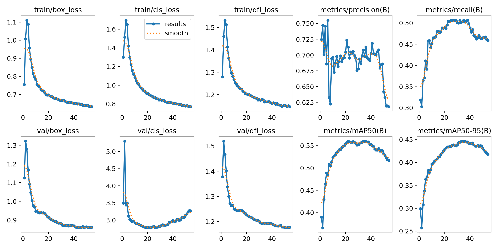
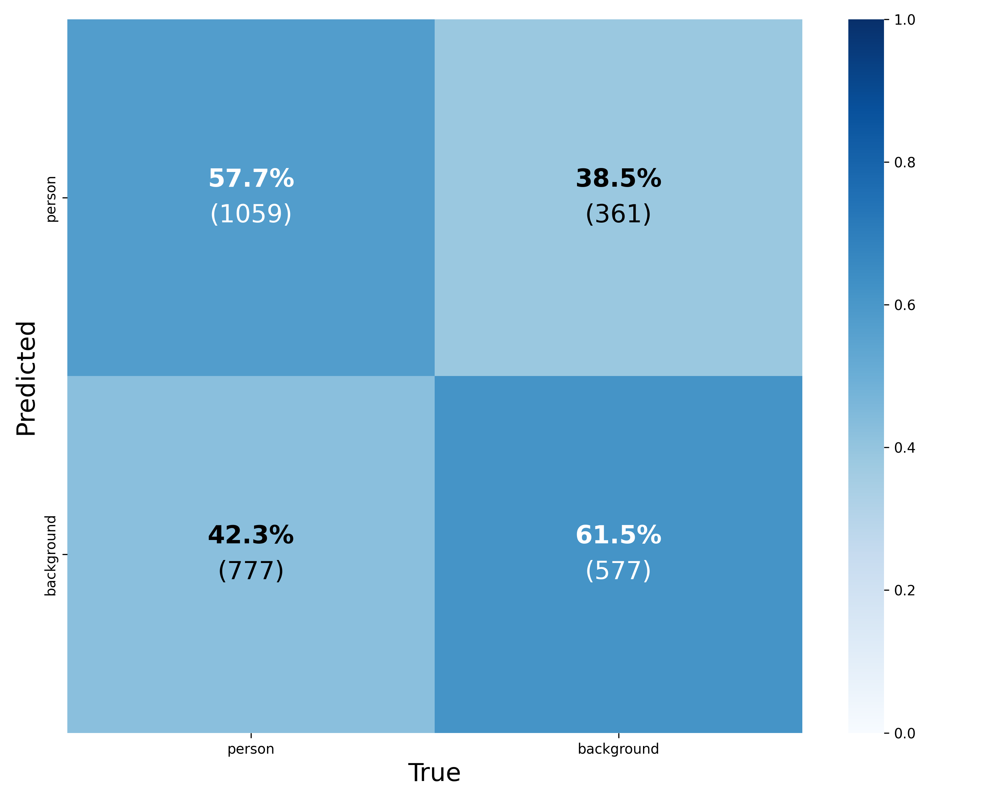
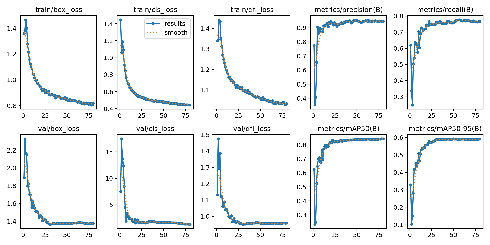
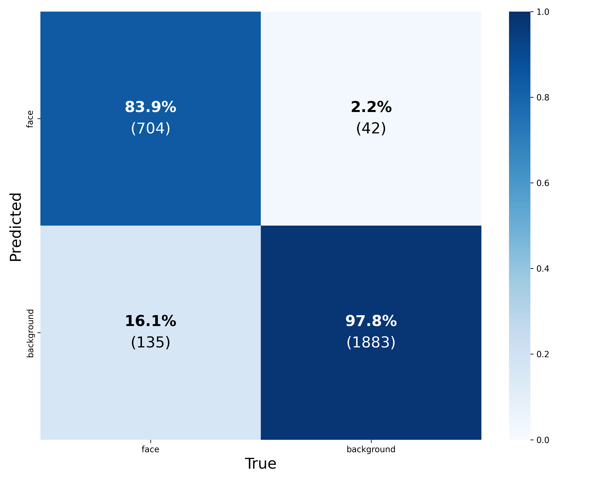
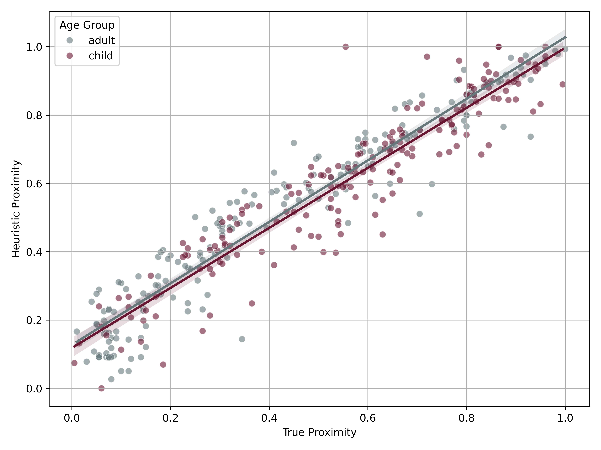
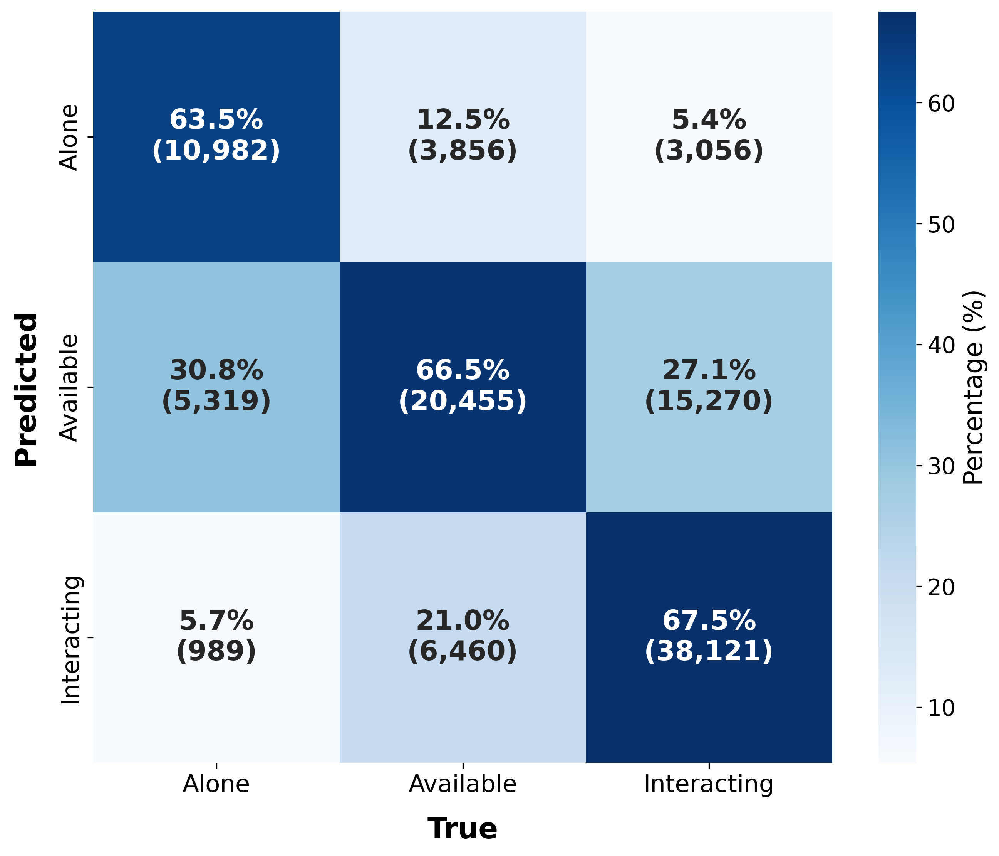
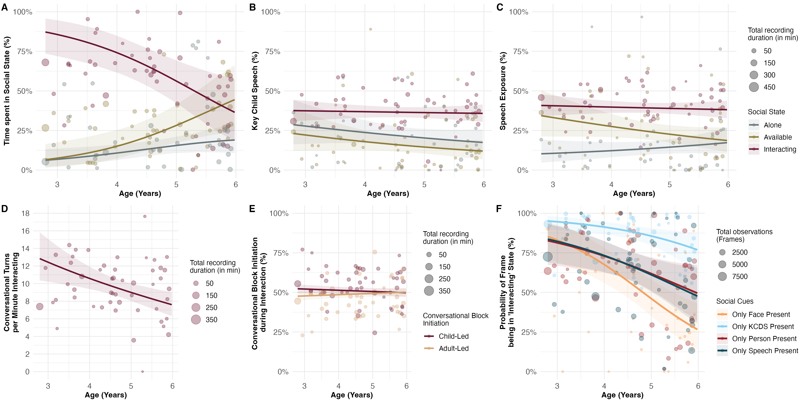
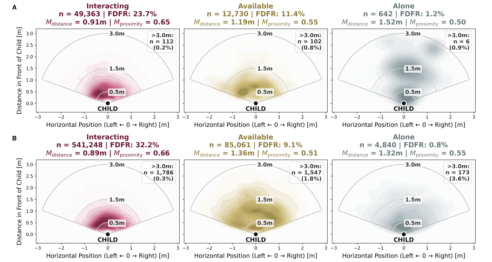

\pagenumbering{arabic}
\setcounter{page}{1}

\setcounter{figure}{0}
\renewcommand{\thefigure}{S\arabic{figure}}

\setcounter{table}{0}
\renewcommand{\thetable}{S\arabic{table}}

```{r setup, include = FALSE}
library(papaja)
library(tidyverse)
library(ggplot2)
library(brms)
library(ggthemes)
library(ggpubr)
library(BayesFactor)
library(broom)
library(coda)
library(reshape2)
library(ggridges)
library(readxl)
library(dplyr)
library(lubridate)
library(zoo)
library(gridExtra)
library(grid)
library(kableExtra)
library(cowplot)
library(patchwork)
library(magick)
library(ggplotify)
library(png)
library(jpeg)
library(lme4)
library(data.table)
library(broom)
library(brms)


estimate_mode <- function(s) {
  d <- density(s)
  return(d$x[which.max(d$y)])
}

hdi_upper<- function(s){
  m <- HPDinterval(mcmc(s))
  return(m["var1","upper"])
}

hdi_lower<- function(s){
  m <- HPDinterval(mcmc(s))
  return(m["var1","lower"])
}
```

```{r analysis-preferences}
# Seed for random number generation
set.seed(42)
knitr::opts_chunk$set(cache.extra = knitr::rand_seed)
knitr::opts_chunk$set(echo = F, warning = F, message = F)
```

```{r quantex-statistics-old, echo=FALSE, message=FALSE, warning=FALSE}
quantex_data <- read_csv2("data/quantex_data_sheet_MASTER.csv")

# 1. Create a data frame for calculating statistics based on unique subject recordings (sessions)
quantex_unique_data <- quantex_data %>%
  distinct() %>%  # Removes strictly duplicate rows
  filter(!is.na(minutes_per_id), minutes_per_id != 0,
         !is.na(id), included == "Yes") %>%
  # Keep only one row per ID/Minutes_per_ID combo for accurate per-subject stats
  distinct(id, minutes_per_id, .keep_all = TRUE) %>%
  mutate(id = as.double(id)) # Convert ID to numeric

# 2. Create a data frame for total video count (all video rows that meet criteria)
quantex_cleaned_data <- quantex_data %>%
  filter(!is.na(minutes_per_id), minutes_per_id != 0,
         !is.na(id), included == "Yes")
quantex_sum_videos <- nrow(quantex_cleaned_data)

# ----------------------------------------------------
# 3. Gender Counts
# ----------------------------------------------------

# Get unique subject IDs and their gender from the filtered data
quantex_data_gender_count <- quantex_unique_data %>%
  distinct(id, gender)

quantex_male_count <- quantex_data_gender_count %>%
  filter(gender == "Male") %>%
  nrow()

quantex_female_count <- quantex_data_gender_count %>%
  filter(gender == "Female") %>%
  nrow()

quantex_nr_children <- nrow(quantex_data_gender_count)

# ----------------------------------------------------
# 4. Age Calculation
# ----------------------------------------------------
# Counts
quantex_age_group_counts <- quantex_cleaned_data %>%
  count(age_group, name = "count")

# Safely extract counts (using filter is safer than positional index)
quantex_count_3_plus <- (quantex_unique_data %>% 
  count(age_group) %>% 
  filter(age_group == "3"))$n
quantex_count_4_plus <- (quantex_unique_data %>% 
  count(age_group) %>% 
  filter(age_group == "4"))$n
quantex_count_5_plus <- (quantex_unique_data %>% 
  count(age_group) %>% 
  filter(age_group == "5"))$n

quantex_mean_age <- mean(quantex_cleaned_data$age, na.rm = TRUE)
quantex_sd_age <- sd(quantex_cleaned_data$age, na.rm = TRUE)

# --- START NEW: Duration Calculation by Age Group ---
# Merge unique âqy<wsdxcew32 data with the calculated Age_group for each ID
quantex_duration_by_age_group <- quantex_cleaned_data %>%
  group_by(age_group) %>%
  summarise(
    total_minutes = sum(seconds, na.rm = TRUE)/60,
    .groups = "drop"
  ) %>%
  filter(!is.na(age_group)) # Remove NA age groups from summary

# Extract total minutes and calculate hours per age group
quantex_minutes_3_plus <- quantex_duration_by_age_group %>% filter(age_group == "3") %>% pull(total_minutes)
quantex_minutes_4_plus <- quantex_duration_by_age_group %>% filter(age_group == "4") %>% pull(total_minutes)
quantex_minutes_5_plus <- quantex_duration_by_age_group %>% filter(age_group == "5") %>% pull(total_minutes)

# Calculate hours for easy reporting
quantex_hours_3_plus <- quantex_minutes_3_plus / 60
quantex_hours_4_plus <- quantex_minutes_4_plus / 60
quantex_hours_5_plus <- quantex_minutes_5_plus / 60

# -------------------------------------------------------------------------
# ANNOTATED DATA STATISTICS
# -------------------------------------------------------------------------

# 1. Filter data for the annotated subset
quantex_annotated_cleaned_data <- quantex_data %>%
  filter(!is.na(minutes_per_id), minutes_per_id != 0,
         !is.na(id), included == "Yes",
         annotated == "Yes") # Key filter for annotated subset

# 2. Get unique records and count children in the annotated subset
quantex_annotated_unique_data <- quantex_annotated_cleaned_data %>%
  distinct() %>%
  distinct(id, minutes_per_id, .keep_all = TRUE) %>%
  mutate(id = as.double(id))

quantex_annotated_nr_children <- quantex_annotated_unique_data %>%
  distinct(id) %>%
  nrow()

# 3b. Counts of unique children per Age Group in annotated subset (NEW)
quantex_annotated_age_group_counts <- quantex_annotated_cleaned_data %>%
  count(age_group, name = "count")

quantex_annotated_count_3_plus <- (quantex_annotated_unique_data %>% 
  count(age_group) %>% 
  filter(age_group == "3"))$n
quantex_annotated_count_4_plus <- (quantex_annotated_unique_data %>% 
  count(age_group) %>% 
  filter(age_group == "4"))$n
quantex_annotated_count_5_plus <- (quantex_annotated_unique_data %>% 
  count(age_group) %>% 
  filter(age_group == "5"))$n

# 4. Calculate Total Duration by Age Group for the annotated subset
quantex_annotated_duration_by_age_group <- quantex_annotated_cleaned_data %>%
  group_by(age_group) %>%
  summarise(
    total_minutes = sum(seconds, na.rm = TRUE) / 60,
    .groups = "drop"
  ) %>%
  filter(!is.na(age_group))


# 5. Calculate Total Annotated Hours
quantex_annotated_minutes <- sum(quantex_annotated_cleaned_data$seconds, na.rm = TRUE)/60
quantex_annotated_hours <- quantex_annotated_minutes / 60

# 6. Extract hours for each group and ensure 0 if missing
get_annotated_hours <- function(age, df) {
  minutes <- df %>% filter(age == age_group) %>% pull(total_minutes)
  minutes <- ifelse(length(minutes) == 0, 0, minutes)
  return(minutes / 60)
}

quantex_annotated_hours_3_plus <- get_annotated_hours(3, quantex_annotated_duration_by_age_group)
quantex_annotated_hours_4_plus <- get_annotated_hours(4, quantex_annotated_duration_by_age_group)
quantex_annotated_hours_5_plus <- get_annotated_hours(5, quantex_annotated_duration_by_age_group)

# ----------------------------------------------------
# 5. Time Span & Minute Statistics
# ----------------------------------------------------

# get statistics about filtered and excluded data
quantex_filtered_data <- quantex_data %>%
  filter(!is.na(date), included == "Yes") %>%
  mutate(date = dmy(date))

excluded_data <- quantex_data %>%
  filter(is.na(date) | included != "Yes")
num_excluded_videos <- nrow(excluded_data)
num_excluded_participants <- nrow(excluded_data %>% distinct(id))

num_total_videos <- nrow(quantex_data)
num_total_participants <- nrow(quantex_data %>% distinct(id))
num_filtered_videos <- nrow(quantex_filtered_data)
num_filtered_participants <- nrow(quantex_filtered_data %>% distinct(id))

# Minute Statistics (using quantex_unique_data)
quantex_min_minutes <- min(quantex_unique_data$minutes_per_id[quantex_unique_data$minutes_per_id > 0], na.rm = TRUE)
quantex_max_minutes <- max(quantex_unique_data$minutes_per_id, na.rm = TRUE)
quantex_sum_minutes <- sum(as.numeric(quantex_unique_data$minutes_per_id), na.rm = TRUE)
quantex_mean_minutes <- mean(quantex_unique_data$minutes_per_id, na.rm = TRUE)
quantex_sd_minutes <- sd(quantex_unique_data$minutes_per_id, na.rm = TRUE)

quantex_sum_hours <- quantex_sum_minutes/60

# Date Span
quantex_oldest_date <- min(quantex_filtered_data$date, na.rm = TRUE)
quantex_youngest_date <- max(quantex_filtered_data$date, na.rm = TRUE)

quantex_oldest_year <- as.numeric(format(quantex_oldest_date, "%Y"))
quantex_oldest_month <- as.numeric(format(quantex_oldest_date, "%m"))
quantex_youngest_year <- as.numeric(format(quantex_youngest_date, "%Y"))
quantex_youngest_month <- as.numeric(format(quantex_youngest_date, "%m"))

# Calculate the interval between the two dates
quantex_time_span_months <- (quantex_youngest_year - quantex_oldest_year) * 12 + (quantex_youngest_month - quantex_oldest_month) + 1


###################
# Session Statistics 
# (How many sessions per child, average session duration etc.)

# 1. Identify contiguous recording sessions
# A new session starts if: ID changes, Date changes, OR the segment number (nr) <= previous nr (or nr != lag(nr) + 1)
quantex_sessions <- quantex_filtered_data %>%
  arrange(id, date, nr) %>%
  mutate(
    new_session_flag = (id != lag(id, default = first(id))) |
                       (date != lag(date, default = first(date))) |
                       (nr != lag(nr, default = 0) + 1),
    session_id = cumsum(new_session_flag)
  )

# 2. Aggregate metrics per continuous recording session
sessions_statistics_session_level <- quantex_sessions %>%
  group_by(id, session_id, date) %>%
  summarise(
    n_segments = n(),
    session_duration_sec = sum(seconds, na.rm = TRUE),
    session_duration_min = session_duration_sec / 60,
    session_duration_hrs = session_duration_sec / 3600,
    .groups = "drop"
  )

# 3. Aggregate metrics per child (ID)
sessions_statistics_child_level <- sessions_statistics_session_level %>%
  group_by(id) %>%
  summarise(
    total_sessions = n(),
    total_duration_hrs = sum(session_duration_hrs),
    total_duration_min = sum(session_duration_min),
    mean_session_min = mean(session_duration_min),
    min_session_min = min(session_duration_min),
    max_session_min = max(session_duration_min),
    .groups = "drop"
  )

# 5. Overall Dataset Summary Statistics
sessions_statistics_overall_summary <- tibble(
  total_participants = n_distinct(sessions_statistics_child_level$id),
  total_sessions = nrow(sessions_statistics_session_level),
  total_segments = nrow(quantex_filtered_data),
  total_hours = sum(sessions_statistics_session_level$session_duration_hrs),
  
  # Session counts per child
  mean_sessions_per_child = mean(sessions_statistics_child_level$total_sessions),
  sd_sessions_per_child = sd(sessions_statistics_child_level$total_sessions),
  min_sessions_per_child = min(sessions_statistics_child_level$total_sessions),
  max_sessions_per_child = max(sessions_statistics_child_level$total_sessions),
  
  # Session duration (in minutes)
  mean_session_duration_min = mean(sessions_statistics_session_level$session_duration_min),
  sd_session_duration_min = sd(sessions_statistics_session_level$session_duration_min),
  min_session_duration_min = min(sessions_statistics_session_level$session_duration_min),
  max_session_duration_min = max(sessions_statistics_session_level$session_duration_min)
)
```
```{r quantex-statistics, echo=FALSE, message=FALSE, warning=FALSE}
# 1. Base Data Loading & Filtering
quantex_raw <- read_csv2("data/quantex_data_sheet_MASTER.csv")

quantex_clean <- quantex_raw %>%
  filter(included == "Yes", !is.na(id), !is.na(minutes_per_id), minutes_per_id > 0) %>%
  mutate(
    id = as.character(id),
    
    # 1. Parse date_time string into a full POSIXct datetime object
    dt_parsed = dmy_hm(date_time),
    
    # 2. Extract Date (falls back to existing 'date' column if date_time is NA)
    date = if_else(!is.na(dt_parsed), as.Date(dt_parsed), dmy(date)),
    
    # 3. Extract Time as a string ("HH:MM") or numeric hour of the day (e.g. 9.27 for 09:16)
    time_str  = format(dt_parsed, "%H:%M"),
    time_hour = hour(dt_parsed) + minute(dt_parsed) / 60,
    
    # 4. Extract German Weekday directly from the parsed date
    # 5. Weekend Flag
    is_weekend = if_else(weekday %in% c("Samstag", "Sonntag"), "Wochenende", "Wochentag")
  )

# Exclusion Counts
excluded_data <- quantex_raw %>% filter(is.na(date) | included != "Yes")
num_excluded_videos <- nrow(excluded_data)
num_excluded_participants <- n_distinct(excluded_data$id)
num_total_videos <- nrow(quantex_raw)
num_total_participants <- n_distinct(quantex_raw$id)

# 2. Participant & Age Level Summary
participant_summary <- quantex_clean %>%
  group_by(id, gender, age_group) %>%
  summarise(
    total_seconds = sum(seconds, na.rm = TRUE),
    total_minutes = total_seconds / 60,
    total_hours = total_seconds / 3600,
    age = first(age),
    .groups = "drop"
  )

participant_summary <- quantex_clean %>%
  group_by(id) %>%
  summarise(
    total_seconds = sum(seconds, na.rm = TRUE),
    total_minutes = total_seconds / 60,
    total_hours = total_seconds / 3600,
    gender = first(na.omit(gender)),
    age = max(age, na.rm = TRUE),
    .groups = "drop"
  ) %>%
  mutate(
    age_group = case_when(
      age < 4 ~ "3",
      age < 5 ~ "4",
      age >= 5 ~ "5"
    )
  )

quantex_nr_children <- nrow(participant_summary)
quantex_male_count   <- sum(participant_summary$gender == "Male", na.rm = TRUE)
quantex_female_count <- sum(participant_summary$gender == "Female", na.rm = TRUE)

quantex_count_3_plus <- sum(participant_summary$age_group == "3", na.rm = TRUE)
quantex_count_4_plus <- sum(participant_summary$age_group == "4", na.rm = TRUE)
quantex_count_5_plus <- sum(participant_summary$age_group == "5", na.rm = TRUE)

quantex_mean_age <- mean(participant_summary$age, na.rm = TRUE)
quantex_sd_age   <- sd(participant_summary$age, na.rm = TRUE)
min_age          <- min(participant_summary$age, na.rm = TRUE)
max_age          <- max(participant_summary$age, na.rm = TRUE)

# Duration per Child (Hours & Minutes)
quantex_mean_minutes <- mean(participant_summary$total_minutes)
quantex_sd_minutes   <- sd(participant_summary$total_minutes)
quantex_min_minutes  <- min(participant_summary$total_minutes)
quantex_max_minutes  <- max(participant_summary$total_minutes)

quantex_mean_hours <- quantex_mean_minutes / 60
quantex_sd_hours   <- quantex_sd_minutes / 60
quantex_min_hours  <- quantex_min_minutes / 60
quantex_max_hours  <- quantex_max_minutes / 60
quantex_sum_hours  <- sum(participant_summary$total_hours)

# Duration by Age Group
duration_by_age <- quantex_clean %>%
  group_by(age_group) %>%
  summarise(total_hours = sum(seconds, na.rm = TRUE) / 3600, .groups = "drop")

quantex_hours_3_plus <- duration_by_age %>% filter(age_group == "3") %>% pull(total_hours)
quantex_hours_4_plus <- duration_by_age %>% filter(age_group == "4") %>% pull(total_hours)
quantex_hours_5_plus <- duration_by_age %>% filter(age_group == "5") %>% pull(total_hours)

# 3. Time Span of Data Collection
quantex_oldest_date   <- min(quantex_clean$date, na.rm = TRUE)
quantex_youngest_date <- max(quantex_clean$date, na.rm = TRUE)
quantex_oldest_year   <- as.numeric(format(quantex_oldest_date, "%Y"))
quantex_oldest_month  <- as.numeric(format(quantex_oldest_date, "%m"))
quantex_youngest_year <- as.numeric(format(quantex_youngest_date, "%Y"))
quantex_youngest_month <- as.numeric(format(quantex_youngest_date, "%m"))
quantex_time_span_months <- (quantex_youngest_year - quantex_oldest_year) * 12 + (quantex_youngest_month - quantex_oldest_month) + 1

# 4. Session Segmentation Statistics
quantex_sessions <- quantex_clean %>%
  arrange(id, date, nr) %>%
  mutate(
    new_session_flag = (id != lag(id, default = first(id))) |
                       (date != lag(date, default = first(date))) |
                       (nr != lag(nr, default = 0) + 1),
    session_id = cumsum(new_session_flag)
  )
session_level <- quantex_sessions %>%
  group_by(id, session_id, date) %>%
  summarise(
    n_segments = n(),
    session_min = sum(seconds, na.rm = TRUE) / 60,
    session_hrs = sum(seconds, na.rm = TRUE) / 3600,
    .groups = "drop"
  )

child_session_summary <- session_level %>%
  group_by(id) %>%
  summarise(n_sessions = n(), .groups = "drop")

total_sessions            <- nrow(session_level)
mean_sessions_per_child   <- mean(child_session_summary$n_sessions)
sd_sessions_per_child     <- sd(child_session_summary$n_sessions)
min_sessions_per_child    <- min(child_session_summary$n_sessions)
max_sessions_per_child    <- max(child_session_summary$n_sessions)

mean_session_duration_min <- mean(session_level$session_min)
sd_session_duration_min   <- sd(session_level$session_min)
min_session_duration_min  <- min(session_level$session_min)
max_session_duration_min  <- max(session_level$session_min)

# 5. Annotated Data Statistics
annotated_data <- quantex_clean %>% filter(annotated == "Yes")
quantex_annotated_nr_children <- n_distinct(annotated_data$id)
quantex_annotated_hours       <- sum(annotated_data$seconds, na.rm = TRUE) / 3600

# 6. Weekday Breakdown (Total Hours, %, Sessions, Children)
weekday_summary <- quantex_clean %>%
  group_by(weekday) %>%
  summarise(
    n_videos     = n(),
    n_children   = n_distinct(id),
    total_hours  = sum(seconds, na.rm = TRUE) / 3600,
    .groups = "drop"
  ) %>%
  mutate(
    percent_hours = (total_hours / sum(total_hours)) * 100
  )

# 7. Weekend vs. Weekday Comparison
weekend_vs_weekday <- quantex_clean %>%
  group_by(is_weekend) %>%
  summarise(
    n_videos     = n(),
    n_children   = n_distinct(id),
    total_hours  = sum(seconds, na.rm = TRUE) / 3600,
    .groups = "drop"
  ) %>%
  mutate(
    percent_hours = (total_hours / sum(total_hours)) * 100
  )

# 8. Daytime Analysis
quantex_time_bins <- quantex_clean %>%
  filter(!is.na(dt_parsed)) %>%
  mutate(
    hour_val = hour(dt_parsed) + minute(dt_parsed) / 60,
    time_of_day = case_when(
      hour_val >= 7.0  & hour_val < 12.0 ~ "Morning",
      hour_val >= 12.0 & hour_val < 14.5 ~ "Midday",
      hour_val >= 14.5 & hour_val < 18.0 ~ "Afternoon",
      hour_val >= 18.0 & hour_val <= 24.0 ~ "Evening"
    ),
    time_of_day = factor(time_of_day, levels = c(
      "Morning",
      "Midday",
      "Afternoon",
      "Evening"))
  )

time_range_stats <- quantex_time_bins %>%
  summarise(
    earliest_start = min(time_str, na.rm = TRUE),
    latest_start   = max(time_str, na.rm = TRUE),
    median_hour    = median(hour_val, na.rm = TRUE)
  )

# Time-of-day summary table
time_of_day_summary <- quantex_time_bins %>%
  group_by(time_of_day) %>%
  summarise(
    n_videos     = n(),
    n_children   = n_distinct(id),
    total_hours  = sum(seconds, na.rm = TRUE) / 3600,
    .groups = "drop"
  ) %>%
  mutate(percent_hours = (total_hours / sum(total_hours)) * 100)


# 8. Time-of-Day Summary by Age Group
time_by_age_summary <- quantex_time_bins %>%
  group_by(age_group, time_of_day) %>%
  summarise(
    n_videos    = n(),
    n_children  = n_distinct(id),
    total_hours = sum(seconds, na.rm = TRUE) / 3600,
    .groups = "drop_last"
  ) %>%
  mutate(
    percent_hours_within_age = (total_hours / sum(total_hours)) * 100,
    percent_videos_within_age = (n_videos / sum(n_videos)) * 100
  ) %>%
  ungroup()

# flip table
time_by_age_table <- time_by_age_summary %>%
  select(age_group, time_of_day, percent_hours_within_age) %>%
  pivot_wider(
    names_from = time_of_day,
    values_from = percent_hours_within_age,
    values_fill = 0
  )

contingency_table <- table(quantex_time_bins$age_group, quantex_time_bins$time_of_day)
chi_test_time_of_day <- chisq.test(contingency_table)

# 9. Weekday Summary Table by Age Group
weekday_by_age_summary <- quantex_time_bins %>%
  filter(!is.na(weekday), !is.na(age_group)) %>%
  group_by(age_group, weekday) %>%
  summarise(
    n_videos    = n(),
    n_children  = n_distinct(id),
    total_hours = sum(seconds, na.rm = TRUE) / 3600,
    .groups = "drop_last"
  ) %>%
  mutate(
    percent_hours_within_age  = (total_hours / sum(total_hours)) * 100,
    percent_videos_within_age = (n_videos / sum(n_videos)) * 100
  ) %>%
  ungroup()

weekend_by_age_summary <- quantex_time_bins %>%
  filter(!is.na(is_weekend), !is.na(age_group)) %>%
  group_by(age_group, is_weekend) %>%
  summarise(
    n_videos    = n(),
    n_children  = n_distinct(id),
    total_hours = sum(seconds, na.rm = TRUE) / 3600,
    .groups = "drop_last"
  ) %>%
  mutate(
    percent_hours_within_age  = (total_hours / sum(total_hours)) * 100,
    percent_videos_within_age = (n_videos / sum(n_videos)) * 100
  ) %>%
  ungroup()

# flip table
weekday_by_age_table <- weekday_by_age_summary %>%
  select(age_group, weekday, percent_hours_within_age) %>%
  pivot_wider(
    names_from = weekday,
    values_from = percent_hours_within_age,
    values_fill = 0
  )

weekend_by_age_table <- weekend_by_age_summary %>%
  select(age_group, is_weekend, percent_hours_within_age) %>%
  pivot_wider(
    names_from = is_weekend,
    values_from = percent_hours_within_age,
    values_fill = 0
  )

weekend_contingency <- table(quantex_time_bins$age_group,quantex_time_bins$is_weekend)
chi_test_weekend <- chisq.test(weekend_contingency)

# 10. Covid analysis
# Define pandemic window (e.g., up to end of general restrictions in Germany)
covid_start <- as.Date("2020-03-01")
covid_end   <- as.Date("2020-05-31")

quantex_covid <- quantex_clean %>%
  mutate(
    period = case_when(
      date < covid_start ~ "Pre-COVID",
      date >= covid_start & date <= covid_end ~ "COVID-Period",
      date > covid_end ~ "Post-COVID"
    )
  )

covid_summary <- quantex_covid %>%
  group_by(period) %>%
  summarise(
    n_videos     = n(),
    n_children   = n_distinct(id),
    total_hours  = sum(seconds, na.rm = TRUE) / 3600,
    .groups = "drop"
  ) %>%
  mutate(percent_hours = (total_hours / sum(total_hours)) * 100)

```

\newpage
# Overview
This document provides supplementary details for the study "The social ecology of development: The changing structure of preschoolers’ everyday experiences at home". We first outline the data collection, dataset overview, and ground-truth datasets in [Methods](#sup-methods). We then detail the [Visual Processing](#sup-automatic-analysis-visual) and [Audio Processing](#sup-automatic-analysis-audio) components of our automated analysis pipeline. Next, we present the mathematical formalization of our multimodal classification rules and change-point smoothing in [Multimodal Data Aggregation and Optimization](#sup-multimodal-aggregation), followed by [Hyperparameter Tuning and Pipeline Validation](#sup-pipeline-validation), which details the group 5-fold cross-validation scheme, classification performance, and descriptive segment statistics. Finally, we provide [Ground-Truth Replications of Developmental Analyses](#sup-bayesian-gt), and present [Supplementary Visualizations](#sup-visualizations).

# Methods {#sup-methods}
## Data Collection
Participants were recruited from Leipzig, a mid-sized German city, through an existing lab database, to form a cross-sectional sample of children aged three to five years (with approximately equal distribution across age groups: 30% 3-year-olds, 35% 4-year-olds, 35% 5-year-olds). The data collection protocol was approved by the local ethics committee, and all participating families provided written informed consent, authorizing the use of recordings for scientific research. Parents received a detailed explanation of the study's purpose and procedures, consistent with the information in the study brochure. Families who agreed to participate were provided with an adjustable vest equipped with an embedded camera, which children were asked to wear for approximately two hours their ordinary home activities, with flexible extension options. For privacy protection and third-party consent boundaries, recordings were strictly limited to the home environment (the family home and private garden/yard). Recorded videos were securely stored on the institutional server at the Max Planck Institute for Evolutionary Anthropology and subsequently made accessible to participating families. To minimize participant burden, parents could receive and return the equipment via home delivery, workplace drop-off, or self-pickup.

During the initial handover, parents received one or two vests (multiple sizes available), a fully charged *PatrolEyes WiFi HD Infrared Police Body Camera*. To maintain high-quality data for subsequent automated analysis, devices were pre-configured to record continuous video at 1080p resolution (30fps) with a 140-degree wide-angle field of view (resulting in a broad horizontal perspective with a narrower vertical aspect given the 16:9 aspect ratio). Parents received hands-on instructions on camera operation and practiced using the equipment. The consent documentation required listing the participating child alongside all household members or visitors who might appear on camera. Five copies of informational data-privacy sheets were provided for distribution to any external visitors prior to recording. A follow-up call was scheduled to ensure recording success, typically planned for the weekend following the handover to ensure enough time for recording.

Following the conclusion of the recording period, parents were contacted to confirm recording success and assess any need for additional time. Flexible rescheduling was offered as needed. Once the recording was completed, a pickup or drop-off appointment was arranged to collect the completed consent form, vest, and camera. Parents were also asked to confirm their current email address for sharing the recordings. Children received a "Labyrinth" game as a thank you for their participation.

## Temporal Sampling Distribution Across Age Groups {#sup-dataset}
Because parents were instructed to capture naturalistic, unscripted routines in the home environment and could freely decide when and how often to record, recording duration varied at the individual level (M=`r quantex_mean_minutes` min, SD=`r quantex_sd_minutes`, range = `r quantex_min_minutes`--`r quantex_max_minutes`). Figure \@ref(fig:sup-quantex-minutes-per-child) shows the distribution of video duration per child. To evaluate whether this flexibility in recording led to systematic bias regarding the time of day or weekday across age group, we examined the distribution of recorded hours across four daily time windows (morning: 07:00–11:59, midday: 12:00–14:29, afternoon: 14:30–17:59, evening: 18:00–21:00) and day types (weekday vs. weekend) across the three age groups.

As summarized in Table \@ref(tab:dataset-distribution), total recorded volume was well-represented across all temporal bins. Chi-square tests of independence showed modest distributional variations across age groups for both daytime windows ($\chi^{2}(6) =$ `r round(chi_test_time_of_day$statistic,2)`, $p =$ `r round(chi_test_time_of_day$p.value,3)`) and weekday versus weekend recordings ($\chi^{2}(2) =$ `r round(chi_test_weekend$statistic,2)`, $p =$ `r round(chi_test_weekend$p.value,3)`). However, post-hoc examination of standardized residuals confirmed that these differences were minor (all $|z| < 1.84$). 

Regarding time of day, the residuals reflected subtle everyday shifts, such as slightly higher morning recordings in 3-year-olds ($z=1.73$), higher evening volume in 4-year-olds ($z=1.66$), and higher afternoon volume in 5-year-olds ($z=1.60$). All residuals remained within the conventional non-significance range ($|z| < 1.96$), which confirms that no single daytime window dominated any age group. Regarding type of day, data distribution shows a slightly higher weekend percentage in 4-year-olds ($z=1.52$) to higher weekday coverage in 5-year-olds ($z=1.46$; weekend $z=-1.83$), while 3-year-olds showed an even split ($|z| \leq 0.34$). Together, these analyses confirm that open-ended sampling instructions did not introduce systematic biases, as recordings captured a broad range of experiences across diverse times of day and days of the week across all age groups.

```{r dataset-distribution, echo=FALSE, message=FALSE, warnings=FALSE, results='asis', eval=TRUE}

df <- data.frame(
  AgeGroup = c("Age Group", "3-year-olds", "4-year-olds", "5-year-olds"),
  Morning = c("Morning", 
              sprintf("%.1f%%", time_by_age_table$Morning[1]), 
              sprintf("%.1f%%", time_by_age_table$Morning[2]),
              sprintf("%.1f%%", time_by_age_table$Morning[3])
              ),
  Midday = c("Midday", 
             sprintf("%.1f%%", time_by_age_table$Midday[1]), 
             sprintf("%.1f%%", time_by_age_table$Midday[2]), 
             sprintf("%.1f%%", time_by_age_table$Midday[3]) 
             ),
  Afternoon = c("Afternoon", 
              sprintf("%.1f%%", time_by_age_table$Afternoon[1]), 
              sprintf("%.1f%%", time_by_age_table$Afternoon[2]), 
              sprintf("%.1f%%", time_by_age_table$Afternoon[3])
              ),
  Evening = c("Evening", 
              sprintf("%.1f%%", time_by_age_table$Evening[1]), 
              sprintf("%.1f%%", time_by_age_table$Evening[2]), 
              sprintf("%.1f%%", time_by_age_table$Evening[3])
              ),
  Weekday = c("Weekday", 
              sprintf("%.1f%%", weekend_by_age_table$Wochentag[1]), 
              sprintf("%.1f%%", weekend_by_age_table$Wochentag[2]), 
              sprintf("%.1f%%", weekend_by_age_table$Wochentag[3])
              ),
  Weekend = c("Weekend", 
              sprintf("%.1f%%", weekend_by_age_table$Wochenende[1]), 
              sprintf("%.1f%%", weekend_by_age_table$Wochenende[2]), 
              sprintf("%.1f%%", weekend_by_age_table$Wochenende[3])
              ),
  stringsAsFactors = FALSE
)

names(df) <- unname(as.list(df[1,]))
df <- df[-1,] 
row.names(df) <- NULL
apa_table(
  df,
  caption = "Proportion of recorded videos across time of day and day type by age group.", 
  note = "Values represent within-age group percentages of total recording time. Morning (07:00–11:59), Midday (12:00–14:29), Afternoon (14:30–17:59), and Evening (18:00–21:00). Weekday (Monday-Friday) and Weekend (Saturday-Sunday).",
  escape = FALSE
)
```
 
```{r sup-quantex-minutes-per-child, echo=FALSE, message=FALSE, warning=FALSE, fig.cap="Video recording duration (in minutes) per Child.", fig.height=2.5, fig.width=3.5}
quantex_unique_data$id <- as.factor(quantex_unique_data$id)

ggplot(quantex_unique_data, aes(x = minutes_per_id)) +
  geom_point(aes(y = 0), shape = "I", size = 5) + 
  geom_density(fill = "gray", alpha = 0.5, color = "black") + 
  theme_minimal() +
  theme(legend.position = "none") +
  labs(
    x = "Minutes per ID",
    y = "Density"
  )
quantex_1_plot <- ggplot(quantex_unique_data, aes(x = minutes_per_id)) +
  geom_point(aes(y = 0), shape = "I", size = 5) + 
  geom_density(fill = "gray", alpha = 0.5, color = "black") + 
  theme_minimal() +
  theme(
    legend.position = "none",
    axis.title = element_text(size = 25),      # Increase label size
    axis.text = element_text(size = 25),       # Increase tick label size
    axis.ticks.length = unit(0.5, "cm")        # Increase tick size
  ) +
  labs(
    x = "Minutes per ID",
    y = "Density"
  )

# Specify the file path and name
# Save the plot
ggsave(filename = "images/minutes_per_id.png", plot = quantex_1_plot, width = 8, height = 6, dpi = 600)
```

```{r final hyperparameter}

segments_annotated_percentage = 0.1 # percentage of total dataset annotated for interaction states
segments_annotated = quantex_sum_hours*segments_annotated_percentage
irr_annotated_percentage = 0.1 # percentage of annotated dataset used for interrater reliability check
segments_annotated_min_irr = 212.07
irr = 0.84

audio_visual_gating_floor = 0.35
instant_confidence_threshold = 0.15
max_turn_taking_gap_sec = 5.0
max_same_speaker_gap_sec = 1.0
proximity_threshold = 0.60
sustained_kcds_window_sec = 10.0
sustained_kcds_threshold = 0.95
high_confidence_proximity_threshold = 0.65
high_confidence_face_confidence = 0.85
visual_persistence_sec = 3.0
short_term_visual_memory_sec = 3.5
sustained_ohs_window_sec = 10.0
sustained_ohs_threshold = 0.65
cpd_penalty = 5.0
cpd_interacting_threshold = 0.40
cpd_total_presence_floor = 0.45
same_segment_merge_threshold = 3.0
gap_stretch_threshold = 2.0

num_hyperparameter = 18
```

## Ground-Truth Datasets {#sup-ground-truth-datasets}
To finetune and validate the different components of our automated multimodal pipeline, we created three independent human-annotated ground-truth datasets from our dataset. Additionally, we used an external open-access dataset for audio finetuning. A clear overview of each dataset and its annotation strategy are detailed below.

### 1. Bounding-Box Ground-Truth Dataset (Frame-Level)
The annotations focused on central elements of social interactions, specifically, persons the child interacted with by identifying the presence of their body parts or face. For each detected person or face, we recorded additional attributes: a unique identifier (ID), estimated age category (infant, child, teen, adult), and perceived gender (female, male). Faces were annotated even when occluded, blurred, or cropped to ensure visual detection models were trained on challenging real-world examples. Importantly, the camera-wearing child's own limbs and torso were deliberately annotated as a unique category to not include it into the person category for model training. In total, `r quantex_annotated_hours` hours from `r quantex_annotated_nr_children` children were manually annotated at a rate of 1 frame per second (every 30th frame from 30-fps video) to train, validate, and test the YOLOv12 person and face detection models (see [Visual Processing](#sup-automatic-analysis-visual)).

### 2. Face-Proximity Ground-Truth Dataset (Frame-Level):
To validate our proximity estimation against human judgment, we conducted a quality check against independent human annotations. A total of 364 representative still frames (185 adult faces, 179 child faces) were evaluated by two independent annotators. Frames were sampled across the entire spectrum of bounding-box sizes—from small, distant faces to close-ups. Each rater assigned a proximity value on a continuous scale between 0 (furthest) and 1 (closest). To ensure consistency across annotators, both annotators were shown the same reference frames (one for $\text{proximity}=0$ and one for $\text{proximity}=1$ per age group), which were used to define the model’s minimum and maximum area parameters. The ground-truth proximity score for each frame was calculated as the mean of the two ratings.

### 3. Social-State Ground-Truth Dataset (Continuous Video-Level)
Two independent annotators manually labeled `r segments_annotated` hours of video material using our definitions of Interacting, Available, and Alone states. Inter-Rater Reliability (IRR) was assessed on a shared subset of `r segments_annotated_min_irr` minutes, yielding a Cohen’s Kappa of $\kappa$=`r irr`. Cohen’s Kappa [@cohenCoefficientAgreementNominal1960] measures agreement between raters while accounting for the possibility of agreement occurring by chance; values range from -1 to 1, where scores above 0.8 typically characterize 'almost perfect' alignment. Therefore, this value indicates substantial agreement and validates the functional definitions of our social states. The remaining `r segments_annotated - (segments_annotated_min_irr/60)` hours were split between the annotators to form the ground-truth benchmark used for hyperparameter tuning via group 5-fold cross-validation and end-to-end pipeline evaluation (see [Pipeline Validation](#sup-pipeline-validation)).

### 4. Audio Dataset: ChildLens (Speech Type Classification)
A unique aspect of this module is its training source. Due to the lack of exhaustive audio annotations in the current dataset, we relied on high-quality labels from the openly available ChildLens dataset [@suffoChildLensEgocentricVideo2026]. Since ChildLens employed an identical hardware setup and wearable vest in similar naturalistic home environments within the same regional population, this shared ecological context allowed for robust cross-dataset generalization. The audio annotations were used to adapt and evaluate the pretrained BabyHuBERT architecture to classify Key Child Speech (KCS), Key Child-Directed Speech (KCDS), and Overheard Speech (OHS; see [Audio Processing](#sup-automatic-analysis-audio)).

# Automated Analysis Pipeline: Visual Processing {#sup-automatic-analysis-visual}
The visual processing branch of our pipeline consists of three core modules: person detection, face detection, and a logarithmic face proximity estimation. These modules transform raw egocentric video frames into structured spatial data.

## System Specifications and Environment
Visual module fine-tuning and inference were conducted on a dedicated high-performance Linux server equipped with 48 CPU cores, 187 GB of RAM, and two NVIDIA Quadro RTX 8000 GPUs (48 GB VRAM each; CUDA version 12.5, driver version 555.42.06). Both face and person detection used the attention-centric YOLOv12 architecture [@tianYOLOv12AttentionCentricRealTime2025], implemented in Python 3.8.19 using the Ultralytics framework.

```{r statistics, echo=FALSE, message=FALSE, warning=FALSE}
det_face_f1 <- 0.88
det_face_map <- 0.91
det_face_recall <- 0.83
det_face_precision <- 0.94

tp_face <- 704
fn_face <- 135
fp_face <- 42

det_person_f1 <- 0.65
det_person_map <-  0.70 
det_person_recall <- 0.57
det_person_precision <- 0.74

tp_person <- 1059
fn_person <- 777
fp_person <- 361
```

## Person Detection {#person-det}
In our study, we used Ultralytics' YOLOv12 for efficient person and face detection. While newer iterations of the YOLO series have since been released, YOLOv12 [@tianYOLOv12AttentionCentricRealTime2025] was selected due to its robust attention-centric architecture, which provides an optimal balance between real-time inference speed and high-precision detection in complex egocentric environments. The base model was trained on the COCO dataset [@linMicrosoftCOCOCommon2014], a large-scale dataset containing labeled images for 80 object categories commonly found in everyday environments. COCO is widely used for object detection, instance segmentation, and keypoint detection tasks. 

Released in February 2025, YOLOv12 introduced several architectural improvements, such as the Area Attention Mechanism, an efficient adaptation of conventional self-attention that reduces computational complexity and achieves comparable performances. It also implemented Residual Efficient Layer Aggregation Networks (R-ELAN), which improved optimization and feature aggregation in deeper models. In addition, YOLOv12 enhanced both speed and accuracy as it incorporated optimized attention components such as Flash Attention and separable convolutions. These improvements make the YOLOv12 detection model, pretrained on COCO, well-suited for training on our egocentric dataset.

Because standard off-the-shelf YOLO person detectors are trained predominantly on third-person images, they frequently misclassify the camera-wearing child's own visible arms, legs, and torso as separate social partners. Domain-specific fine-tuning on our annotated egocentric dataset was therefore essential to train the network to distinguish external social partners from the key child’s own body parts.

```{r person-distribution, echo=FALSE, message=FALSE, warnings=FALSE, results='asis', eval=TRUE}
my.data <- "Class     | Training  | Validation  | Testing
            Children  | 21        | 3           | 3
            Person    | 41754     | 1694        | 1549
            No Person | 41754     | 1629        | 938
            Total     | 83508     | 3323        | 2487"

df <- read.delim(textConnection(my.data), header=FALSE, sep="|", strip.white=TRUE, stringsAsFactors=FALSE)

# Set the column names
names(df) <- unname(as.list(df[1,]))
df <- df[-1,]  # Remove the first row with column names
row.names(df) <- NULL


# Print the updated table
apa_table(
  df,
  caption = "Number of manually annotated video frames (derived from the 27.78-hour bounding-box ground-truth dataset) with and without persons across training, validation, and testing splits. Data were partitioned at the participant level (indicated by 'Children') to ensure out-of-sample generalization. The training set was balanced with an equal number of frames with and without persons, whereas validation and test sets remained unbalanced to mirror the real world distribution.",
  escape = FALSE
)
```

```{r person-training, fig.cap = "Training and validation curves for the YOLOv12 person detection model. While training losses show consistent convergence, validation metrics reflect the complexity of naturalistic egocentric data. The model maintains a prioritization of precision over recall, a deliberate trade-off to ensure the reliable detection of social partners while successfully suppressing false positives from the child’s own body parts.", out.width = "100%"}

```

### Dataset Splitting and Model Finetuning
We partitioned the bounding-box ground-truth dataset into training (80%), validation (10%) and testing. (10%) sets using a  stratified child-level split to ensure that all frames from a given child appeared strictly in one set to guarantee out-of-sample evaluation. For the training split, negative frames were undersampled to produce a balanced 50-50 distribution for better model training. For validation and testing splits, all frames of the respective videos were included to mirror the real world distribution (see Table \@ref(tab:person-distribution)).

The model was trained with YOLOv12’s built-in data augmentation (including mosaic and scale transforms), a frame size of 640 pixels, a batch size of 64, and a cosine annealing learning rate scheduler [@loshchilovSGDRStochasticGradient2017]. While training was scheduled for 300 epochs, the early stopping mechanism terminated the process after 55 epochs to prevent further divergence. As shown in the training logs (see Figure \@ref(fig:person-training)), training losses for box, classification, and DFL showed a consistent downward trend. However, the validation classification loss (val/cls_loss) reached its minimum at approximately epoch 25 and began to increase thereafter, indicating the onset of overfitting. Consequently, performance metrics such as precision, recall, and mAP reached their peak around epoch 30 and showed a slight decline in the final stages of training, suggesting that the model's peak generalization was achieved early in the process.

```{r person-metrics, echo=FALSE, message=FALSE, warnings=FALSE, results='asis', eval=TRUE}
my.data <- "mAP@0.5 | Precision | Recall  | F1 Score 
            0.70    | 0.74      | 0.57    | 0.65"

df <- read.delim(textConnection(my.data), header=FALSE, sep="|", strip.white=TRUE, stringsAsFactors=FALSE)

# Set the column names
names(df) <- unname(as.list(df[1,]))
df <- df[-1,]  # Remove the first row with column names
row.names(df) <- NULL


# Print the updated table
apa_table(
  df,
  caption = "YOLOv12 person detection performance: mAP@0.5, Precision, Recall, and F1-Score on the held-out test split.",
  escape = FALSE,
)
```

```{r person-cm, fig.align = "center", fig.cap="Confusion matrix for YOLOv12 person detection. Values reflect column-normalization by ground-truth class, where the top-left cell represents Recall and the top-right cell represents the background False Positive Rate. Across all positive person detections $(N=1,420)$, true positives $(n=1,059)$ outnumbered false positives $(n=361)$, resulting in a precision of 74.6%. The detector is tuned to prioritize confidence over detection coverage to ensure that detected persons are genuine (higher precision) while accepting occasional missed detections (lower recall).", out.width="50%"}
# Load images

```

### Evaluation
The performance of the YOLOv12 person detection model was evaluated using standard computer vision metrics on the testing set (see Table \@ref(tab:person-metrics)). The model achieved a precision of `r det_person_precision` and a recall of `r det_person_recall`, resulting in an $F_1$ score of `r det_person_f1`. The confusion matrix (Figure \@ref(fig:person-cm)) highlights the specific challenges of the person detection task in this naturalistic dataset: while the model correctly identified `r tp_person` person instances, it recorded `r fn_person` false negatives (persons identified as background) and `r fn_person` false positives. Overall, the model demonstrated a mean Average Precision ($mAP@0.5$) of `r det_person_map`.

The lower recall compared to precision indicates that while the model is relatively reliable when it does make a detection, it fails to capture a significant portion of person instances present in the frames. This performance gap is likely attributable to the high frequency of partial occlusions and "body snippets" characteristic of preschoolers' everyday experiences (e.g., a visible knee, an arm sleeve, or the back of a head). Such instances are notoriously difficult to categorize, as the model evaluates each frame in isolation. While human annotators find single, static 'body snippets' equally challenging to identify, they can rely on the sequential context of the video to infer the presence of a person from previous or subsequent frames—a temporal continuity that is not available to the frame-level detection model.

Successfully resolving these ambiguities likely requires temporal context—information from the preceding and succeeding frames—to confirm that a specific texture or shape belongs to a person. Because the current YOLOv12 architecture processes frames in isolation, there is a clear limit to its ability to generalize from these highly fragmented visual cues. While these conditions present an inherent challenge for frame-level models, fine-tuning the detector specifically on our egocentric dataset was a crucial step in maintaining data integrity. This targeted training allowed the model to distinguish between external persons and the key child’s own body parts, this way preventing false-positive social detections. While future work involving spatio-temporal architectures or video-based detection could further improve recall, as there remains room for improvement in detecting persons under these ecologically valid, yet visually complex, conditions.

## Face Detection {#face-det}
The face detection task used the same YOLOv12 architecture and COCO-pretrained base model as described in [Person Detection](#person-det). This approach ensured consistency in feature extraction and optimization across both detection tasks. However, because standard COCO-pretrained YOLO models only detect whole bodies and do not include a dedicated "face" class, fine-tuning the architecture on our manual face bounding-box annotations was necessary to enable reliable facial localization.

### Dataset Splitting and Model Finetuning
Following the same stratified splitting and 50-50 training balancing procedure detailed previously, we prepared the face detection dataset (see Table \@ref(tab:face-distribution)).

```{r face-distribution, echo=FALSE, message=FALSE, warnings=FALSE, results='asis', eval=TRUE}
my.data <- "Class     | Training  | Validation  | Testing
            Children  | 20        | 3           | 3
            Face      | 17993     | 1093        | 752
            No Face   | 17993     | 2713        | 1925
            Total     | 35986     | 3806        | 2677"

df <- read.delim(textConnection(my.data), header=FALSE, sep="|", strip.white=TRUE, stringsAsFactors=FALSE)

# Set the column names
names(df) <- unname(as.list(df[1,]))
df <- df[-1,]  # Remove the first row with column names
row.names(df) <- NULL


# Print the updated table
apa_table(
  df,
  caption = "Number of manually annotated video frames (derived from the annotated 27.78-hour bounding-box ground-truth dataset) with and without faces across training, validation, and testing splits. Data were partitioned at the participant level (indicated by 'Children') to ensure out-of-sample generalization. The training set was balanced to contain an equal number of frames with and without faces, whereas validation and test sets remained unbalanced to reflect the real world distribution.",
  escape = FALSE
)
```

```{r face-training, fig.cap = "Training and validation curves for the YOLOv12 face detection model. The results demonstrate near-perfect convergence across all loss functions, with mAP@0.5 stabilizing at 0.91. The high alignment between Precision and Recall indicates that the model is both highly accurate and comprehensive.", out.width = "100%"}

```

The training configuration, including augmentation and learning rate scheduling, remained identical to the person detection model. However, the face detection model demonstrated different convergence behavior. As shown in the training logs (Figure \@ref(fig:face-training)), both training and validation losses for all components (box, class, and dfl) showed a consistent, synchronized downward trend. Unlike the person detection task, the validation losses stabilized without significant divergence, and the early stopping mechanism terminated training after 75 epochs upon reaching a stable plateau.

```{r face-metrics, echo=FALSE, message=FALSE, warnings=FALSE, results='asis', eval=TRUE}
my.data <- "mAP@0.5 | Precision | Recall  | F1 Score 
            0.91    | 0.94      | 0.83    | 0.88"

df <- read.delim(textConnection(my.data), header=FALSE, sep="|", strip.white=TRUE, stringsAsFactors=FALSE)

# Set the column names
names(df) <- unname(as.list(df[1,]))
df <- df[-1,]  # Remove the first row with column names
row.names(df) <- NULL


# Print the updated table
apa_table(
  df,
  caption = "YOLOv12 face detection performance: mAP@0.5, Precision, Recall, and F1 Score.",
  escape = FALSE,
)
```

```{r face-cm, fig.align = "center", fig.cap="Confusion matrix for YOLOv12 face detection. Values reflect column-normalization by ground-truth class, where the top-left cell represents Recall and the top-right cell represents the background False Positive Rate. Across all positive face detections $(N=746)$, true positives $(n=704)$ greatly outnumbered false positives $(n=42)$, resulting in a Precision of 94.4%. This shows that the model can clearly distinguish faces from background and reliably detects faces while producing very few false detections.", out.width="50%"}
# Load images


```

### Evaluation
The performance of the face detection model was evaluated using the same metrics as the person detection model (see Table \@ref(tab:face-metrics)). The model achieved a high precision of `r det_face_precision` and a strong recall of `r det_face_recall`, resulting in a balanced $F_1$ score of `r det_face_f1`.

The confusion matrix (Figure \@ref(fig:face-cm)) highlights the model's high specificity in the face detection task, correctly identifying `r tp_face` true face instances. While the matrix indicates `r fn_face` false negatives, the overall robust performance—reflected in a mean Average Precision ($mAP@0.5$) of `r det_face_map`—suggests that faces were significantly less ambiguous to the model than the "body snippets" encountered in the person detection task.

## Face Proximity Estimation {#sup-proximity}
Proximity between individuals is an important aspect of social interaction. Previous studies have shown that interpersonal distance can provide insights into the nature of relationships and social engagement [@janssenTrackingRealtimeProximity2024; @hernandez-herediaProximitySensorMeasuring2024; @onnelaUsingSociometersQuantify2014]. Since our dataset does not contain explicit proximity labels, we developed a logarithmic approach to estimate the distance between the child and other individuals.

We infer proximity from the size of the bounding boxes of detected faces, assuming that the size of these bounding boxes provides an implicit cue for proximity. Specifically, we infer that larger bounding boxes correspond to individuals closer to the camera, whereas smaller bounding boxes indicate individuals further away. The proximity value is calculated using the face area, defined as the product of the bounding box width and height. This computed size is then compared to predefined reference face sizes: one corresponding to a face very close to the camera (within arm’s reach) and another representing a face further away (e.g., in the background or outdoors). 
Due to the nonlinear relationship between face size and distance, where face area decreases quadratically as distance increases, a simple linear mapping would make small differences appear too large for close faces and too small for distant ones. To address this, we apply a logarithmic scaling approach, which maps the calculated face area to a proximity score between 0 and 1:

$$
\text{Proximity} = \frac{\ln(\text{Area}_{detected}) - \ln(\text{Area}_{min})}{\ln(\text{Area}_{max}) - \ln(\text{Area}_{min})}
$$

Where:

- $\text{Area}_{detected}$ is the area of the detected face, calculated as the width multiplied by the height of the bounding box.
- $\text{Area}_{min}$ is the reference area corresponding to the furthest (smallest) detectable face.
- $\text{Area}_{max}$ is the reference area corresponding to the closest (biggest) detectable face.

This logarithmic transformation ensures that proximity values are compressed for large faces (close to the camera) and stretched for small faces (farther away), making them perceptually meaningful. Since human sensitivity to size changes depends on relative differences rather than absolute ones, logarithmic scaling aligns with psychophysical principles of distance perception [@stevensPsychophysicsIntroductionIts2017].

```{r proximity-estimation, echo=FALSE, dpi=600, fig.cap="Proximity score examples across varying physical distances. Bounding boxes indicate detected faces with model confidence in parentheses, alongside the calculated proximity score ($0.00$–$1.00$). Example \\textbf{A} shows a face far away from the camera (proximity = $0.04$). Example \\textbf{B} depicts a face slightly closer (proximity = $0.35$). Example \\textbf{C} shows a face quite close to the camera (proximity = $0.61$), and example \\textbf{D} illustrates a face extremely close to the camera (proximity = $1.00$)."}
prox_1 <- ggdraw() + draw_image("images/prox_0_quantex_at_home_id263284_2023_06_25_02_026520_annotated.png",  y = -0.025, scale = 0.98)
prox_2 <- ggdraw() + draw_image("images/prox_03_quantex_at_home_id255237_2022_05_08_01_006850_annotated.png", y = -0.025, scale = 0.98)
prox_3 <- ggdraw() + draw_image("images/prox_06_quantex_at_home_id254922_2022_04_19_01_000480_annotated.png", y = -0.025, scale = 0.98)
prox_4 <- ggdraw() + draw_image("images/prox_1_quantex_at_home_id264585_2023_09_01_01_000020_annotated.png",  y = -0.025, scale = 0.98)

upper_row <- plot_grid(
  prox_1, prox_2,
  ncol = 2,
  labels = c("A", "B"),
  label_fontface = "bold",
  label_size = 14,
  label_x = 0.005,    # pulls it flush to the left edge
  label_y = 0.97,     # lowers it slightly so it doesn't scrape the ceiling
  hjust = 0,          # left-justified anchor
  vjust = 1           # top-justified anchor
)

lower_row <- plot_grid(
  prox_3, prox_4,
  ncol = 2,
  labels = c("C", "D"),
  label_fontface = "bold",
  label_size = 14,
  label_x = 0.005,
  label_y = 0.97,
  hjust = 0,
  vjust = 1
)

proximity_plot <- plot_grid(
  upper_row,
  lower_row,
  ncol = 1
)

proximity_plot
# save the plot
ggsave(filename = "images/proximity_examples.png", plot = proximity_plot, width = 6, height = 4, dpi = 600)
```

### Aspect Ratio Correction for Extreme Proximity
In addition to face area, the pipeline incorporated the width-to-height aspect ratio as a diagnostic cue for extreme proximity. The expected ratio ($r_{\text{expected}}$) was derived from the width-to-height proportions of the front-facing reference images used to calibrate the model for adults and children. When a face is extremely close to the camera, the bounding box is often partially cropped by the frame boundaries, which causes the detected aspect ratio ($r_{\text{detected}}$) to deviate significantly from the reference standard. If the deviation exceeded a set threshold ($\epsilon$), we inferred a close state and set the proximity score to 1:

$$
r_{\text{expected}} = \frac{w_{\text{expected}}}{h_{\text{expected}}} 
$$

$$
\text{If} \quad |r_{\text{detected}} - r_{\text{expected}}| > \epsilon, \quad Proximity = 1
$$

With ($\epsilon$=1), this addition robustly handled edge cases using only image-based cues, this way avoiding the need for depth sensors. This ensured that social interactions in egocentric recordings were captured even when the child was in very close spatial proximity with another person. Figure \@ref(fig:proximity-estimation) illustrates the resulting proximity scores from 0 (far) to 1 (very close).

### Evaluation
We assessed the proximity estimation by calculating its agreement with the 364-frame face-proximity ground-truth dataset (described in [Ground-Truth Datasets](#sup-ground-truth-datasets)). As shown in Figure \@ref(fig:proximity-plot), the regression lines for both adult and child faces closely follow the diagonal, indicating high concurrent validity.

```{r proximity-metrics, echo=FALSE, message=FALSE, warnings=FALSE, results='asis', eval=TRUE}
gt_estimation_corr <- .9492
adult_gt_estimation_corr <- .9548
child_gt_estimation_corr <- .9372
prox_mae <- .0914
prox_r2 <- .8403


my.data <- "      | Pearson | MAE | RMSE | Bias               
            Adult | 0.96  | 0.10  | 0.12 | 0.09           
            Child | 0.94  | 0.08  | 0.10 | 0.05
            AVG   | 0.95  | 0.09  | 0.11 | 0.07"       


df <- read.delim(textConnection(my.data), header=FALSE, sep="|", strip.white=TRUE, stringsAsFactors=FALSE)
names(df) <- unname(as.list(df[1,]))
df <- df[-1,] 
row.names(df) <- NULL
apa_table(
  df,
  caption = "Proximity estimation performance compared to human annotations across the 364-frame face-proximity ground-truth dataset.",
    note = "MAE = Mean Absolute Error; RMSE = Root Mean Square Error.",
  escape = FALSE
)
```

```{r proximity-plot, fig.align = "center", fig.cap="The plot shows the correlation between the proximity estimation values and the human-annotated values for both adult and child faces. Each line represents the linear regression fit for the respective age group (adult vs. child), while the shaded area indicates the 95% confidence interval.", out.width="300px"}

```

Overall, the proximity estimation demonstrated a strong Pearson correlation with human judgments (`r gt_estimation_corr` for all faces, $r_{adult}$ = `r adult_gt_estimation_corr`, and $r_{child}$ = `r child_gt_estimation_corr`, see Table \@ref(tab:proximity-metrics). The coefficient of determination ($R^2$ = `r prox_r2`) indicates that the estimation accounts for `r prox_r2*100`% of the variance in human proximity ratings. Furthermore, the Mean Absolute Error ($MAE$ = `r prox_mae`) suggests that the automated estimate deviates from human judgment by less than 10% on average across the entire scale. Critically, the high correlation observed for both adult and child faces suggests that the proximity estimation is robust to variations in physical head size across different age groups. In conclusion, the proximity estimation provides a reliable estimate of interpersonal distance, enabling the inclusion of spatial social dynamics in our analysis without the requirement for additional hardware or manual coding.

# Automated Analysis Pipeline: Audio Processing {#sup-automatic-analysis-audio}
The audio branch of our pipeline transforms raw egocentric recordings into functional speech events (Key-Child, Key-Child Directed, and OverHeard Speech) using a fine-tuned adaptation of the self-supervised BabyHuBERT architecture [@charlotBabyHuBERTMultilingualSelfSupervised2025]. This model was selected for its state-of-the-art performance in self-supervised speech segmentation, which is particularly advantageous for our dataset given the limited availability of annotated audio data.

```{r audio-distribution, echo=FALSE, message=FALSE, warnings=FALSE, results='asis', eval=TRUE}
my.data <- "Class     | Training  | Validation  | Testing | Total
            Children  | 38        | 10          | 10      | 58
            KCDS      | 751.14    | 116.15      | 82.62   | 949.90
            KCS      | 985.62    | 119.36      | 129.55  | 1234.54
            OHS       | 407.54    | 49.54       | 61.14   | 518.22
            Total     | 2144.30   | 285.05      | 273.31  | 2702.66"
    
df <- read.delim(textConnection(my.data), header=FALSE, sep="|", strip.white=TRUE, stringsAsFactors=FALSE)

# Set the column names
names(df) <- unname(as.list(df[1,]))
df <- df[-1,]  # Remove the first row with column names
row.names(df) <- NULL


# Print the updated table
apa_table(
  df,
  caption = "Distribution of speech types (in minutes) across training, validation, and testing splits from the ChildLens dataset (Suffo et al., 2026)",
  note = "KCS = Key Child Speech, KCDS = Key Child-Directed Speech, OHS = OverHeard Speech",
  escape = FALSE
)
```

## System Specifications and Training Data
To meet the memory demands of the BabyHuBERT architecture [@charlotBabyHuBERTMultilingualSelfSupervised2025], model adaptation and fine-tuning were performed on a dedicated Linux-based high-performance computing cluster equipped with an NVIDIA L40S GPU (46 GB VRAM). The speech type classification module was implemented in Python 3.13.11 using PyTorch 2.10.0, TorchAudio 2.10.0, TorchMetrics 1.8.2, TorchCodec 0.10.0, and the Hugging Face Transformers library 4.57.6.

## Speech Type Classification {#sup-speech-type}
```{r}
f1_kcs = 0.84
f1_kcds = 0.69
f1_ohs = 0.45
f1_avg = 0.66

precision_kcs = 0.85
precision_kcds = 0.75
precision_ohs = 0.48
precision_avg = 0.69

recall_kcs = 0.85
recall_kcds = 0.68
recall_ohs = 0.67
recall_avg = 0.73
```
We aimed to classify speech by its intended target, distinguishing between Key-Child Speech (KCS): Speech from the child wearing the camera, Key-Child Directed Speech (KCDS): Speech directed at the key child, and Overheard Speech (OHS): Background conversations the child can hear but is not part of. For this task, we adapted the BabyHuBERT architecture [@charlotBabyHuBERTMultilingualSelfSupervised2025] and modified the final output layer to align with these functional categories.

```{r stc-results, echo=FALSE, message=FALSE, warnings=FALSE, results='asis', eval=TRUE}
my.data <- "          | KCS   | KCDS  | OHS  | AVG
            F1-Score  | 0.84  | 0.69  | 0.45 | 0.66
            Precision | 0.85  | 0.75  | 0.48 | 0.69
            Recall    | 0.85  | 0.68  | 0.67 | 0.73"


df <- read.delim(textConnection(my.data), header=FALSE, sep="|", strip.white=TRUE, stringsAsFactors=FALSE)
names(df) <- unname(as.list(df[1,]))
df <- df[-1,] 
row.names(df) <- NULL
apa_table(
  df,
  caption = "Speech Type Classifier (STC) evaluation metrics on the held-out test split by speech type and overall average.",
  escape = TRUE
)
```

### Dataset Splitting and Model Finetuning
To ensure the model generalizes to unseen acoustic environments, we employed a stratified child-level split (80% Training, 10% Validation, 10% Testing) based on 58 unique participant IDs. This prevented data leakage by ensuring the model was evaluated on "unseen" vocal characteristics. As shown in Table \@ref(tab:audio-distribution), this stratification preserved the approximate relative proportions of speech types across all splits.

The model was fine-tuned using the PyTorch Lightning framework and the AdamW optimizer. To ensure stable convergence, we implemented a ReduceLROnPlateau scheduler to monitor validation loss, automatically reducing the learning rate when performance reached a plateau. This allowed the model to leverage BabyHuBERT's self-supervised feature extraction while specifically optimizing for the nuances of naturalistic, egocentric audio.

### Evaluation
The performance of the STC model across categories is summarized in Table \@ref(tab:stc-results). The model achieved its highest performance on KCS ($F_1=$ `r f1_kcs`) and KCDS ($F_1=$ `r f1_kcds`). Performance on OHS was lower ($F_1=$ `r f1_ohs`), which likely reflects the inherent complexity of this category; OHS encompasses a wide range of scenarios, from distant background noise to clear speech directed at individuals near the child. While OHS has a lower overall $F_1$ score, its solid recall (`r recall_ohs`) shows the model is highly sensitive to these events. We prioritized this sensitivity to ensure the Not Interacting states were thoroughly mapped, even if it meant accepting a higher rate of false positives in complex background noise.

# Multimodal Data Aggregation and Optimization {#sup-multimodal-aggregation}  
As outlined in the main manuscript (*Social State Classification*), our pipeline consists of three stages: multimodal cue synchronization, frame-level rule-based classification, and segment-level aggregation. This section presents the mathematical notation for the frame-level classification rules and segment-level aggregation, including all `r num_hyperparameter` optimized hyperparameters. The hyperparameters used in this section were selected through cross-fold validation, as described in the [Hyperparameter Tuning and Pipeline Validation](#sup-pipeline-validation) section.

## Frame-Level State Classification Rules {#frame-level}
To classify each sampled frame into a provisional social state, we evaluated five hierarchical classification rules (Rules 1–5) based on synchronized visual and acoustic cues. Throughout these rules, $v$ denotes a specific video file and $t$ denotes the index of a sampled frame from video $v$. Videos were recorded at $\text{fps} = 30$ frames per second and sampled at a step size of $r=10$ (every 10th raw frame).

### Rule 1: Conversational Turn-Taking
To capture active communicative engagement, Rule 1 identified dyadic vocal exchanges between the camera-wearing child (Key Child Speech, KCS) and a social partner (Key Child-Directed Speech, KCDS). All sampled frames falling within the temporal boundaries of a qualified conversational bout were flagged as an active Interaction state:

\[
R_{1,v,t} = \mathbb{I}\left(\exists B : t \in [t_{\text{start}}, t_{\text{end}}]\right).
\]


Here, an interactive conversational bout $B = [t_{\text{start}}, t_{\text{end}}]$ was defined as a maximal sequence of consecutive speaker turns containing both speaker types ($\text{KCS} \in B$ and $\text{KCDS} \in B$) such that every adjacent pair of turns $k$ and $k+1$ satisfied:

\[
\Delta t_k = t_{k+1}^{\text{start}} - t_k^{\text{end}} \le 
\begin{cases} 
`r max_same_speaker_gap_sec`\text{ s}, & \text{if } \text{Speaker}_k = \text{Speaker}_{k+1} \\ 
`r max_turn_taking_gap_sec`\text{ s}, & \text{if } \text{Speaker}_k \neq \text{Speaker}_{k+1}. 
\end{cases}
\]

A conversational bout ended whenever the inter-turn gap $\Delta t_k$ exceeded the corresponding threshold. 

### Rule 2: Physical Proximity
Because interpersonal proximity provides a relevant spatial marker of direct engagement, Rule 2 identified frames where an external person’s face appears within close interactive range. To reduce false positives from brief or low-confidence visual detections, this rule required both an instantaneous detection confidence $C^{\text{inst}}_{v,t}$ of at least `r instant_confidence_threshold`, and a face proximity score $\text{Proximity}_{v,t}$ of at least `r proximity_threshold`:

\[
R_{2,v,t} =\mathbb{I}\left(
C^{\text{inst}}_{v,t} \geq `r instant_confidence_threshold`
\;\land\;
\text{Proximity}_{v,t} \geq `r proximity_threshold`
\right).
\]

Here, $C^{\text{inst}}_{v,t}$ represented the instantaneous visual certainty that a human partner was present, defined as the maximum detection confidence between the YOLO face detector and the YOLO person detector:

$$
C^{\text{inst}}_{v,t} = \max\left(C^{\text{face}}_{v,t}, C^{\text{person}}_{v,t}
\right).
$$
Therefore, Rule 2 was only activated when both the visual detection was sufficiently confident and the detected face met the predefined proximity criterion.

### Rule 3: Sustained Key Child-Directed Speech (KCDS)
To capture sustained direct communication that may not contain immediate child vocal replies (e.g., a parent reading a book or giving instructions), Rule 3 evaluated whether child-directed speech was continuously present alongside visual evidence of a social partner:

\[
R_{3,v,t} = \mathbb{I}\left(P^{\text{KCDS}}_{v,t} \ge `r sustained_kcds_threshold` \;\land\; S^{\text{presence}}_{v,t} \ge `r audio_visual_gating_floor`\right).
\]

Here, the speech proportion $P^{\text{KCDS}}_{v,t}$ was the proportion of sampled frames labeled as child-directed speech within a backward-looking window ($W^{\text{kcds}}_t =$ `r sustained_kcds_window_sec` s):

$$
P^{\text{KCDS}}_{v,t} = \frac{1}{\vert{}W^{\text{kcds}}\vert{}} \sum_{j \in W^{\text{kcds}}_t} \mathbb{I}\left(\text{Speech}_{v,j} = \text{KCDS}\right).
$$

The visual presence score ($S^{\text{presence}}_{v,t}$) was a centered one-second rolling average of the instantaneous visual certainty ($C^{\text{inst}}_{v,t}$) across three consecutive sampled frames:
   
$$
S^{\text{presence}}_{v,t} = \frac{1}{3} \sum_{j = t-1}^{t+1} C^{\text{inst}}_{v,j}.
$$
Requiring $S^{\text{presence}}_{v,t} \ge `r audio_visual_gating_floor`$ served as a cross-modal safety check to prevent distant shouting or electronic media from falsely triggering an active Interaction state.

### Rule 4: Visual Persistence 
When children are not actively interacting, communicative partners frequently remain nearby during passive co-presence, but may momentarily turn away, move behind furniture, or step briefly outside the camera’s field of view. To bridge these short periods where a person was not detected in every single frame, Rule 4 flagged a frame as Available if a partner was detected across either of two complementary temporal buffers:

$$
R_{4,v,t} = \mathbb{I}\left(A_{v,t} = 1 \;\lor\; M_{v,t} = 1\right).
$$
The high-confidence anchor $A_{v,t}$ captured a close or clearly detected face which provided strong evidence of a social partner. An instantaneous anchor flag ($a_{v,t}$) was triggered whenever face proximity or face confidence exceeded their thresholds:


\[
a_{v,t} = \mathbb{I}\left(\text{Proximity}_{v,t} > `r high_confidence_proximity_threshold` \;\lor\;
C^{\text{face}}_{v,t} > `r high_confidence_face_confidence`
\right).
\]

This anchor was sustained across a centered temporal window of $W^{\text{anchor}}_t$ = `r visual_persistence_sec` seconds surrounding frame $t$:

$$
A_{v,t} = \max_{j \in W^{\text{anchor}}_t} a_{v,j}
$$
Second, to maintain continuity for distant, moving, or partially occluded partners, a short-term memory buffer $M_{v,t}$ evaluated whether the instantaneous presence confidence $C^{\text{inst}}_{v,j}$ met or exceeded `r instant_confidence_threshold` within a centered window of $W^{\text{mem}}_t$ = `r short_term_visual_memory_sec` seconds:

\[
M_{v,t} = \mathbb{I}\left( \max_{j \in W^{\text{mem}}_t} C^{\text{inst}}_{v,j} \ge `r instant_confidence_threshold` \right).
\]

### Rule 5: Intermittent Speech
Passive co-presence in the home environment is frequently accompanied by overheard background conversations that are not directly addressed to the camera-wearing child. Rule 5 captured these communicative contexts by detecting sustained intervals of overheard Speech alongside visual evidence of a social partner:

\[
R_{5,v,t} = \mathbb{I}\left( P^{\text{OHS}}_{v,t} \ge `r sustained_ohs_threshold` \;\land\; S^{\text{presence}}_{v,t} \ge `r audio_visual_gating_floor` \right).
\]

Here, the speech proportion $P^{\text{OHS}}_{v,t}$ was the proportion of sampled frames labeled as overheard speech within a backward-looking window ($W^{\text{ohs}}_t =$ `r sustained_ohs_window_sec` s):

\[
P^{\mathrm{OHS}}_{v,t} =\frac{1}{\lvert W^{\mathrm{ohs}} \rvert}
\sum_{j \in W^{\mathrm{ohs}}_t}
\mathbb{I}\left(\mathrm{Speech}_{v,j} = \mathrm{OHS}\right).
\]

As in Rule 3, requiring the centered visual presence score to satisfy $S^{\text{presence}}_{v,t} \ge$ `r audio_visual_gating_floor` served as a cross-modal filter to ensure that overheard vocalizations corresponded to a social partner co-present in the child's immediate environment rather than background television or distant speech from another room.

### Hierarchical Frame State Assignment
At each sampled frame $t$, the pipeline combined the rule triggers through top-down priority logic (Interacting > Available > Alone):
$$
Y_{v,t} =
\begin{cases}
\text{Interacting}, & \text{if } R_{1,v,t} \lor R_{2,v,t} \lor R_{3,v,t}, \\[4pt]
\text{Available}, & \text{else if } R_{4,v,t} \lor R_{5,v,t}, \\[4pt]
\text{Alone}, & \text{otherwise}.
\end{cases}
$$

## Segment-Level Aggregation
Because moment-to-moment computer vision and audio detections naturally fluctuate from frame to frame (e.g., due to body turns, momentary occlusions, or brief pauses), raw frame-level classifications cannot be directly interpreted as social episodes. To transform these frame-level classifications into stable social state segments, the frame sequence was aggregated in two sequential stages: (1) partitioning the sequence of sampled frames into candidate segment slices via Change Point Detection (PELT) on the continuous rolling presence score, and (2) assigning each segment slice a definitive social state followed by boundary post-processing.

### Change Point Detection (CPD)
Rather than applying arbitrary fixed-length moving averages, we used Change Point Detection to identify natural transitions in social presence directly from the data. Specifically, we applied the Pruned Exact Linear Time (PELT) algorithm [@killickOptimalDetectionChangepoints2012] to the continuous rolling presence score $y = S^{\text{presence}}_{v,t}$. PELT automatically detected significant, sustained shifts in visual presence (such as a social partner entering or leaving the room) while ignoring brief, transient noise.

PELT partitioned the timeline into $m+1$ discrete candidate segments separated by $m$ boundary changepoints ($\tau_1, \dots, \tau_m$) by minimizing an $L_2$ cost function with a complexity penalty:

$$
\min_{\boldsymbol{\tau}} \left( \sum_{i=1}^{m+1} \mathcal{C}\left(y_{(\tau_{i-1}+1):\tau_i}\right) + \beta m \right),
$$
where $\beta$ is the complexity penalty parameter ($\beta=$ `r cpd_penalty`). This penalty controls segmentation granularity: higher values prevent over-segmentation by requiring substantial, sustained shifts in visual presence to introduce new segment boundaries.

### Segment-Level Social State Assignment
Once PELT partitioned the recording into candidate segments $[\tau_{i-1} + 1, \tau_i]$, each segment was assigned a single social state based on the proportion of frames that were provisionally assigned to each state.  

Let $d_s$ represent the frame proportion of social state $s$, defined as the proportion of sampled frames within a segment slice assigned to provisional state $s$:

$$
d_s = \frac{1}{N_{\mathrm{slice}}} \sum_{t \in \mathrm{slice}}
\mathbb{I}\left(Y_{v,t} = s\right),
\qquad
s \in \{\mathrm{int},\mathrm{avl},\mathrm{aln}\}.
$$
The final social state of the segment, $S_{\mathrm{slice}}$, was then determined via hierarchical decision criteria:

\[
S_{\mathrm{slice}} = \begin{cases}
\text{Interacting}, & \text{if }
d_{\text{int}} \geq `r cpd_interacting_threshold`, \\[4pt]
\text{Available}, & \text{else if }
(d_{\text{int}} + d_{\text{avl}}) \geq `r cpd_total_presence_floor`, \\[4pt]
\text{Alone}, & \text{otherwise}.
\end{cases}
\]

1. Interacting: A segment was categorized as Interacting if the interaction frame proportion $d_{\text{int}}$ (the proportion of frames triggering Rule 1, 2, or 3) met or exceeded `r cpd_interacting_threshold * 100`%. This requirement ensured that isolated detections could not convert an entire segment into an interaction while allowing brief frame dropouts caused by partner occlusion or momentary motion blur.
2. Available: If the interaction criteria were not satisfied, the segment was classified as Available if the combined social presence frame proportion $(d_{\text{int}} +d_{\text{avl}})$, represented as the proportion of frames triggering either active interaction (Rules 1-3) or passive co-presence (Rules 4-5) met or exceeded `r cpd_total_presence_floor * 100`%. This captured sustained periods where an interaction partner was in the immediate environment but not actively engaging with the child.
3. Alone: Any segment slices failing to meet the combined presence threshold defaulted to the baseline state of Alone

### Temporal Post-Processing
Following state assignment across all PELT slices, identical frame state slices were converted into timestamped social state segments and refined via three post-processing operations: 

1. Initial Segment Merging: Adjacent segments sharing the identical social state separated by a temporal gap $\le$ `r same_segment_merge_threshold` seconds were joined into a single continuous segment. This step prevented over-segmentation and ensured that brief interruptions did not fragment longer social episodes. 
2. Gap Stretching and Default Gap Filling: Short unassigned timeline gaps ($\le$ `r gap_stretch_threshold` seconds) between divergent segments were filled by extending the boundary of the preceding segment. Larger gaps (> `r gap_stretch_threshold` seconds) were populated with the baseline state of Alone.
3. Secondary Segment Merging: To ensure structural integrity, segment merging was executed a second time immediately following gap filling. This step merged any stretched segments that had expanded to meet an adjacent segment of the same state.

# Hyperparameter Tuning and Pipeline Validation {#sup-pipeline-validation}
## Group 5-Fold Cross-Validation Strategy
As established in [Ground-Truth Datasets](#sup-ground-truth-datasets), the automated pipeline was tuned and validated against the `r segments_annotated`-hour social-state ground-truth dataset. To optimize the pipeline's `r num_hyperparameter` hyperparameters, we implemented a group 5-fold cross-validation scheme. Unlike standard cross-validation, which partitions data by randomly splitting individual video files, Group K-Fold ensures that all recording sessions from a given child are restricted strictly to a single fold. By partitioning our 51 unique child IDs into mutually exclusive groups, we ensured that the validation phase of each fold was conducted on "unseen" children, and therefore provided a rigorous assessment of the model's generalizability to new individuals and environments.

Within each fold, we performed a random search across the hyperparameter space and evaluated 50 unique combinations on the training partitions. This search was conducted exclusively on the training videos of that fold to identify the hyperparameter configuration that achieved the highest Macro $F_1$ score. To evaluate configuration stability, the winning parameters from each fold were validated on the held-out test set. Finally, to derive a single, robust parameter configuration for processing the full `r quantex_sum_hours`-hour dataset, we selected the configuration that demonstrated the highest cross-fold stability (highest mean macro $F_1$ and lowest standard deviation across validation folds). Table \@ref(tab:final-hyperparameters-table) provides the complete list of all `r num_hyperparameter` tunable pipeline hyperparameters, organized by pipeline stage, along with their operational definitions and final values.

```{r segments-fold-metrics, echo=FALSE, message=FALSE, warnings=FALSE, results='asis', eval=TRUE}
cv_summary <- read.csv("data/cv_summary_final.csv", row.names = 1, stringsAsFactors = FALSE)

# extract mean and sd
m  <- cv_summary["mean", ]
sd <- cv_summary["std", ]
min_val <- cv_summary["min", ]
max_val <- cv_summary["max", ]

# function for formatting
fmt_stat <- function(x, digits = 2) sprintf(paste0("%.", digits, "f"), as.numeric(x))
fmt_sd   <- function(mean_val, sd_val) sprintf("%.2f ($\\pm$ %.2f)", as.numeric(mean_val), as.numeric(sd_val))

# Dynamic inline variables
segments_f1_mean <- fmt_stat(m$macro_avg_f1)
segments_f1_sd   <- fmt_stat(sd$macro_avg_f1)
segments_f1_min  <- fmt_stat(min_val$macro_avg_f1)
segments_f1_max  <- fmt_stat(max_val$macro_avg_f1)

segments_interacting_f1        <- fmt_stat(m$interacting_f1)
segments_interacting_precision <- fmt_stat(m$interacting_precision)
segments_interacting_recall    <- fmt_stat(m$interacting_recall)

segments_available_f1        <- fmt_stat(m$available_f1)
segments_available_precision <- fmt_stat(m$available_precision)
segments_available_recall    <- fmt_stat(m$available_recall)

segments_alone_f1        <- fmt_stat(m$alone_f1)
segments_alone_precision <- fmt_stat(m$alone_precision)
segments_alone_recall    <- fmt_stat(m$alone_recall)

# create table
# Create table
metrics_sd_df <- data.frame(
  Metric = c("F1 Score", "Precision", "Recall"),
  Interacting = c(
    fmt_sd(m$interacting_f1, sd$interacting_f1),
    fmt_sd(m$interacting_precision, sd$interacting_precision),
    fmt_sd(m$interacting_recall, sd$interacting_recall)
  ),
  Available = c(
    fmt_sd(m$available_f1, sd$available_f1),
    fmt_sd(m$available_precision, sd$available_precision),
    fmt_sd(m$available_recall, sd$available_recall)
  ),
  Alone = c(
    fmt_sd(m$alone_f1, sd$alone_f1),
    fmt_sd(m$alone_precision, sd$alone_precision),
    fmt_sd(m$alone_recall, sd$alone_recall)
  ),
  `Macro AVG / Overall` = c(
    fmt_sd(m$macro_avg_f1, sd$macro_avg_f1),
    fmt_sd(m$macro_avg_precision, sd$macro_avg_precision),
    fmt_sd(m$macro_avg_recall, sd$macro_avg_recall)
  ),
  check.names = FALSE,
  stringsAsFactors = FALSE
)

colnames(metrics_sd_df)[1] <- " "

apa_table(
  metrics_sd_df,
  caption = "Detailed Performance Metrics by Social State across group 5-fold cross-validation.", 
  note = "Values represent means with standard deviations across the five validation folds reported in parentheses ($M \\pm SD$). Precision, Recall, and F1 scores were calculated per-second.",
  align = c("l", "c", "c", "c"),
  escape = FALSE
)
```


```{r final-hyperparameters-table, echo=FALSE, message=FALSE, warning=FALSE, results='asis'}
hyperparameters_data <- data.frame(
  Parameter = c(
    # --- Gating & Detection ---
    "\\textbf{Gating \\& Base Detection}",
    "\\quad Audio-Visual Gating Floor",
    "\\quad Instant Confidence Threshold",
    # --- Rule 1 ---
    "\\textbf{Rule 1: Turn-Taking}",
    "\\quad Maximum Turn-Taking Gap",
    "\\quad Maximum Same-Speaker Gap",
    # --- Rule 2 ---
    "\\textbf{Rule 2: Physical Proximity}",
    "\\quad Proximity Threshold",
    # --- Rule 3 ---
    "\\textbf{Rule 3: Sustained KCDS}",
    "\\quad Sustained KCDS Window Duration",
    "\\quad Sustained KCDS Threshold",
    # --- Rule 4 ---
    "\\textbf{Rule 4: Visual Persistence}",
    "\\quad High-Confidence Proximity Anchor",
    "\\quad High-Confidence Face Confidence",
    "\\quad Visual Persistence Window",
    "\\quad Short-Term Visual Memory Window",
    # --- Rule 5 ---
    "\\textbf{Rule 5: Sustained OHS}",
    "\\quad Sustained OHS Window Duration",
    "\\quad Sustained OHS Threshold",
    # --- CPD & Segment Assignment ---
    "\\textbf{Segmentation \\& State Assignment}",
    "\\quad Change Point Detection Penalty",
    "\\quad Segment Interacting Threshold",
    "\\quad Segment Presence Floor",
    # --- Post-Processing ---
    "\\textbf{Post-Processing}",
    "\\quad Same-Segment Merge Threshold",
    "\\quad Gap Stretch Threshold"
  ),
  Definition = c(
    "",
    "Minimum 1-s rolling visual presence score required to gate speech rules (R3, R5)",
    "Minimum detection confidence (max of person and face) for valid presence",
    "",
    "Maximum silence allowed between alternating KCS and KCDS speaker turns",
    "Maximum pause allowed between consecutive turns from the same speaker",
    "",
    "Minimum logarithmic proximity score for face-based interaction",
    "",
    "Backward-looking temporal window evaluated for continuous KCDS",
    "Minimum proportion of frames within window containing active KCDS",
    "",
    "Proximity threshold qualifying a face as a high-confidence visual anchor",
    "Detection confidence qualifying a face as an active visual anchor",
    "Centered temporal window sustaining presence around a visual anchor",
    "Centered memory buffer retaining transient visual detections",
    "",
    "Backward-looking temporal window evaluated for continuous OHS",
    "Minimum proportion of frames within window containing active OHS",
    "",
    "Complexity penalty ($\\beta$) for PELT segmentation on visual presence",
    "Minimum frame proportion of interaction ($d_{\\text{int}}$) to assign Interacting",
    "Minimum combined presence proportion ($d_{\\text{int}} + d_{\\text{avl}}$) to assign Available",
    "",
    "Maximum temporal gap between same-state segments for automatic merging",
    "Maximum unassigned boundary gap extended by the preceding state"
  ),
  Winning_Value = c(
    "",
    sprintf("%.2f", audio_visual_gating_floor),           # 0.35
    sprintf("%.2f", instant_confidence_threshold),        # 0.15
    "",
    sprintf("%.1f s", max_turn_taking_gap_sec),           # 5.0 s
    sprintf("%.1f s", max_same_speaker_gap_sec),          # 1.0 s  <-- updated from %.2f
    "",
    sprintf("%.2f", proximity_threshold),                 # 0.60
    "",
    sprintf("%.1f s", sustained_kcds_window_sec),         # 10.0 s
    sprintf("%.2f", sustained_kcds_threshold),            # 0.95
    "",
    sprintf("%.2f", high_confidence_proximity_threshold), # 0.65
    sprintf("%.2f", high_confidence_face_confidence),     # 0.85
    sprintf("%.1f s", visual_persistence_sec),            # 3.0 s
    sprintf("%.1f s", short_term_visual_memory_sec),      # 3.5 s
    "",
    sprintf("%.1f s", sustained_ohs_window_sec),          # 10.0 s
    sprintf("%.2f", sustained_ohs_threshold),             # 0.65
    "",
    sprintf("%.1f", cpd_penalty),                         # 5.0
    sprintf("%.2f", cpd_interacting_threshold),           # 0.40
    sprintf("%.2f", cpd_total_presence_floor),            # 0.45
    "",
    sprintf("%.1f s", same_segment_merge_threshold),      # 3.0 s
    sprintf("%.1f s", gap_stretch_threshold)              # 2.0 s
  ),
  stringsAsFactors = FALSE
)

colnames(hyperparameters_data) <- c("Hyperparameter", "Operational Definition", "Value")
section_breaks <- c(4, 7, 9, 12, 17, 20, 24)

apa_table(
  hyperparameters_data,
  caption = "Overview of Tunable Pipeline Hyperparameters, Operational Definitions, and Final Winning Values.",
  note = "Values reflect the optimal configuration selected via random search during group 5-fold cross-validation on the social-state ground-truth dataset. KCS = Key Child Speech, KCDS = Key Child-Directed Speech, OHS = Overheard Speech, PELT = Pruned Exact Linear Time.",
  align = c("p{6.0cm}", "p{8.5cm}", "c"),
  added_stub_head = NULL,
  midrules = section_breaks,
  escape = FALSE
)
```

## Performance Analysis
Automated classifications were evaluated against the social-state ground-truth dataset across all sampled frames. Generalization stability was assessed via child-grouped 5-fold cross-validation, with the overall multi-class performance of the selected winning configuration quantified via macro $F_1$.

### Cross-Fold Consistency
The pipeline demonstrated robust stability across diverse home environments and individual children. As shown in Table \@ref(tab:segments-fold-metrics), the pipeline achieved a mean Macro $F_1$ score of `r segments_f1_mean` ($SD$=`r segments_f1_sd`). Consistent performance across folds (ranging from `r segments_f1_min` to `r segments_f1_max`) indicates that the rule-based temporal smoothing and multi-modal integration generalize effectively without overfitting to child-specific acoustic or positional habits.

```{r social-states-cm, fig.align = "center", fig.cap = "Confusion Matrix for Multimodal Social State Classification. Second-level evaluation of the automated pipeline on the full social-state ground-truth dataset using the final optimal hyperparameter setup selected via group 5-fold cross-validation. Values represent column-normalized class recall alongside absolute frame counts in parentheses. Classification recall was highest for Interacting (67.5%, 38,121 frames), followed by Available (66.5%, 20,455 frames) and Alone (63.5%, 10,982 frames). Misclassifications were mainly concentrated along the boundary between Available and its neighboring states, which reflect the subtle transitions between quiet co-presence, solitary activity, and active engagement in naturalistic home environments. Direct confusion between Alone and Interacting remained minimal (5.7% and 5.4%).", out.width="60%"}

```

### Categorical Performance and Trade-offs
Performance metrics across individual social states demonstrate specific classification strengths alongside expected ecological boundary trade-offs. Evaluated across the full social-state ground-truth dataset, the pipeline attained an overall macro $F_1$ score of `r segments_f1_mean`.

Across specific categories, the pipeline achieved its highest performance for the Interacting state ($\overline{F_1}_{int}$ = `r segments_interacting_f1`, $\bar{P}_{int}$= `r segments_interacting_precision`). High precision ensures that frames flagged as active social interaction reliably reflect authentic mutual engagement. While interaction recall ($\bar{R}_{int}$= `r segments_interacting_recall`) was moderately conservative, this intentional trade-off prevented brief, incidental co-presence from artificially inflating active interaction measures.

For the Alone state, the pipeline demonstrated consistent performance ($\overline{F_1}_{aln}$=`r segments_alone_f1`). As illustrated in the confusion matrix (Figure \@ref(fig:social-states-cm)), classification error was primarily due to the ambiguous boundary between Alone and Available. This pattern was expected given the inherent ambiguity of the Available state, which frequently shares overlapping features with both Interacting (e.g., a person is present and visible nearby) and Alone (e.g., a person is at a physical distance, silent, or not currently the focus of the child's attention). Despite these ambiguous transition zones, direct misclassification between the polar opposites Alone and Interacting was minimal (3.3% false-interaction rate in ground-truth alone frames). Given the overall moderate performance for the Available state ($\overline{F_1}_{avl}$=`r segments_available_f1`), the pipeline successfully maintained the three-way distinction necessary to map the child's full social ecology.

### Dataset-Level Descriptive Segment Statistics {#sup-segment-stats}
Following hyperparameter optimization and validation, the finalized pipeline was applied to the complete `r quantex_sum_hours`-hour corpus. Table \@ref(tab:segment-descriptives) details the resulting segment count and duration metrics across the three social states.

```{r segment-descriptives, echo=FALSE, message=FALSE, warning=FALSE}
interaction_segments <- read_csv("data/pipeline_output/interaction_segments.csv")
summary_stats <- interaction_segments %>%
  group_by(interaction_type) %>%
  summarise(
    n_segments = sum(!is.na(duration_sec)),
    mean = mean(duration_sec, na.rm = TRUE),
    sd = sd(duration_sec, na.rm = TRUE),
    median = median(duration_sec, na.rm = TRUE),
    min = min(duration_sec, na.rm = TRUE),
    max = max(duration_sec, na.rm = TRUE),
    .groups = "drop"
  ) %>%
  mutate(
    across(where(is.numeric), ~ round(.x, 2))
  )

# Format and rearrange the columns directly from your tibble
formatted_table <- summary_stats %>%
  # Arrange in standard logical order
  arrange(factor(interaction_type, levels = c("Interacting", "Available", "Alone"))) %>%
  transmute(
    `Social State` = interaction_type,
    `$N$`          = sprintf("%d", as.integer(n_segments)),
    `$M$`          = sprintf("%.2f", mean),
    `$SD$`         = sprintf("%.2f", sd),
    `$Md$`        = sprintf("%.2f", median),
    `Min`          = sprintf("%.2f", min),
    `Max`          = sprintf("%.2f", max)
  )

apa_table(
  formatted_table,
  caption = "Descriptive Statistics of Segment Durations Across Social States.",
  note = "Durations are reported in seconds. $N$ indicates total segment count; $M$, $SD$, and $Mdn$ denote mean, standard deviation, and median, respectively.",
  placement = "H",
  escape = FALSE
)
```

\newpage
# Ground-Truth Replication of Developmental Analyses {#sup-gt-replication}
```{r bayesian-gt-plots, fig.cap = "Replication of state-dependent developmental analyses mapped onto the 26.75-hour social-state ground-truth dataset. Analyses were evaluated on the subset of recordings which contains the social-state ground-truth segments. Rather than using the pipeline's automated state classification, individual acoustic and visual detections from our pipeline (automated face detection, person detection, proximity estimation, and speech type classification) were mapped directly onto the ground-truth social-state timeline. \\textbf{A}: Relative proportion of total recording time spent in Interacting, Available, and Alone states. \\textbf{B}: Key child speech proportion: Percentage of time within each specific social state during which the key child spoke. \\textbf{C}: Speech exposure proportion: Percentage of time within each specific social state during which the child was exposed to speech. \\textbf{D}: Conversational turn-taking rate (turns per minute) during periods of interaction. \\textbf{E}: Proportion of social exchanges initiated by the child versus the adult during periods of interaction. \\textbf{F}: Cue specificity for social interaction: Model-predicted probability that an isolated social cue (Only Face, Only KCDS, Only Person, or Only Speech) coincides with an Interacting segment. Points represent each child’s aggregated values within each social state (\\textbf{A-C}), over their total interacting duration (\\textbf{D, E}), or across total cue observations (\\textbf{F}), with point sizes scaled to total recording duration (\\textbf{A-C}), total interaction duration (\\textbf{D, E}), and total observation frames (\\textbf{F}). Lines and shaded areas represent model-predicted values with 95% credible intervals (CrI).", out.width = "100%"}


```

To verify that our primary developmental findings were not artifacts of automated social state classification, we re-estimated all statistical models using the ground-truth social state segments (Figure \@ref(fig:bayesian-gt-plots)). Overall, the ground-truth replication reproduced the core developmental patterns observed in the full dataset:

- Macro-Level Social Ecology (Figure \@ref(fig:bayesian-gt-plots)A): The distribution of time spent across social states closely replicates our primary findings (Figure 2A). We observe the same developmental shift away from active interaction toward solitary activity and passive co-presence, with the proportion of Interacting decreasing substantially while Alone and Available increase across the preschool years.
- Conversational Agency (Figure \@ref(fig:bayesian-gt-plots)E): The balance of conversational agency closely mirrors the main pipeline results (Figure 4B) and confirms a balanced 50/50 split between child-led and adult-led conversational blocks that remains stable across the preschool years.
- Cue Specificity (Figure \@ref(fig:bayesian-gt-plots)F): Compared to the main analysis (Figure 4C), the age-related trajectories are slightly more pronounced in the smaller ground-truth subset. However, the qualitative hierarchy of specificity matches the full dataset: isolated KCDS remains the most specific social cue for interaction, followed by person and speech, while face alone shows the steepest developmental decline.

Due to the smaller volume of the human-annotated data (`r segments_annotated` hours) and the resulting increase in sample variability, several analyses exhibit wider credible intervals and minor numerical deviations:

- Child Speech Activity (Figure \@ref(fig:bayesian-gt-plots)B): The proportion of time children spent vocalizing remains consistently highest during Interacting segments across age. For the Non-Interacting states (Available and Alone), the ground-truth dataset displays a flipped order relative to the full dataset: the fitted line for alone lies slightly above available. However, the 95% credible intervals overlap widely across the entire age range in both datasets. This indicates that children frequently engage in self-directed speech or solitary vocal play regardless of whether partners are co-present or completely absent. 
- Conversational Turn-taking Rate (Figure \@ref(fig:bayesian-gt-plots)D): Whereas the analysis of the full dataset showed a relatively stable rate of approximately 10 turns per minute of interaction across age (Figure 3A in the main manuscript), the analysis on the ground-truth subset displays a downward trend from roughly 13 turns/min at age 3 to 8 turns/min at age 6. Inspection of the individual data points indicates that this trend does not reflect a fundamental divergence in conversational turn-taking rate: in both datasets, the vast majority of children fall within a comparable range of 7 to 14 turns per minute of active interaction. Rather, in the smaller  ground-truth subsample, the regression line is influenced by sample variability at the age extremes—specifically, a few highly vocal 3-year-olds alongside lower-rate sessions near age 6. In contrast, the credible interval for the full dataset is narrow, as the increased sample size across more children stabilizes the developmental trajectory around a consistent 10 turns/min baseline. Because this stable estimate remains well within the wider credible intervals of the ground-truth model, the turn-taking rate is broadly preserved across coding approaches.
- Speech Exposure Within States (Figure \@ref(fig:bayesian-gt-plots)C): Speech exposure during Interacting remains stable, consistent with the main analysis (Figure 1C in the main manuscript). During Available segments, model estimates show a slight negative trend across age and a slight upward trend during time spent Alone. However, the wide credible intervals reflect uncertainty in these developmental trajectories. Subtle shifts in the smaller ground-truth benchmark dataset should not be over-interpreted as definitive developmental changes.

Taken together, these ground-truth analyses confirm that our primary conclusions regarding the changing social ecology of early childhood are robust and not artifacts of automated boundary placement. Because the social-state ground-truth dataset encompasses only a subset of recording hours (`r segments_annotated` hours from the full `r quantex_sum_hours`-hour dataset), parameter estimations naturally reflect greater uncertainty, as reflected in wider credible intervals and increased sensitivity to participant-level variation. Scaling the analysis across the full dataset successfully reduces the influence of individual sessions and results in more stable parameter estimates. These results highlight the value of large-scale egocentric data for studying development in naturalistic settings.

\newpage
# Supplementary Visualizations {#sup-visualizations}
## Qualitative Evaluation of Person Detection
```{r person-detection-visualizations, fig.width = 6, fig.height = 6, out.width = "100%", echo=FALSE, dpi=600, fig.cap="Overview of person detection performance and error modes. Ground-truth person are shown in solid blue (GT Person), correct detections in solid green (TP: Person, confidence scores in parentheses), false positives in solid orange (FP: Person), and missed ground-truth persons (false negatives) in dashed orange (FN: GT Person). \\textbf{A, B}: True positives (TP) show robust localization of interaction partners while ignoring the camera-wearing child's own body parts (\\textbf{A}), and multiple individuals in crowded backgrounds (\\textbf{B}). \\textbf{C, D}: False positives (FP) arise from the child's own body parts at unusual camera angles (\\textbf{C}), or insufficient bounding-box overlap despite correct detection (\\textbf{D}); latter localization error is uncritical for our pipeline, which prioritizes overall person presence over precise coordinates. \\textbf{E, F}: False negatives (FN) occur when persons are very small, heavily cropped to small body parts (\\textbf{E}), or severely occluded (\\textbf{F})"}

person_tp_1 <- ggdraw() + draw_image("images/person_tp_quantex_at_home_id255695_2022_02_12_01_014700_annotated.jpg", y = -0.025, scale = 0.98)
person_tp_2 <- ggdraw() + draw_image("images/person_tp_quantex_at_home_id255695_2022_02_12_01_026070_annotated.png", y = -0.025, scale = 0.98)
person_fp_1 <- ggdraw() + draw_image("images/person_fp_quantex_at_home_id255695_2022_02_12_01_002910_annotated.jpg", y = -0.025, scale = 0.98)
person_fp_2 <- ggdraw() + draw_image("images/person_fp_quantex_at_home_id257108_2021_06_18_01_006750_annotated.jpg", y = -0.025, scale = 0.98)
person_fn_1 <- ggdraw() + draw_image("images/person_fn_quantex_at_home_id255695_2022_02_12_01_005070_annotated.jpg", y = -0.025, scale = 0.98)
person_fn_2 <- ggdraw() + draw_image("images/person_fn_quantex_at_home_id257108_2021_06_18_01_018690_annotated.jpg", y = -0.025, scale = 0.98)

upper_row <- plot_grid(
  person_tp_1, person_tp_2,
  ncol = 2,
  labels = c("A", "B"),
  label_fontface = "bold",
  label_size = 14,
  label_x = 0.005,
  label_y = 0.97,
  hjust = 0,
  vjust = 1
)

middle_row <- plot_grid(
  person_fp_1, person_fp_2,
  ncol = 2,
  labels = c("C", "D"),
  label_fontface = "bold",
  label_size = 14,
  label_x = 0.005,
  label_y = 0.97,
  hjust = 0,
  vjust = 1
)

lower_row <- plot_grid(
  person_fn_1, person_fn_2,
  ncol = 2,
  labels = c("E", "F"),
  label_fontface = "bold",
  label_size = 14,
  label_x = 0.005,
  label_y = 0.97,
  hjust = 0,
  vjust = 1
)

person_detections_plot <- plot_grid(
  upper_row,
  middle_row,
  lower_row,
  ncol = 1
)

person_detections_plot
# save the plot
ggsave(filename = "images/person_detections_examples.png", plot = person_detections_plot, width = 6, height = 6, dpi = 600)
```

\newpage
## Qualitative Evaluation of Face Detection {#sup-face-heatmap}
```{r face-detection-visualizations, fig.width = 6, fig.height = 6, out.width = "100%", echo=FALSE, dpi=600, fig.cap="Overview of face detection performance and error modes. Ground-truth annotations with a matched prediction are shown in solid cyan (GT Face), correct model detections in solid green (TP: Face, confidence scores in parentheses), false positive detections in solid orange (FP: Face), and missed ground-truth faces (false negatives) in dashed orange (FN: GT Face). \\textbf{A, B}: True positive detections (TP) demonstrate accurate face localization across varying orientations and distances for close, cropped, and background faces. \\textbf{C, D}: False positive detections (FP) triggered by non-face visual patterns, including printed character illustrations on playing cards (\\textbf{C}) and high-contrast toy structures (\\textbf{D}). \\textbf{E, F}: False negatives (FN) illustrate missed ground-truth faces due to strong motion blur at a distance (\\textbf{E}) and severe visual occlusion or reflection (\\textbf{F})."}

face_tp_1 <- ggdraw() + draw_image("images/face_tp_quantex_at_home_id255695_2022_02_12_01_000330_annotated.png", y = -0.025, scale = 0.98)
face_tp_2 <- ggdraw() + draw_image("images/face_tp_quantex_at_home_id255695_2022_02_12_01_010230_annotated.jpg", y = -0.025, scale = 0.98)
face_fp_1 <- ggdraw() + draw_image("images/face_fp_quantex_at_home_id254922_2022_04_12_01_013060_annotated.jpg", y = -0.025, scale = 0.98)
face_fp_2 <- ggdraw() + draw_image("images/face_fp_quantex_at_home_id260772_2022_08_23_01_002850_annotated.jpg", y = -0.025, scale = 0.98)
face_fn_1 <- ggdraw() + draw_image("images/face_fn_quantex_at_home_id255695_2022_02_12_01_000990_annotated.jpg", y = -0.025, scale = 0.98)
face_fn_2 <- ggdraw() + draw_image("images/face_fn_quantex_at_home_id255695_2022_02_12_01_003990_annotated.jpg", y = -0.025, scale = 0.98)

upper_row <- plot_grid(
  face_tp_1, face_tp_2,
  ncol = 2,
  labels = c("A", "B"),
  label_fontface = "bold",
  label_size = 14,
  label_x = 0.005,
  label_y = 0.97,
  hjust = 0,
  vjust = 1
)

middle_row <- plot_grid(
  face_fp_1, face_fp_2,
  ncol = 2,
  labels = c("C", "D"),
  label_fontface = "bold",
  label_size = 14,
  label_x = 0.005,
  label_y = 0.97,
  hjust = 0,
  vjust = 1
)

lower_row <- plot_grid(
  face_fn_1, face_fn_2,
  ncol = 2,
  labels = c("E", "F"),
  label_fontface = "bold",
  label_size = 14,
  label_x = 0.005,
  label_y = 0.97,
  hjust = 0,
  vjust = 1
)

face_detections_plot <- plot_grid(
  upper_row,
  middle_row,
  lower_row,
  ncol = 1
)

face_detections_plot
# save the plot
ggsave(filename = "images/face_detections_examples.png", plot = face_detections_plot, width = 6, height = 6, dpi = 600)
```

\newpage
## Proximity and Face Location Across Social States
```{r create-heatmaps-plot}
heatmap_gt <- rasterGrob(readPNG("images/gt_face_heatmap.png"), interpolate = TRUE)
heatmap_full <- rasterGrob(readPNG("images/full_face_heatmap.png"), interpolate = TRUE)

fig <- plot_grid(
  heatmap_gt,
  heatmap_full,
  ncol = 1,
  labels = c("A", "B"),
  label_fontface = "bold",
  label_x = 0.02,
  label_y = 0.98
)

ggsave(fig, file = "images/face_heatmaps_combined.png", height = 8, width = 15, dpi = 600)
```

```{r face-heatmap, fig.cap = "Bird’s-eye distribution of face detections across social states (0-3m horizon) relative to the child $(0,0)$ for \\textbf{A} human-annotated social state segments (social-state ground-truth dataset) and \\textbf{B} automated state classifications from our pipeline on the full dataset. Coordinates were projected using logarithmic proximity conversion ($d_{\\min} = 0.3\\text{ m}$, $d_{\\max} = 5.0\\text{ m}$). Contour shading represents relative within-state density (kernel density estimate normalized within each social state). Subtitles show total detections ($n$), Face Detection Frame Rate (FDFR; % of sampled frames with $\\ge 1$ face), mean estimated distance and mean proximity; upper-right boxes summarize faces beyond 3.0 m. In \\textbf{A}, close-range faces during Alone states reflect rare artifacts (mirror reflections, photos or detector false positives). The matching pattern in \\textbf{B} indicates similar false-positive findings at a negligible frequency ($\\text{FDFR} = 0.6\\%$).", out.width = "100%"}

```

\newpage
## Representative Frame Sequences by Social State
```{r available-visualizations, fig.pos = "H", fig.width = 6, fig.height = 4.5, out.width = "100%", echo=FALSE, dpi=600, fig.cap="Exemplary sequence of twelve consecutive sampled frames within an overarching continuous Available segment. Bounding boxes highlight visual detections: person detections (green) and face detections with estimated physical proximity (D, blue). The box in the lower left details the evaluated classification rules for the Available state ([\\text{v}] indicates satisfied criteria; [\\,] indicates inactive). An acoustic indicator (pink/rose) below the box displays the detected speech classes (Key Child-Directed Speech [KCDS], Key Child Speech [KCS], or Overheard Speech [OHS]; 'None' if unvoiced). Here, the acoustic detection of OHS at frame 8300 and the person detection at frame 8320 were sufficient to activate the Available state criteria. The missed person detection at frame 8410 did not change the final classification, as visual persistence (R4) and Pruned Exact Linear Time (PELT) temporal smoothing helped preserve the Available segment despite the brief visual dropout."}

avl_1 <- ggdraw() + draw_image("images/multimodal_available_examples/quantex_at_home_id258239_2021_02_17_02_008300_multimodal_annotated.jpg", scale = 0.98)
avl_2 <- ggdraw() + draw_image("images/multimodal_available_examples/quantex_at_home_id258239_2021_02_17_02_008310_multimodal_annotated.jpg", scale = 0.98)
avl_3 <- ggdraw() + draw_image("images/multimodal_available_examples/quantex_at_home_id258239_2021_02_17_02_008320_multimodal_annotated.jpg", scale = 0.98)
avl_4 <- ggdraw() + draw_image("images/multimodal_available_examples/quantex_at_home_id258239_2021_02_17_02_008330_multimodal_annotated.jpg", scale = 0.98)
avl_5 <- ggdraw() + draw_image("images/multimodal_available_examples/quantex_at_home_id258239_2021_02_17_02_008340_multimodal_annotated.jpg", scale = 0.98)
avl_6 <- ggdraw() + draw_image("images/multimodal_available_examples/quantex_at_home_id258239_2021_02_17_02_008350_multimodal_annotated.jpg", scale = 0.98)
avl_7 <- ggdraw() + draw_image("images/multimodal_available_examples/quantex_at_home_id258239_2021_02_17_02_008360_multimodal_annotated.jpg", scale = 0.98)
avl_8 <- ggdraw() + draw_image("images/multimodal_available_examples/quantex_at_home_id258239_2021_02_17_02_008370_multimodal_annotated.jpg", scale = 0.98)
avl_9 <- ggdraw() + draw_image("images/multimodal_available_examples/quantex_at_home_id258239_2021_02_17_02_008380_multimodal_annotated.jpg", scale = 0.98)
avl_10 <- ggdraw() + draw_image("images/multimodal_available_examples/quantex_at_home_id258239_2021_02_17_02_008390_multimodal_annotated.jpg", scale = 0.98)
avl_11 <- ggdraw() + draw_image("images/multimodal_available_examples/quantex_at_home_id258239_2021_02_17_02_008400_multimodal_annotated.jpg", scale = 0.98)
avl_12 <- ggdraw() + draw_image("images/multimodal_available_examples/quantex_at_home_id258239_2021_02_17_02_008410_multimodal_annotated.jpg", scale = 0.98)

first_row <- plot_grid(
  avl_1, avl_2, avl_3,
  ncol = 3,
  hjust = 0,
  vjust = 1
)

second_row <- plot_grid(
  avl_4, avl_5, avl_6,
  ncol = 3,
  hjust = 0,
  vjust = 1
)

third_row <- plot_grid(
  avl_7, avl_8, avl_9,
  ncol = 3,
  hjust = 0,
  vjust = 1
)

fourth_row <- plot_grid(
  avl_10, avl_11, avl_12,
  ncol = 3,
  hjust = 0,
  vjust = 1
)

available_multimodal_plot <- plot_grid(
  first_row,
  second_row,
  third_row,
  fourth_row,
  ncol = 1
)

available_multimodal_plot
# save the plot
ggsave(filename = "images/available_multimodal_plot.png", plot = available_multimodal_plot, width = 6, height = 4.5, dpi = 600)
```

\newpage
```{r alone-visualizations, fig.pos = "H", fig.width = 6, fig.height = 4.5, out.width = "100%", echo=FALSE, dpi=600, fig.cap="Exemplary sequence of twelve consecutive sampled frames within an overarching continuous Alone segment. Bounding boxes highlight visual detections: person detections (green) and face detections with estimated physical proximity (D, blue). The box in the lower right details the evaluated Classification Rules for the Alone state ([\\text{v}] indicates satisfied criteria; [\\,] indicates inactive). An acoustic indicator (pink/rose) below the box displays the detected speech classes (Key Child-Directed Speech [KCDS], Key Child Speech [KCS], or Overheard Speech [OHS]; 'None' if unvoiced). Because none of the interaction (R1–R3) or availability rules (R4–R5) are satisfied, frames default to the baseline state. Through Pruned Exact Linear Time (PELT) change point smoothing, the continuous Alone classification remains stable across the segment even in the presence of isolated visual false positives (e.g., the detected person in frame 37070)."}

alone_1 <- ggdraw() + draw_image("images/multimodal_alone_examples/quantex_at_home_id257608_2021_11_12_01_037010_multimodal_annotated.jpg", scale = 0.98)
alone_2 <- ggdraw() + draw_image("images/multimodal_alone_examples/quantex_at_home_id257608_2021_11_12_01_037020_multimodal_annotated.jpg", scale = 0.98)
alone_3 <- ggdraw() + draw_image("images/multimodal_alone_examples/quantex_at_home_id257608_2021_11_12_01_037030_multimodal_annotated.jpg", scale = 0.98)
alone_4 <- ggdraw() + draw_image("images/multimodal_alone_examples/quantex_at_home_id257608_2021_11_12_01_037040_multimodal_annotated.jpg", scale = 0.98)
alone_5 <- ggdraw() + draw_image("images/multimodal_alone_examples/quantex_at_home_id257608_2021_11_12_01_037050_multimodal_annotated.jpg", scale = 0.98)
alone_6 <- ggdraw() + draw_image("images/multimodal_alone_examples/quantex_at_home_id257608_2021_11_12_01_037060_multimodal_annotated.jpg", scale = 0.98)
alone_7 <- ggdraw() + draw_image("images/multimodal_alone_examples/quantex_at_home_id257608_2021_11_12_01_037070_multimodal_annotated.jpg", scale = 0.98)
alone_8 <- ggdraw() + draw_image("images/multimodal_alone_examples/quantex_at_home_id257608_2021_11_12_01_037080_multimodal_annotated.jpg", scale = 0.98)
alone_9 <- ggdraw() + draw_image("images/multimodal_alone_examples/quantex_at_home_id257608_2021_11_12_01_037090_multimodal_annotated.jpg", scale = 0.98)
alone_10 <- ggdraw() + draw_image("images/multimodal_alone_examples/quantex_at_home_id257608_2021_11_12_01_037100_multimodal_annotated.jpg", scale = 0.98)
alone_11 <- ggdraw() + draw_image("images/multimodal_alone_examples/quantex_at_home_id257608_2021_11_12_01_037110_multimodal_annotated.jpg", scale = 0.98)
alone_12 <- ggdraw() + draw_image("images/multimodal_alone_examples/quantex_at_home_id257608_2021_11_12_01_037120_multimodal_annotated.jpg", scale = 0.98)

first_row <- plot_grid(
  alone_1, alone_2, alone_3,
  ncol = 3,
  hjust = 0,
  vjust = 1
)

second_row <- plot_grid(
  alone_4, alone_5, alone_6,
  ncol = 3,
  hjust = 0,
  vjust = 1
)

third_row <- plot_grid(
  alone_7, alone_8, alone_9,
  ncol = 3,
  hjust = 0,
  vjust = 1
)

fourth_row <- plot_grid(
  alone_10, alone_11, alone_12,
  ncol = 3,
  hjust = 0,
  vjust = 1
)

alone_multimodal_plot <- plot_grid(
  first_row,
  second_row,
  third_row,
  fourth_row,
  ncol = 1
)

alone_multimodal_plot
# save the plot
ggsave(filename = "images/alone_multimodal_plot.png", plot = alone_multimodal_plot, width = 6, height = 4.5, dpi = 600)
```

\newpage
## Video Timeline Examples: Pipeline vs. Ground Truth {#sup-bayesian-gt}
```{r segment-timelines-visualizations, fig.cap="Temporal alignment between automated pipeline classifications and the social-state ground-truth dataset. \\textbf{A-C} show exemplary timeline comparisons across three different 30-minute recording sessions (1,800 seconds). For each example, upper bars display ground-truth social-state boundaries, and lower bars show the corresponding automated pipeline predictions. Automated classification yielded a balanced overall Macro $F_1$ score of 0.63. The pipeline reliably captures macro-level structure and sustained social episodes, yet rapid transitions between states remain challenging and are smoothed over by its temporal post-processing procedure.",fig.width = 6, fig.height = 6, out.width = "100%", echo=FALSE, dpi=600}

timeline_1 <- ggdraw() + draw_image("images/quantex_at_home_id262333_2024_12_01_03_segment_timeline.png", y = -0.025, scale = 0.98)
timeline_2 <- ggdraw() + draw_image("images/quantex_at_home_id257609_2022_11_09_02_segment_timeline.png", y = -0.025, scale = 0.98)
timeline_3 <- ggdraw() + draw_image("images/quantex_at_home_id260106_2022_11_13_01_segment_timeline.png", y = -0.025, scale = 0.98)

segments_timeline_plot <- plot_grid(
  timeline_1, timeline_2, timeline_3,
  ncol = 1,
  labels = c("A", "B", "C"),
  label_fontface = "bold",
  label_size = 14,
  label_x = 0.005,
  label_y = 0.97,
  hjust = 0,
  vjust = 1
)

segments_timeline_plot
# save the plot
ggsave(filename = "images/segments_timeline_plot.png", plot = segments_timeline_plot, width = 6, height = 5, dpi = 600)
```

\newpage
# References
\begingroup
\setlength{\parindent}{-0.5in}
\setlength{\leftskip}{0.5in}

<div id = "refs"></div>
\endgroup

